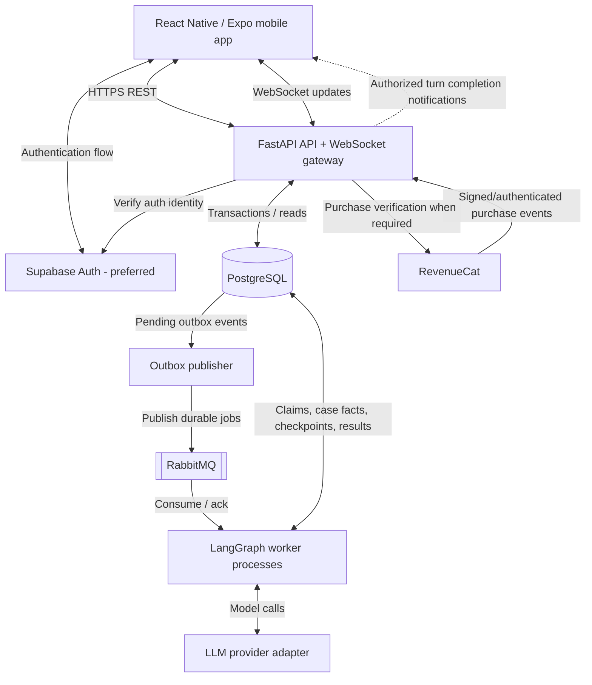
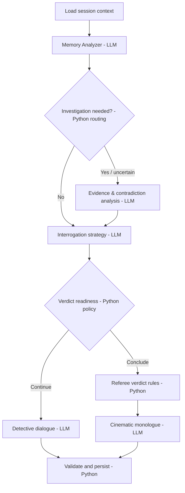

# ALIBI — Architecture Design Document

**Phase:** 2 — System Architecture  
**Deliverable:** 1 of 7 — Architecture Design Document  
**Release:** Alibi V1  
**Document version:** 1.0  
**Status:** Architecture decisions consolidated; implementation details identified where still open  
**Source of product requirements:** `prd.md` (Phase 1)

---

## 1. Purpose and Scope

Alibi is a mobile, story-driven AI interrogation game. Players defend themselves through free-form conversation against detectives that remember claims, analyze established evidence, spot contradictions, adapt questioning, and deliver justified verdicts.

This document defines **the system's components, communication paths, deployment boundaries, and major technical choices**. It does not replace the dedicated Database ERD, AI Agent Design, Game Engine Specification, API Specification, Infrastructure Design, or Implementation Plan.

### Architectural requirements

1. **Canonical case truth is fixed per session.** An agent can reason over it, not alter or invent it.
2. **Structured memory supplements conversation history.** Claims, contradiction status, and evidence interactions are persisted and traceable.
3. **The referee owns game rules.** LLMs analyze meaning and recommend actions; Python applies approved scoring, state transitions, and verdict rules.
4. **Every accepted turn is recoverable.** Network failures, worker restarts, duplicate deliveries, and delayed LLM responses cannot cause duplicate or out-of-order commits.
5. **Inference is observable and bounded.** Costs, latency, retries, and token consumption are attributable to turns and graph nodes.

## 2. Finalized Technology Stack

| Layer | Selection | Role |
|---|---|---|
| Mobile | React Native, Expo, TypeScript | Cross-platform game application |
| API | Python, FastAPI, Pydantic | REST APIs, WebSockets, auth verification, validation |
| AI orchestration | LangGraph | Conditional interrogation workflow and recoverable execution state |
| Game engine / referee | Python modules inside backend | Deterministic session rules, scoring, verdict decisions |
| Primary database | PostgreSQL | Canonical game state, case data, sessions, progress, commerce ledger, outbox |
| ORM / migrations | SQLAlchemy, Alembic | Relational data access and schema migrations |
| Job broker | RabbitMQ | Durable work distribution to AI workers |
| Authentication | Managed authentication with guest mode; **Supabase Auth preferred** | Anonymous guest identity, identity linking, sign-in |
| In-app purchases | RevenueCat | Apple/Google purchase integration and transaction events |
| Application packaging | Docker, Docker Compose | Services deployed on a VPS |
| CI/CD / images | GitHub Actions, GitHub Container Registry | Build, test, publish, deploy |
| Observability | Structured JSON logs, OpenTelemetry, Sentry | Logs, traces, errors, usage metrics |
| AI models | Provider-agnostic integration; provider/model **not yet selected** | Memory, investigation, strategy, dialogue, monologue |
| Cache | Redis **optional**, not part of required baseline | Add if measured requirements justify it |

**No Unity or Unreal Engine.** The “game engine” is application logic, not a rendering engine. No Kubernetes and no microservice split for V1.

## 3. Repository and Deployment Boundaries

Two Git repositories:

```text
alibi-mobile/                    # React Native + Expo app
alibi-backend/                   # FastAPI + LangGraph + game engine + infrastructure
```

Suggested organization within `alibi-backend` (illustrative, not a fixed package-level contract):

```text
alibi-backend/
├── app/
│   ├── api/                     # REST routes and WebSocket gateway
│   ├── auth/                    # JWT verification and principal resolution
│   ├── users/                   # Profiles and progression
│   ├── cases/                   # Published variations, facts, evidence
│   ├── sessions/                # Turn orchestration and lifecycle
│   ├── ai/                      # LangGraph, prompts, tool interfaces, model adapter
│   ├── game/                    # Deterministic referee, scoring, verdicts
│   ├── commerce/                # Credits, entitlements, purchase verification
│   ├── messaging/               # Outbox publisher, RabbitMQ consumers, notifications
│   ├── db/                      # SQLAlchemy models and persistence
│   └── observability/
├── migrations/                  # Alembic
├── tests/
├── docs/architecture/
├── docker/
└── compose.yaml
```

Mobile and backend ship separately. **FastAPI and AI workers deploy as separate containers from the same backend codebase/image**, with different entrypoint commands. They are not separate microservices. API contracts originate in FastAPI's generated OpenAPI specification; TypeScript client types may be generated in the mobile repository.

## 4. High-Level System Diagram



The diagram shows **logical communications**, not a guarantee that every connection is a dedicated network service. In particular, WebSocket delivery across API and worker processes requires a cross-process notification mechanism; PostgreSQL remains authoritative regardless of how notifications are implemented.

## 5. Component Responsibilities

| Component | Owns | Must not do |
|---|---|---|
| **Mobile app** | User experience, local view state, text entry, accessible evidence display, connection recovery | Hold hidden case truth, provider secrets, or authoritative scores |
| **FastAPI gateway** | Authentication verification, authorization, REST/WS endpoints, input validation, requests and status retrieval | Execute long-running LangGraph calls in the HTTP request |
| **Game/session service** | Session creation, idempotent turn acceptance, sequencing, lifecycle transitions, turn-to-worker coordination | Delegate authoritative state transitions to unconstrained LLM text |
| **Case service** | Published case variation selection, truth/evidence access policy, authorized disclosures | Mutate facts of a variation already pinned to a session |
| **LangGraph workers** | Context assembly, claim interpretation, evidence analysis, strategy, dialogue, structured findings | Write arbitrary database mutations through LLM-controlled tools |
| **Referee/game rules** | Validate allowed transitions, compute suspicion, award results, decide verdict from validated findings | Treat unsupported claims as confirmed facts |
| **PostgreSQL** | Single source of truth for durable entities, sessions, turns, outbox, rewards, entitlements | Depend on a WebSocket or LLM process for persistence |
| **RabbitMQ** | Work delivery, acknowledgment, redelivery | Guarantee exactly-once model calls or state changes |
| **RevenueCat integration** | Verified store event reconciliation to local purchases and entitlements | Trust a client-reported successful payment without verification |

### Modularity rule

All modules live inside one FastAPI/Python codebase. Boundaries are expressed through service interfaces and repositories rather than internal HTTP calls. This allows extraction into independently deployed services later *if actual scale or ownership requirements demand it*.

## 6. Authoritative Data Domains

The dedicated ERD will specify complete columns, keys and indexes. The principal tables already agreed are:

| Domain | Core tables | Notes |
|---|---|---|
| Identity & progression | `users`, `detectives`, `ranks`, `xp_events`, `achievements`, `user_achievements`, `user_detective_unlocks` | Account and player profile live in **one `users` table** |
| Case content | `cases`, `case_variations`, `canonical_facts`, `evidence` | Four core relational tables; published variation content is versioned/immutable |
| Investigation | `game_sessions`, `interrogation_turns`, `player_claims`, `contradictions`, `session_evidence` | Structured memory and evidence disclosure are persisted |
| Commerce & daily challenges | `purchases`, `user_entitlements`, `credit_transactions`, `daily_challenges`, `user_daily_challenges` | Purchases, allowances and rewards are transactional and idempotent |
| Durable processing | Transactional outbox and worker processing/attempt metadata | Exact schema to be set in ERD |
| AI usage | Per-call/per-node usage records associated with sessions and turns | Model, tokens, latency, cost, retry/attempt information |

Claims preserve their originating turn and uncertainty. Contradictions retain status (potential/confirmed/resolved/dismissed) and provenance. **Timelines are derived from structured claims**, not duplicated in a dedicated timeline table for V1.

All server-only truth and undisclosed evidence are excluded from player-facing serializers. A session pins a specific published case variation version so future content edits cannot silently rewrite the facts mid-interrogation.

## 7. Session and Turn Lifecycle

### Session states

```text
CREATED -> ACTIVE -> COMPLETED
                  \-> ABANDONED
```

An unfinished `ACTIVE` session can be resumed after app termination. A completed session is immutable from the gameplay perspective. More detailed handling of failed or interrupted turn processing is tracked at the **turn**, not by pretending that the session has completed.

### Turn states

```text
PENDING -> PROCESSING -> COMPLETED
               |
               +-> RETRYING -> PROCESSING
               +-> FAILED
```

**Invariant: at most one nonterminal interrogation turn per session.** A new message while a turn is `PENDING`, `PROCESSING`, or `RETRYING` is rejected with a recoverable conflict response. If the prior turn fails permanently, the game must provide an explicit retry/abandon path rather than silently accepting a later turn out of order.

### Accepted turn execution sequence

1. **Client submits** `POST /api/v1/sessions/{id}/turns` with an idempotency key.
2. **FastAPI checks** identity, session ownership, active session, input limits, and no conflicting active turn.
3. **One database transaction** creates the turn as `PENDING` and an outbox event, enforces unique idempotency/sequence constraints, then commits. HTTP responds `202 Accepted` with `turn_id`.
4. **Outbox publisher** durably publishes the work request to RabbitMQ, then marks the outbox record published. Publishing may repeat after a crash; consumers handle duplicates.
5. **Worker claims** the turn using a database-backed processing attempt/lease/fencing token. It loads the pinned case and session context and executes LangGraph **outside a long-lived database transaction**.
6. **AI returns** proposed claims, contradiction findings, evidence references, strategy, and dialogue/verdict content. Python validates schemas, provenance, permissions and game rules.
7. **Final transaction** verifies that the attempt is still current and the session version has not changed; atomically saves approved findings, score/state changes, response, and completed turn. A stale attempt is not allowed to commit.
8. **Worker acknowledges** the RabbitMQ message after successful durable commit, or safely recognizes that the turn was already completed by another attempt.
9. **Client receives** a WebSocket event when connected and fetches authoritative result via REST. If disconnected, it reconnects or polls the turn endpoint.

A RabbitMQ acknowledgment is not a database transaction. **At-least-once delivery plus idempotent processing and fencing** is the guarantee sought; exactly-once LLM execution cannot be promised.

### Duplicate and late-result protections

- Idempotency key scoped to authenticated player/session request.
- Uniqueness constraint for active turns and ordered turn sequence.
- Attempt ownership token/lease for each worker execution.
- Compare-and-swap session version or equivalent conditional transaction.
- Atomic application of related claims, contradiction status, game state and reply.
- Late completions from timed-out attempts are discarded when no longer authorized.

## 8. Interrogation AI Architecture

### Logical LangGraph workflow



Nodes describe **responsibilities**, not a promise of one model call per node. Conditional routing means more complex turns may need more calls than simple turns. Node combination and model routing can be optimized only after testing.

### Investigator, detective, referee

- **Investigator:** Interpret natural-language statements, propose structured claims, spot conflicts, evaluate credibility and relevance, distinguish evidence from allegations, suggest investigation needs.
- **Strategy/Detective:** Decide which line of questioning to pursue; produce distinctive, adaptive spoken-style text. Personality changes tactics and wording, **not canonical truth**.
- **Referee:** A deterministic Python layer validates allowable findings and applies scoring, suspicion, ending conditions, progression, and verdict rules. The AI's semantic assessment is **probabilistic**; Python cannot independently prove that a contradiction severity label is correct.

### Controlled tools and writes

LLM-accessible investigation tools are restricted to authorized reads and checks (e.g. claim history, evidence by ID, turn history). LangGraph nodes produce **Pydantic-validated proposed updates**, not direct model-controlled SQL writes. The backend records evidence UI interactions itself and validates natural-language requests for evidence disclosure before revealing it.

### Memory strategy

Use **full interrogation history by default** for V1's short sessions, alongside structured claims, contradiction status, and authorized case context. Each node gets the smallest useful context package. Preserve original messages in PostgreSQL. If token budgets are exceeded, use semantic retrieval and/or auxiliary summaries; neither becomes the source of truth. No vector database is required initially.

### Evidence integrity

1. Ground evidence-based dialogue in the session's immutable canonical case material.
2. Require structured references to existing evidence/fact IDs for verifiable allegations.
3. Deterministically check existence, ownership of the case variation, and disclosure policy.
4. Recognize that **valid IDs do not prove correct natural-language interpretation**.
5. Use selective semantic verification for high-risk claims; when unsupported statements are found, correct/regenerate or return a safe failure rather than present unsupported evidence as verified.
6. Test against adversarial scenarios involving metaphor, sarcasm, conflicting timestamps, bluffing, and invented evidence.

### Timeouts, recovery and cost limits

Use **node-specific timeouts plus workflow deadlines appropriate to the selected conditional path**, bounded retries with backoff, and recoverable LangGraph checkpoints. Recovered workers may repeat paid LLM calls; the system must account for that cost and ensure stale attempts cannot commit. Exact timeout, call-count and budget numbers are **pending real provider benchmarking**.

## 9. Mobile/API Communication

- **REST over HTTPS** is authoritative for session creation, turn submission, saved history, progress, case catalog, purchases and recovery.
- **WebSockets** provide live turn status, completion, detective messages and UI updates.
- **REST polling** is the fallback if WebSockets are unavailable; event payloads are informational and may be missed or duplicated.
- The mobile app should not silently resend a turn as a new turn after reconnection; it first checks the original turn by ID/idempotency key.
- Because workers are separate processes, a dedicated cross-process notification mechanism is needed to fan out durable state changes to connected API instances. **The exact event relay mechanism is not yet finalized.** It must not be the only way to recover turn results.
- Live, interruptible voice transport is **not part of the agreed V1 baseline**; WebRTC can be evaluated if voice becomes a committed requirement.

FastAPI produces `openapi.json` automatically. The mobile repository can generate TypeScript types from it. WebSocket event schemas and error/reconnect rules will be documented separately because OpenAPI does not natively define WebSocket message contracts.

## 10. Identity, Access and Commerce

### Authentication and account linking

Managed authentication with anonymous guest accounts is selected, with **Supabase Auth currently preferred**. FastAPI verifies provider tokens and maps authenticated subject identity to the application's `users` record. If a guest links a new permanent identity to the **same underlying account**, its internal user record and XP remain intact. Signing into a different existing account is **not** an automatic merge: purchases, XP and credit balances must not be combined without an explicit safe policy.

### Authorization and hidden evidence

All reads and mutations go through FastAPI. Every session/resource query enforces the current user identity and ownership. The server selects which case fields and evidence are visible. The app never receives hidden canonical truth, provider API keys, or authoritative score input. Rate limits include user-level controls and stronger restrictions for abuse-prone guest entry.

### Payment and credits

RevenueCat handles store purchase integration. FastAPI verifies trusted transaction state and idempotently updates `purchases`, `user_entitlements` and `credit_transactions`. Owning a case pack and holding an AI session allowance are **different concepts**. Credits/allowances are consumed on starting a session—not per message—through an atomic transaction. Refund and revoked-entitlement behavior, particularly for already-consumed credits, remains to be specified in the dedicated monetization architecture.

## 11. Hosting, Delivery and Operations

### V1 production topology

Run a single VPS with Docker Compose services:

```text
VPS
├── reverse proxy / TLS termination (implementation TBD)
├── fastapi-api
├── langgraph-worker (scale replicas by capacity)
├── outbox-publisher
├── rabbitmq
└── postgres (persistent volume)
```

This is a **single-host deployment** and therefore a single-host availability risk. Extra workers on the VPS increase concurrency only within its available CPU/RAM, provider limits and database capacity. PostgreSQL backups must leave the VPS, and restoration must be tested. Redis remains optional.

### Delivery pipeline

GitHub Actions runs linting/tests, builds backend images and publishes to GHCR. Deployment pulls versioned images and updates Compose services. Run Alembic migrations as a controlled deployment step, not separately in each worker; check health before completing a rollout. Retain previous image tags for rollback, and design schema changes to preserve safe rollback compatibility.

Use separate credentials and isolated data/broker namespaces for local, staging and production. Production secrets stay outside source control and container images.

### Telemetry and cost attribution

Attach `request_id`, `session_id`, `turn_id`, `worker_attempt_id` and tracing context as appropriate. Record API errors, queue backlog, redeliveries, worker failures, database pool metrics, LangGraph node timings, LLM token usage and per-call costs, including failed/retried calls. Use structured logs, OpenTelemetry, and Sentry. Do not log secrets, unrevealed case truth, or full private conversation payloads by default.

Budget controls apply per model call, turn, and session. Precise budgets, scaling thresholds and VPS sizing follow model latency/cost benchmarking.

## 12. Significant Decisions and Tradeoffs

| Decision | Why | Accepted tradeoff |
|---|---|---|
| Two repositories: mobile and backend | Independent workflows/deployments as preferred | Coordinate contracts across repos |
| Modular monolith | Lower operational complexity for solo development | AI/API share a deployable codebase |
| Background LangGraph workers | Long AI operations do not hold open client HTTP requests | More asynchronous state and recovery logic |
| RabbitMQ + outbox | Broker-native queue semantics; no lost DB-to-broker handoff | Additional VPS service and at-least-once handling |
| PostgreSQL structured memory | Traceable claims/contradictions and explainable verdicts | More relational writes and validation logic |
| Full history + structured memory | Avoids brittle keyword-only retrieval | Higher context tokens than aggressive trimming |
| Controlled LLM outputs + Python referee | Makes scoring and state transitions auditable | Semantic judgments are still probabilistic |
| REST + WebSockets + REST fallback | Reliable commands plus responsive chat updates | Connection management and event delivery implementation |
| Supabase Auth preferred + guest mode | Frictionless start with identity linking | Guest recovery and account collision scenarios need care |
| RevenueCat | Less store-specific payment integration | External service dependency; local ledger still required |
| VPS + Compose | Full control and predictable initial operations | Single-host failure domain and manual capacity planning |

## 13. Interfaces to the Remaining Phase 2 Documents

This document establishes **boundaries**. The following artifacts will provide implementation-level detail rather than duplicate these decisions:

1. **Database ERD:** Columns, composite keys, foreign keys, partial unique indexes, outbox/lease/attempt tables and migrations.
2. **AI Agent Design:** Typed graph state, node contracts, tools, exact conditional routing, checkpointing, prompt/model policies and evaluations.
3. **Game Engine Specification:** Session/turn transition rules, severity rubric, scoring weights, verdict criteria and fairness invariants.
4. **API Specification:** REST request/response/error models, idempotency behavior, auth claims, WebSocket events and reconnect protocol.
5. **Infrastructure Design:** Compose configuration, broker topology, TLS, deployment steps, monitoring thresholds, backup schedules and cost scenarios.
6. **Implementation Plan:** Ordered Phase 3 work, dependencies, deliverable tests and acceptance criteria.

### Details deliberately not finalized here

- Exact provider/model combinations, token limits, timeout values, retry numbers and budget thresholds.
- Full ERD, index definitions, worker lease durations, RabbitMQ topology and outbox polling cadence.
- WebSocket cross-process event relay implementation and reconnection event cursors.
- Exact scoring weights, ranks, unlock rules and monetization prices/free allowances.
- Production VPS provider/size, TLS proxy choice, exact RPO/RTO and backup retention.
- Voice as a committed feature (not required in the Phase 1 V1 baseline).

These require decisions/specification or performance evidence in the relevant remaining artifacts; **they are not silently assumed solved**.

---

**Document conclusion:** Alibi V1 uses two repositories and a modular FastAPI backend. Accepted turns are persisted in PostgreSQL, distributed through a transactional outbox and RabbitMQ, processed by recoverable LangGraph workers, committed under deterministic game-state safeguards, and delivered to React Native through REST and WebSockets. Canonical case truth, structured memory, fair referee rules, and bounded AI execution govern the design.
