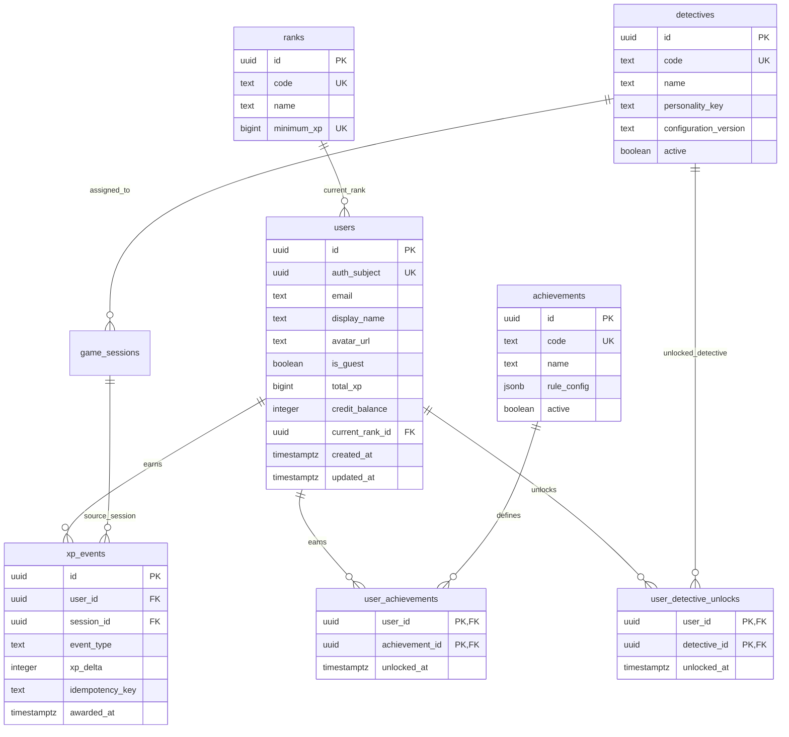
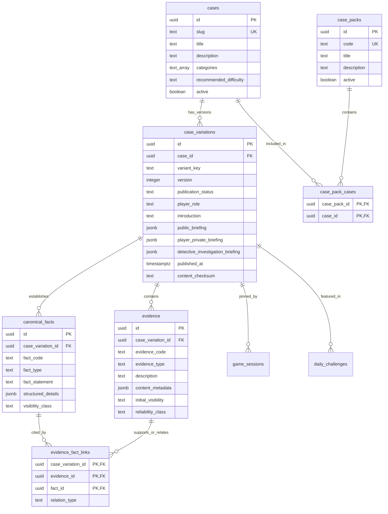
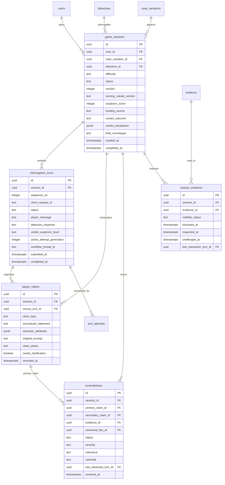
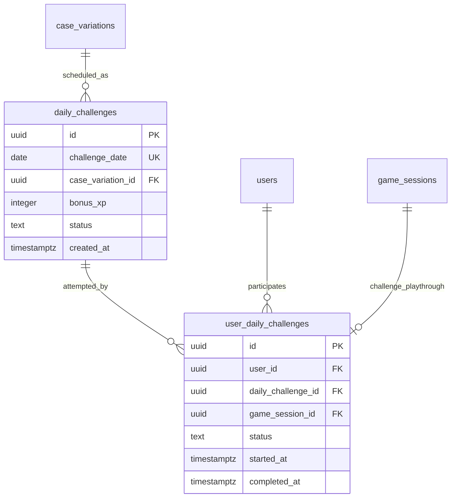
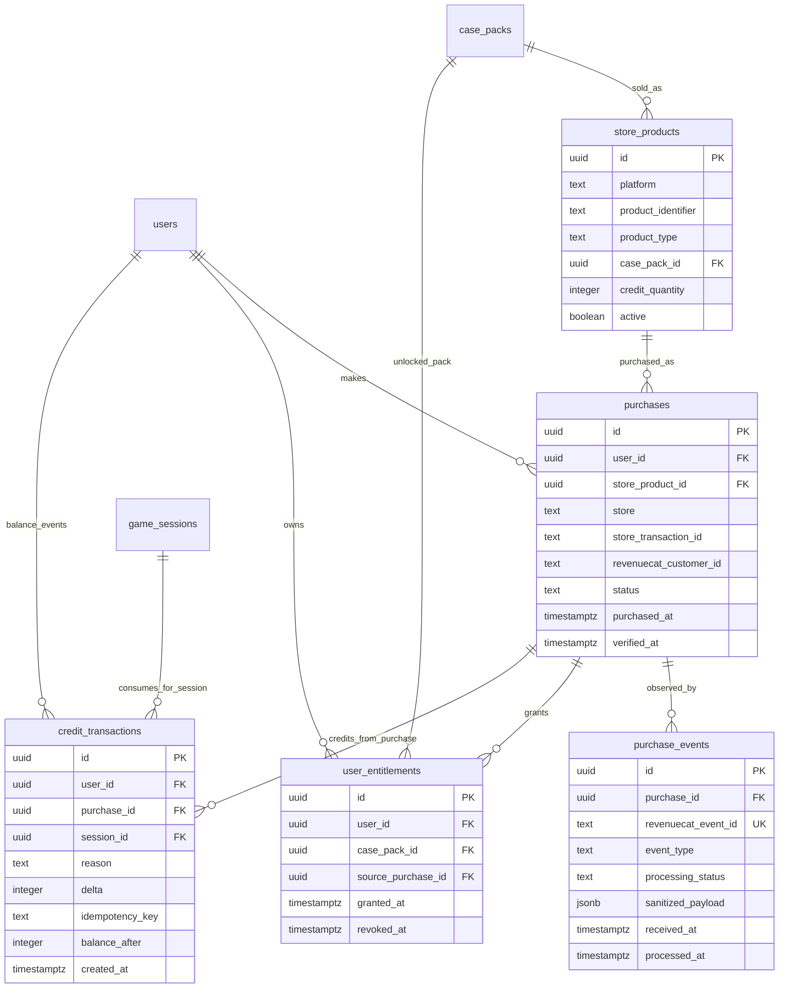
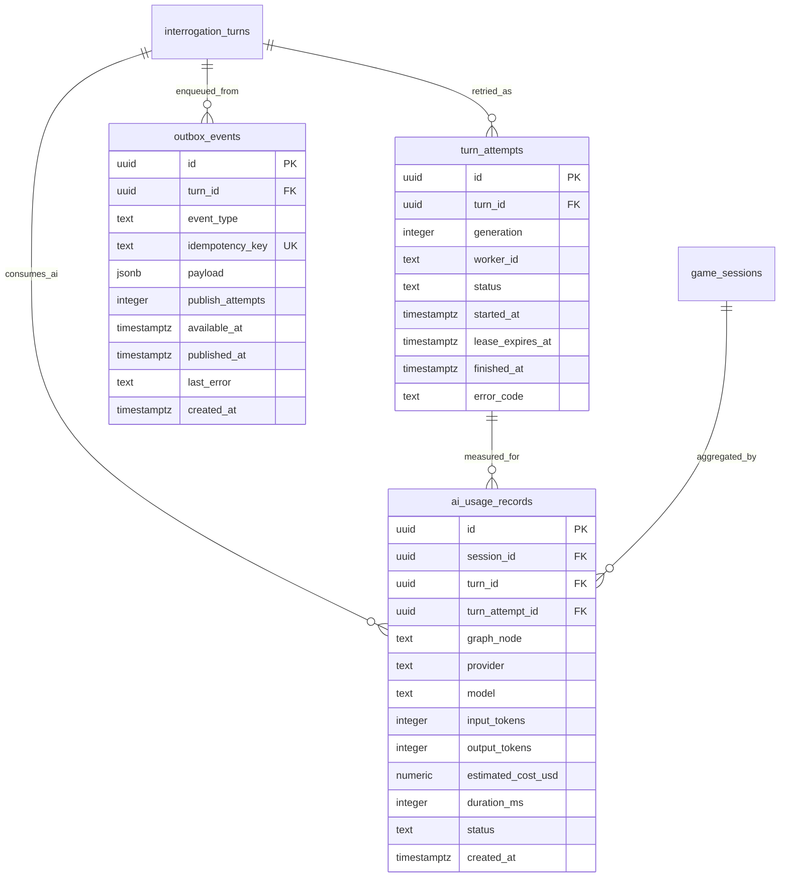

# ALIBI V1 — Database ERD & Relational Schema

**Phase:** 2 — System Architecture  
**Deliverable:** 2 of 7 — Database ERD  
**Document version:** 1.0  
**Status:** Detailed schema proposal based on finalized architecture decisions; implementation-level field choices still subject to migration review  
**Companion document:** `alibi_phase2_01_architecture_design.md`  
**Product requirements:** `prd.md`

---

## 1. Scope and Design Rules

This document defines the proposed **PostgreSQL application schema** for Alibi V1: entities, fields, primary/foreign keys, important constraints and indexes, and how records are updated safely. Mermaid diagrams below are split by domain to remain readable, but together constitute the ERD.

### Decisions already finalized

- **One `users` table** holds account identity, display profile, total XP and rank; no separate `player_profiles` table.
- Four **core case-content tables**: `cases`, `case_variations`, `canonical_facts`, `evidence`. Small association tables are permitted where genuine many-to-many relationships require them.
- **Structured relational memory:** `game_sessions`, `interrogation_turns`, `player_claims`, `contradictions`, `session_evidence`.
- **No standalone timeline table.** Timelines are derived from claims, original turns and canonical facts.
- **Separate purchases, content entitlements and credit ledger**; purchase identity and credit usage must be idempotent.
- **Supabase Auth is preferred** for guest-to-registered identity linking; FastAPI owns the application's records and authorization.
- **RabbitMQ is the broker**, not the authoritative database. A PostgreSQL transactional outbox bridges committed turns to broker publication.
- **One active turn per session**, worker attempt fencing, and atomic game-state commits.
- Canonical case facts and published variation content cannot be silently rewritten during an active investigation.

### Proposed schema conventions (not additional product decisions)

- Primary keys: `UUID` generated server-side; timestamps: `TIMESTAMPTZ` in UTC.
- Currency/cost: exact `NUMERIC` values; never floating-point for money. Credits/XP: signed or nonnegative `INTEGER`/`BIGINT` with checks.
- Enums below are **logical allowed values**; SQLAlchemy may implement them as PostgreSQL enums or `TEXT + CHECK`. This choice remains a migration-level detail.
- `JSONB` is restricted to **flexible case content, interpreted claim attributes, investigation breakdowns, and third-party payloads**; it does not replace relationships that require keys, uniqueness or referential integrity.
- `created_at` and `updated_at` should be populated by reliable server-side defaults/application logic. Every index below is a **candidate based on known queries**, to be checked with `EXPLAIN` and actual traffic.
- Use `ON DELETE RESTRICT` for canonical case history, accounting, audit and completed investigations. Account deletion/anonymization requires an explicit workflow rather than broad cascades.

## 2. Entity Inventory

| Domain | Tables |
|---|---|
| Identity, detectives, progression | `users`, `ranks`, `detectives`, `xp_events`, `achievements`, `user_achievements`, `user_detective_unlocks` |
| Case content and catalog | `cases`, `case_variations`, `canonical_facts`, `evidence`, `evidence_fact_links`, `case_packs`, `case_pack_cases` |
| Interrogation and memory | `game_sessions`, `interrogation_turns`, `player_claims`, `contradictions`, `session_evidence` |
| Daily challenges | `daily_challenges`, `user_daily_challenges` |
| Purchases and session credits | `store_products`, `purchases`, `purchase_events`, `user_entitlements`, `credit_transactions` |
| Durable processing and inference usage | `outbox_events`, `turn_attempts`, `ai_usage_records` |

**Total: 29 proposed application tables.** The four primary case tables and five primary investigation tables are still the core designs chosen in Decisions 8 and 9. Supporting association, catalog and reliability tables are included because those finalized behaviors require independent records. This is a logical architecture schema, **not a claim that all 29 tables must be migrated on the first day of Phase 3**.

## 3. ERD — Identity, Detectives and Progression



### Field and constraint details

**`users`** — `id` is Alibi's internal user identity. `auth_subject` uniquely identifies the current Supabase-authenticated user (including anonymous users). Guest registration **links the identity rather than transferring XP to a different user row**. `email` is nullable for anonymous users. `total_xp >= 0` and `credit_balance >= 0`; both totals are updated in the same transaction as their event ledger. `current_rank_id` references `ranks`, and its consistency with total XP is enforced by application rules. Suggested unique index on `LOWER(email)` when email is not null. Do **not** store passwords or access tokens here.

**`ranks`** — Stable `code`, display `name`, unique `minimum_xp >= 0`. No rank/XP thresholds have been finalized; content entries will be authored later.

**`detectives`** — Stable `code` and display identity; `personality_key`/`configuration_version` refer to curated prompt/config assets, not arbitrary user-written instructions. Two launch personalities; one starts unlocked. The exact names and unlock rules are still undecided.

**`xp_events`** — `xp_delta > 0` for earned XP; one event per unique `(user_id, idempotency_key)`. `session_id` is nullable for non-session rewards. Replays, daily bonuses and achievements can each use distinct event types/keys. No duplicate rewards on retry.

**`achievements` / `user_achievements`** — Definitions separate from per-user completion. Composite primary key `(user_id, achievement_id)` prevents duplicate unlocks. `rule_config` carries authored metadata, not arbitrary executable logic.

**`user_detective_unlocks`** — Composite primary key `(user_id, detective_id)` prevents duplicates. The default detective may be treated as available by catalog rule rather than inserting a redundant unlock row for every user.

## 4. ERD — Canonical Cases, Evidence and Case Packs



### Immutable variation contract

- `cases` represents the recognizable story; `case_variations` represents **one exact, versioned set of playable facts**. Unique `(case_id, variant_key, version)`.
- `case_variations.player_role` is `GUILTY` or `INNOCENT`. Difficulty is selected at the session level, not baked into every fact.
- After publishing a variation, its **truth-bearing content, `canonical_facts`, and `evidence` are immutable**. To correct material, publish a new `version` and retire the old one from new selection. Existing `game_sessions.case_variation_id` continues referencing the original immutable version.
- `canonical_facts` records what is established as true. `evidence` records available investigative material, including witness allegations whose reliability may be uncertain. **Evidence does not automatically mean the allegation is true.**
- `evidence_fact_links` is a *supporting association table*, not a fifth top-level case concept. It records how an evidence item relates to one or more facts (`SUPPORTS`, `CONTRADICTS`, `CONTEXT`, etc.). Composite foreign keys must enforce that both entries belong to the **same variation**.
- Unique `(case_variation_id, fact_code)` and `(case_variation_id, evidence_code)` make evidence/fact references stable and unambiguous within a variation.
- `case_packs` and `case_pack_cases` support the purchased-content catalog without embedding lists of case IDs inside JSON. Packs unlock **cases**; the service selects permitted variations for gameplay.

**Security boundary:** server-only truth and detective-held evidence are not serialized to mobile. The `public_briefing` and player-private briefing are separately authorized; the latter is revealed only to that session's player. Published-content immutability should be enforced through service permissions **and an explicit database write guard/role policy**, not merely a developer convention.

## 5. ERD — Game Sessions and Structured Investigation Memory



### Session rules

**`game_sessions`** — Session belongs to exactly one user, a pinned variation version and a selected detective. `status` is `CREATED | ACTIVE | COMPLETED | ABANDONED`; `difficulty` is `ROOKIE | INTERMEDIATE | EXPERT`. `suspicion_score` must be `0..100`; **the exact score is never sent to the player before verdict**. `version` is a positive optimistic-concurrency counter. `scoring_ruleset_version` is `VARCHAR(30) NOT NULL`, assigned when a session is created, and references an immutable scoring configuration version. It cannot change during an interrogation and is used for suspicion and verdict calculations. `funding_source` identifies how the *session* was permitted (`STARTER_FREE | DAILY_FREE | CREDIT | OTHER`; exact free allowance policy TBD). Result fields are null until completion. `verdict_breakdown` may contain auditable score components and result-card material; authoritative contributing claims/evidence remain in relational tables.

**`interrogation_turns`** — One record for each accepted player input, with original unmodified text and eventual detective reply. `status`: `PENDING | PROCESSING | RETRYING | COMPLETED | FAILED`; `sequence_no >= 1`. Unique `(session_id, sequence_no)` and `(session_id, client_request_id)`. Store a request body hash (recommended extra field) to reject reuse of an idempotency key for a different message. `workflow_thread_id` correlates graph checkpoints with this turn and should be unique across turns. Retrying a `FAILED` turn **reuses its turn ID**; later turns cannot skip unresolved failed turns.

**`player_claims`** — One semantically meaningful claim per record; source turn and an original excerpt remain traceable. `semantic_attributes` holds optional location, normalized/relative time, subject, uncertainty and other *claim-specific* properties, but the model must not force metaphorical or ambiguous language into physical locations/timestamps. `claim_status` could be `ASSERTED | CORRECTED | RETRACTED`; revisions should preserve historical rows and provenance. Timeline views are derived from these claims and the stored conversation; there is **no `timeline_events` table**.

**`contradictions`** — References a primary claim plus one or more proposed conflicting sources: a second claim, canonical fact, or evidence. Require at least one comparison source. Status `POTENTIAL | CONFIRMED | RESOLVED | DISMISSED`; severity `MINOR | MODERATE | MAJOR` per the agreed rubric. **Severity is an LLM assessment**, checked against a rubric and test cases, not a fact Python can prove by validating an enum. The referee only scores eligible validated findings; resolving a contradiction removes/reduces its contribution rather than penalizing it again. Foreign-key ownership checks should ensure both player claims are from the same session. Case-fact/evidence variation compatibility also needs enforcement (composite FKs or validated transactional guards).

**`session_evidence`** — One row per `(session_id, evidence_id)` when evidence has been made available or interacted with. Status and timestamps capture disclosure/inspection/challenge; do **not** create a row exposing every hidden evidence item to the client. The backend authorizes all disclosures and records them itself, including AI-initiated disclosures proposed through structured output. `UNIQUE(session_id, evidence_id)`. Evidence must belong to the session's pinned variation.

### Critical PostgreSQL indexes and invariants

```sql
-- Only one nonterminal turn can exist per interrogation session.
CREATE UNIQUE INDEX uq_interrogation_one_active_turn
    ON interrogation_turns (session_id)
    WHERE status IN ('PENDING', 'PROCESSING', 'RETRYING');

-- No concurrent unfinished investigation for one user in V1.
CREATE UNIQUE INDEX uq_user_one_active_session
    ON game_sessions (user_id)
    WHERE status IN ('CREATED', 'ACTIVE');

-- Stable sequencing and at-least-once safe retries.
CREATE UNIQUE INDEX uq_turn_session_sequence
    ON interrogation_turns (session_id, sequence_no);
CREATE UNIQUE INDEX uq_turn_session_request
    ON interrogation_turns (session_id, client_request_id);

CREATE INDEX ix_claims_session_source
    ON player_claims (session_id, source_turn_id);
CREATE INDEX ix_contradictions_session_status
    ON contradictions (session_id, status);
CREATE UNIQUE INDEX uq_session_evidence_item
    ON session_evidence (session_id, evidence_id);
```

`uq_turn_session_sequence` already supports history scans by `(session_id, sequence_no)`; do not create a redundant nonunique index over those same columns.

### Transactional invariants

1. **Submit:** lock/check session, reject conflicting active turns, create `PENDING` turn and outbox event **in the same transaction**, then return `202`.
2. **Claim:** a worker obtains a database lease/attempt generation for this turn, outside any long-running AI transaction.
3. **Execute:** LangGraph runs without holding database locks. It produces proposed claim/contradiction/evidence changes.
4. **Commit:** in one transaction, lock/recheck session and turn; verify active worker attempt token/generation, lease and expected session version; atomically insert findings, adjust state/score, store response and mark turn `COMPLETED`.
5. **Stale execution:** if fencing/version checks fail, discard output and do not modify state. RabbitMQ can redeliver; a duplicate is recognized by the completed turn record.
6. **Interleaved player actions:** state-changing evidence interactions that could affect an active turn must be serialized with turn processing or folded into the turn; do not let them silently invalidate the AI's context midway through an accepted turn.

## 6. ERD — Daily Challenges



- `daily_challenges.challenge_date` is unique under a **single globally defined reset timezone** (exact timezone not finalized). Each date points to a prevalidated case variation. Players may choose difficulty if the daily challenge rules allow it.
- `user_daily_challenges` is unique on `(user_id, daily_challenge_id)` and on non-null `game_session_id`. Rewards must use a unique `xp_events.idempotency_key` derived from challenge identity.
- Streaks can be derived from consecutive `user_daily_challenges` completions initially; avoid a redundant `users.streak` column unless a measured query or product need justifies one.

## 7. ERD — Store Purchases, Case Entitlements and Credits



### Purchase, ownership and credit rules

**`store_products`** — Server-side catalog mapping verified Apple/Google product identifiers to either `CASE_PACK` or `CREDIT_BUNDLE`. Unique `(platform, product_identifier)`. Enforce: case pack product has non-null `case_pack_id`; credit bundle has `credit_quantity > 0`. Pricing is sourced from the store/RevenueCat offering, not trusted from client input.

**`purchases`** — A normalized record of the store transaction and verified lifecycle (`PENDING | VERIFIED | REFUNDED | REVOKED`, as applicable). Unique `(store, store_transaction_id)`; the backend must not grant ownership or credits merely because the mobile app claims a purchase succeeded. Exact RevenueCat/Apple/Google identifiers used in final schema must be checked against the chosen event formats at integration time.

**`purchase_events`** — Durable webhook intake and idempotency boundary. `revenuecat_event_id` is unique. A transaction can legitimately have multiple lifecycle events (purchase then refund); **deduplicating only by transaction ID would incorrectly discard those later changes**. `purchase_id` can be nullable until a trusted event is reconciled; do not discard unmatched events. Keep raw sensitive payloads out of normal logs; field-level retention to be specified.

**`user_entitlements`** — Records case-pack rights; a current grant has `revoked_at IS NULL`. Candidate partial unique index `(user_id, case_pack_id) WHERE revoked_at IS NULL` to prevent duplicate active ownership. Support revocation/regrant history rather than overwriting purchase history. **Owning a case pack does not imply unlimited free AI sessions.**

**`credit_transactions`** — Signed immutable movements: positive for grant/refund, negative for session spend/reversal. Unique `(user_id, idempotency_key)`; **unique session-spend transaction per session** for the debit reason. `users.credit_balance` is updated under row lock in the *same* transaction as ledger insertion. Check balance is sufficient before spending; `balance_after >= 0`. Do not mutate/delete ledger records to implement refunds—append reversal entries. This protects against double charges, duplicate webhooks and retries.

**Session starts and free allowances:** create the session and consume a credit **atomically**, or record an explicit free funding source. The number of free sessions, whether daily challenges have dedicated allowances, refunds on abandoned sessions and package prices **remain product decisions for pricing/monetization**, not schema assumptions.

```sql
-- Credit-spend uniqueness, without blocking separate refund/reversal entries.
CREATE UNIQUE INDEX uq_credit_once_per_session
    ON credit_transactions (session_id)
    WHERE reason = 'SESSION_SPEND';

CREATE UNIQUE INDEX uq_credit_idempotency
    ON credit_transactions (user_id, idempotency_key);

CREATE UNIQUE INDEX uq_active_case_pack_entitlement
    ON user_entitlements (user_id, case_pack_id)
    WHERE revoked_at IS NULL;
```

## 8. ERD — Durable Processing and AI Usage



**`outbox_events`** — Supports `turn.requested` and `turn.completed` events. A `turn.requested` event is persisted in the same DB transaction as an accepted turn; a `turn.completed` event is inserted in the same DB transaction that finalizes the turn. A publisher claims unpublished rows using bounded batches (e.g. `FOR UPDATE SKIP LOCKED`), publishes persistent RabbitMQ messages with publisher confirmation, then records `published_at`. Crash before marking published can cause duplicate delivery; consumer idempotency handles it. Candidate polling index: `(available_at, created_at) WHERE published_at IS NULL`. An outbox item is **not** proof that the AI result is committed.

**`turn_attempts`** — Immutable attempt identity plus state. Unique `(turn_id, generation)`, with monotonically increasing `generation`; the turn's `active_attempt_generation` identifies the current authorized attempt. A recovered worker cannot commit its stale result if another generation took over. `lease_expires_at`/heartbeat recovery must be reconciled against RabbitMQ redelivery, not treated as exactly-once execution. Suggested index `(status, lease_expires_at)` for stuck-attempt detection.

**`ai_usage_records`** — Each actual provider call is attributable to a session, turn and attempt, even if the workflow later fails. Nullable token counts and costs support failed calls whose usage isn't returned. `estimated_cost_usd` should be `NUMERIC(16, 8)` or another deliberately chosen fixed precision. Useful indexes: `(session_id, created_at)` and `(turn_id, turn_attempt_id)`. API telemetry traces are complementary; usage records support reconciliation of budgets and player economics.

**LangGraph checkpoints:** LangGraph's PostgreSQL checkpointer may create its **own library-managed tables**. Do not hand-design their columns in this application ERD or assume they match the application `turn_attempts` schema. Store/correlate `workflow_thread_id` on the turn; adopt versioned checkpointer migrations and keep checkpoint data isolated from authoritative game state. Checkpoints help resume execution but **cannot bypass worker fencing or atomic final writes**.

## 9. Index and Constraint Checklist

| Table(s) | Constraint / index | Why |
|---|---|---|
| `users` | `UNIQUE(auth_subject)`, `UNIQUE(LOWER(email))` where non-null | Unique provider identity and account lookup |
| `users` | `CHECK(total_xp >= 0)`, `CHECK(credit_balance >= 0)` | No negative balance / XP |
| `ranks` | `UNIQUE(code)`, `UNIQUE(minimum_xp)` | Stable rank mapping |
| `case_variations` | `UNIQUE(case_id, variant_key, version)` | Immutable variation identity |
| `canonical_facts`, `evidence` | `UNIQUE(case_variation_id, fact_code/evidence_code)` | Stable IDs and lookup |
| `game_sessions` | Partial unique active session per user; index `(user_id, created_at DESC)` | Session selection and resume |
| `interrogation_turns` | Partial unique active turn; unique sequence and request ID per session | Ordering/idempotency |
| `player_claims` | `(session_id, source_turn_id)`; optional type filtering after profiling | Context retrieval |
| `contradictions` | `(session_id, status)` and claim-source FKs | Retrieve unresolved issues |
| `session_evidence` | `UNIQUE(session_id, evidence_id)` | No duplicated disclosure state |
| `daily_challenges` | `UNIQUE(challenge_date)` | One globally shared daily case |
| `user_daily_challenges` | `UNIQUE(user_id, daily_challenge_id)` | One rewardable daily attempt |
| `xp_events` | `UNIQUE(user_id, idempotency_key)` | No duplicate XP |
| `purchases` | `UNIQUE(store, store_transaction_id)` | Deduplicate store transactions |
| `purchase_events` | `UNIQUE(revenuecat_event_id)` | Deduplicate webhook deliveries without ignoring refunds |
| `user_entitlements` | Partial unique active `(user_id, case_pack_id)` | No duplicate active pack rights |
| `credit_transactions` | `UNIQUE(user_id, idempotency_key)`; unique spend per session | Prevent double debit |
| `outbox_events` | `UNIQUE(idempotency_key)`; partial unpublished index | Safe broker publication |
| `turn_attempts` | `UNIQUE(turn_id, generation)`, index active lease expiry | Worker fencing/recovery |
| `ai_usage_records` | `(session_id, created_at)`, `(turn_id, turn_attempt_id)` | Turn/session inference cost |

**Database-enforced cross-domain consistency:** simple foreign keys are insufficient for proving that every `session_evidence.evidence_id`, `contradictions.evidence_id`, or `canonical_fact_id` belongs to the session's pinned case variation. Add composite `UNIQUE`/foreign keys using the variation ID (or equivalent triggers) where appropriate, plus service validation. Similarly, source claim IDs and assessment turn IDs must be bound to the **same session**. Define these composite references precisely in Alembic migration design before shipping the schema.

## 10. Migration and Data-Lifecycle Plan

Use SQLAlchemy models and Alembic. Generate migration revisions in development, **review DDL manually**, test forwards migration and rollback compatibility, then run a single migration job during deployment before starting/updating workers.

**Recommended rollout order** (dependency order, not necessarily one migration per item):

1. `ranks`, `users`, `detectives`, `achievements`, progression/unlock mapping.
2. `cases`, `case_variations`, `canonical_facts`, `evidence`, case pack association.
3. `game_sessions`, `interrogation_turns`, claims/contradictions/evidence interaction state.
4. Outbox, attempts, AI usage and library-managed LangGraph checkpoint installation.
5. Daily challenges and commerce, catalog mapping, ledger and verified purchase events.
6. Seed curated detective/rank/case data; mark case variations as published only after validation.

**Publishing migration safety:** do not back-edit published case records. Seed a new variation version, make it available for future sessions, and retain the old referenced version for historical saves and audit.

**Retention and deletion:** completed case history, commerce/accounting audit and AI usage have different retention needs. Define retention windows, export/deletion procedure, and minimal-data logging before launch; do not default to deleting referenced records with `CASCADE`.

**Testing migration invariants:** migrations and integration tests must prove that duplicate idempotency keys, concurrent turn submissions, stale worker attempts, cross-user references, invalid variation evidence and double credit spending cannot commit invalid state.

## 11. Deliberately Open Implementation Details

These do **not** override the architecture decisions above; they need implementation-level resolution in subsequent Phase 2 documents or concrete engineering tickets:

- Exact SQLAlchemy enum representation, complete DDL and specific nullability/`ON DELETE` for all references.
- Exact field layout for sufficiently flexible claim time representation, and whether more source-reference association records become necessary for complex contradictions.
- Rank thresholds, achievements, initial credit quantities, free allowance frequency and purchase/refund economics.
- RevenueCat event ID / transaction ID reconciliation mapping verified against chosen SDK and webhook formats.
- WebSocket notification relay mechanism across independently running API and worker processes.
- RabbitMQ exchange/queue/retry topology, lease durations, heartbeat intervals, outbox batch schedule.
- Cost budgets and the exact checkpoint library/table lifecycle.

---

## 12. Implementation Acceptance Checks for the Schema

- A guest account can link a permanent auth identity **without changing `users.id` or losing XP/unlocks**.
- A session always points to one published, immutable variation version; old sessions remain valid after new versions are published.
- A player cannot access other players' records through authorized API queries; hidden facts are never serialized to mobile.
- Player statements and their structured claims remain traceable; resolved contradictions don't vanish or get double-scored.
- Two simultaneous turn submissions cannot both become active for the same session.
- Duplicate RabbitMQ deliveries and late worker completions cannot apply the same turn twice or overwrite a later state.
- Session creation, credit spending, XP awards and RevenueCat event processing are idempotent under retries.
- Full conversation, game state, evidence visibility and result are recoverable after application restart.
- AI usage records remain attributable to sessions/turns across failed, retried and completed graph calls.

**Document conclusion:** PostgreSQL holds Alibi V1's authoritative identity, published case truth, session/memory state, commerce ledger, daily challenges, and durable processing metadata. The schema uses relational keys where consistency matters and limited JSONB where meaning and content genuinely vary. AI outputs are **proposed state changes**, which Python validates and commits transactionally; they are never a substitute for database integrity.
