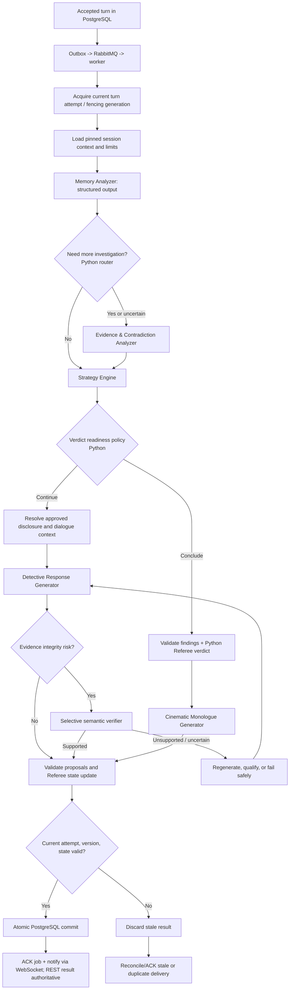

# ALIBI V1 — AI Agent Design & LangGraph Workflow

**Phase:** 2 — System Architecture  
**Deliverable:** 3 of 7 — AI Agent Design  
**Document version:** 1.0  
**Status:** Detailed technical design; provider/model choices and benchmark-driven limits remain open  
**Companion documents:** `prd.md`, `alibi_phase2_01_architecture_design.md`, `alibi_phase2_02_database_erd.md`

---

## 1. Goal and Boundaries

Alibi's detective must **investigate rather than merely chat**: preserve previous statements, find and reconsider inconsistencies, reason about established evidence, decide what to ask next, and deliver a verdict that reflects the player's actions. The agent must support guilty and innocent roles, difficulty-based tactics, and two distinct launch detectives.

**Finalized architectural decisions:**

- **LangGraph** orchestrates a **single workflow with specialized responsibilities**; the Investigator, Strategy Engine, and Detective are logical roles, not necessarily separate autonomous agents.
- **Python Referee/Game Engine** applies rules and authorized state changes. An LLM does not award scores, rewrite canonical facts, or directly mutate PostgreSQL.
- Use **controlled read/check tools** and **Pydantic structured outputs** for AI proposals.
- Route conditionally after semantic analysis; uncertain cases favor further investigation.
- **Full conversation history + structured memory by default**, with node-specific context and token-aware fallback. No vector database is required initially.
- Evidence claims must be grounded in immutable case-variation data; use deterministic reference checks and **selective semantic verification** where risk warrants it. Neither a valid ID nor a Pydantic response proves semantic truth.
- Run the workflow in **RabbitMQ-backed worker containers**, outside the player's HTTP request. Persist turn state and apply attempts/fencing so late or duplicate AI responses cannot corrupt a session.

**Non-goals of this document:** Final scoring weights/verdict thresholds (Document 4), exhaustive REST/WS payloads (Document 5), exact broker topology/VPS operations (Document 6), and implementation task sequencing (Document 7).

---

## 2. Responsibilities and Trust Boundaries

| Responsibility | Implementation | Inputs | Produces | Does **not** own |
|---|---|---|---|---|
| Context Builder | Python + PostgreSQL | Pinned variation, history, claims, revealed evidence, state | Authorized context packages | Interpreting player intent or changing truth |
| Memory Analyzer | LLM node | Current input, history, structured claims | Proposed claims, corrections, ambiguity, routing hints | Database writes or authoritative contradictions |
| Evidence & Contradiction Analyzer | LLM node; conditional | Claims, source excerpts, permitted case facts/evidence | Proposed conflicts, assessments, grounded evidence references | Promoting every suspicion to proven fact |
| Strategy Engine | LLM node | Findings, unresolved issues, personality, difficulty | Next tactic, question target, evidence disclosure request, possible conclusion recommendation | Final verdict or score updates |
| Verdict Readiness Gate | Python policy | Turn counts, validated findings, strategy recommendation, state | Continue / conclude / require further inquiry | Semantic interpretation of raw text |
| Detective Response | LLM node | Approved strategy, permitted evidence, style, recent/full context as needed | Natural dialogue + structured citations/claims used | Changing canonical facts, deciding score |
| Referee / Game Engine | Deterministic Python | Validated findings, game state, rules | Suspicion, state transition, decision, structured verdict | Inventing interpretations unsupported by evidence |
| Cinematic Monologue | LLM node; verdict path | Finalized verdict, real events, detective persona | Personalized closing speech | Changing the verdict |
| Semantic Evidence Verifier | Optional LLM node; conditional | Generated assertion(s), cited facts/evidence | Supported / unsupported / uncertain assessment | Being a guaranteed truth oracle |
| Persistence / Delivery | Python + PostgreSQL + WebSocket relay | Approved turn result and current fencing info | Atomic durable commit; notification after commit | Trusting client or LLM as source of truth |

**Separation principle:** The LLM's structured output is a *proposal*. Python can validate schema, IDs, provenance, permissions, allowed status transitions, and scoring calculations. Python **cannot** independently establish whether nuanced natural-language reasoning is correct. That residual uncertainty is handled with rubrics, selective semantic checks, and evaluation datasets.

### Evidence visibility levels

There are at least three distinct audiences:

1. **Canonical case truth (server only):** Established facts of the published variation, including facts that are not available to the detective as admissible investigative evidence.
2. **Detective-authorized investigation context (server only):** Facts and evidence the detective may reason about under this case's rules; evidence reliability and its source are explicit.
3. **Player-visible material:** Briefing and evidence actually available or disclosed to the player. This alone may be returned over REST or WebSocket.

A tool never takes an LLM-provided `session_id` or `user_id` as authority. Worker identity and the already-authorized session context constrain every access. Hidden case truth must never be copied into the mobile response simply because the Investigator can read it.

---

## 3. End-to-End Turn Execution



**Diagram caveats:** This is the *logical* workflow. A node may contain Python operations and zero or more LLM requests; conditional nodes may be skipped or combined after evaluation. The verifier/rewrite loop must have a strict maximum attempt count. The exact conclusion criteria come from the Game Engine Specification, not from a model's preference to finish.

### The nine processing stages

1. **Accept:** API persists `interrogation_turns(PENDING)` and an `outbox_events` entry in one transaction, returning `202` and a stable turn ID.
2. **Claim:** Worker verifies turn ownership, claims a fresh `turn_attempts.generation`, and records its lease. It performs no long-running AI work under an open DB transaction.
3. **Assemble context:** Fetch pinned immutable variation, past turns, structured claims, contradiction statuses, available evidence, chosen detective, difficulty and limits.
4. **Interpret:** Memory Analyzer proposes structured updates and whether further investigation is needed.
5. **Investigate when required:** Check evidence and claim conflicts; record ambiguity and alternative explanations rather than assuming a lie.
6. **Choose tactic:** Strategy Engine decides what to pursue; Python determines whether ending is legal under game rules.
7. **Speak or conclude:** Generate detective dialogue, or run Referee verdict logic and then the final monologue.
8. **Validate:** Resolve references, policy decisions, evidence disclosures and risky factual assertions; compute the authorized state changes.
9. **Commit:** Compare worker attempt generation/lease and session version; atomically save the turn response, claims, contradictions, evidence state and game effects, then notify the client.

**Important:** A generated reply must not be delivered to mobile *before* its evidence claims and turn state are validated and durably committed. Live WebSockets initially stream **status/progress**, then the approved completed reply; streaming raw unvalidated detective tokens would bypass the anti-hallucination gate.

---

## 4. Typed LangGraph State

Use a **transient typed graph state** separate from the database's **authoritative application state**. The following is an illustrative Python contract; precise classes and `TypedDict`/Pydantic boundaries may be refined during implementation.

```python
from typing import Literal, TypedDict

class TurnGraphState(TypedDict, total=False):
    session_id: str
    turn_id: str
    workflow_thread_id: str
    attempt_generation: int
    expected_session_version: int
    difficulty: Literal["ROOKIE", "INTERMEDIATE", "EXPERT"]
    detective_id: str

    # Server-assembled, scoped to the pinned variation.
    player_message: str
    conversation: list[dict]
    existing_claims: list[dict]
    existing_contradictions: list[dict]
    detective_evidence_context: list[dict]
    visible_evidence_ids: list[str]
    canonical_reference_context: dict

    # Structured node proposals, not durable DB mutations.
    memory_analysis: dict
    investigation_findings: dict
    strategy: dict
    proposed_disclosures: list[str]
    proposed_dialogue: dict
    proposed_verdict_content: dict

    # Routing, validation and budget control.
    investigation_required: bool
    verdict_ready: bool
    validation_failures: list[dict]
    model_call_count: int
    token_budget_remaining: int
    deadline_at: str
```

Implementation requirements:

- `session_id`, `turn_id`, case version, attempt generation and expected session version are **trusted worker inputs** resolved from PostgreSQL, not generated by the model.
- All model-proposed records reference existing claims/evidence by validated IDs. Proposed new claims can use **turn-local reference keys** (`new_claim_0`) until Python assigns UUIDs during final commit.
- Prefer **replace-on-node-completion** for node outputs. Avoid concurrent fan-out writing incompatible updates to shared state without explicit reducers/merge rules.
- Graph checkpoints may persist transient working state, but **do not replace** `interrogation_turns`, `player_claims`, `contradictions`, or the Referee's official game state.
- Never embed reusable secrets or unbounded user content inside instrumentation metadata. Checkpoint storage is privileged because it can hold hidden case information.

### Context-builder inputs

| Context segment | Policy |
|---|---|
| Full turn history | Include by default for short V1 sessions; store original text, ordered by `sequence_no` |
| Structured claims | Include reliable IDs, origin excerpts and claim status (`ASSERTED`, `CORRECTED`, `RETRACTED`) |
| Contradiction state | Include potential, confirmed, resolved and dismissed findings; do not erase resolved history |
| Canonical facts | Scoped to exact pinned variation; distinguish truth from disputed testimony |
| Evidence | Provide only the evidence the selected detective may use, with reliability and visibility rules |
| Difficulty/personality | Static behavior policies plus current interpersonal posture; do not reduce baseline memory reliability on easier difficulties |
| Budget | Model/node token caps, remaining allowed calls and execution deadline |

If the budget is exceeded, compress **low-relevance** segments or retrieve specific old statements by semantic meaning and source references, keeping authoritative originals in PostgreSQL. The retrieval path should not rely on string matching such as the presence of `time` or `location` in a sentence. No vector store is required for the initial short-session design.

---

## 5. Node Input/Output Contracts

### 5.1 Memory Analyzer — LLM

**Purpose:** Understand arbitrary natural-language statements, including indirect references, sarcasm, approximate time expressions and metaphors, without forcing them into invalid categories.

**Input:** Player message; previous turns; existing structured claims; recent detective question; case context necessary for reference resolution.

**Output proposal:**

```json
{
  "intent": "challenge_evidence",
  "new_claims": [
    {
      "local_ref": "new_claim_0",
      "type": "mental_state",
      "normalized_statement": "Player says they were mentally disengaged",
      "original_excerpt": "I wasn't mentally present there",
      "semantic_attributes": {"physical_location": null},
      "needs_clarification": false
    }
  ],
  "claim_revisions": [],
  "referenced_existing_claim_ids": [],
  "referenced_evidence_ids": [],
  "requires_evidence_analysis": true,
  "requires_contradiction_analysis": false,
  "uncertainty": "The statement does not assert a new physical location"
}
```

*This is an illustrative output for the phrase inside a possible larger evidence challenge; an isolated statement of mental disengagement should not automatically require evidence analysis.*

**Rules:**

- Extract only material claims; empty `new_claims` is valid.
- A reference like “after Sarah left” may be relational/relative, not a concrete timestamp.
- Preserve unknown and approximate values; don't invent exact clock times.
- Retractions/corrections point to earlier claim IDs, keeping the original records traceable.
- Analyzer may propose follow-up investigation; it cannot confirm a contradiction or write to `player_claims` itself.

### 5.2 Investigation Router — Python

**Purpose:** Avoid unnecessary LLM calls without missing high-value investigations.

```python
def route_after_memory(memory, server_signals):
    # server_signals are derived from trusted context and validated references.
    if server_signals.explicit_evidence_interaction:
        return "evidence_contradiction_analyzer"
    if memory.requires_evidence_analysis or memory.requires_contradiction_analysis:
        return "evidence_contradiction_analyzer"
    if server_signals.ambiguous_high_stakes_claim or memory.uncertainty_requires_review:
        return "evidence_contradiction_analyzer"
    return "strategy_engine"
```

**Notes:** `uncertainty_requires_review` is a **proposed implementation field**, not a finalized DB column. Server signals may be constructed from actual evidence interactions and existing unresolved conflicts; these checks are not claimed to understand arbitrary prose. A later Strategy Engine may request a **bounded** investigation pass if it notices an overlooked issue.

### 5.3 Evidence & Contradiction Analyzer — Conditional LLM

**Purpose:** Compare claims to other claims and evidence; assess significance, uncertainty, evidence reliability and reasonable explanations.

**Output proposal:**

```json
{
  "findings": [
    {
      "primary_claim_ref": "claim_uuid_1",
      "comparison_claim_ref": "new_claim_0",
      "evidence_ids": [],
      "status": "POTENTIAL",
      "severity": "MAJOR",
      "relevance": "ALIBI",
      "rationale": "Player previously denied visiting the house but now claims to have entered it",
      "ambiguity": "Check whether the player meant the same house and date",
      "suggested_next_action": "CLARIFY"
    }
  ],
  "evidence_assessments": [],
  "candidate_finding_updates": []
}
```

The example assumes `claim_uuid_1` is the earlier denial of visiting the house and `new_claim_0` is a later admission of entering it. These are **illustrative references**, not linked to the preceding mental-state example. Even an apparently major conflict remains `POTENTIAL` until its meaning and source references are checked.

**Rubric:** `MINOR` = small discrepancy with little case relevance; `MODERATE` = meaningful inconsistency affecting credibility/timeline; `MAJOR` = direct conflict central to the accusation or evidence. Valid enum ≠ correct semantic evaluation. `POTENTIAL`, `CONFIRMED`, `RESOLVED`, and `DISMISSED` are **proposed finding statuses**; any transition must be allowed by Python rules and be justified against preserved sources. A plausible explanation can reduce or remove a finding's significance.

### 5.4 Strategy Engine — LLM

**Purpose:** Decide what question or tactic best advances the investigation, while maintaining the detective's distinct personality and selected difficulty.

Suggested output:

```json
{
  "tactic": "CLARIFY_ALIBI",
  "target_claim_ids": ["claim_uuid_1"],
  "target_evidence_ids": [],
  "disclosure_requests": [],
  "question_goal": "Ask the player to reconcile the two times",
  "reasoning_summary": "Timeline gap remains unresolved",
  "recommend_conclusion": false,
  "pressure_level": "MODERATE"
}
```

A `reasoning_summary` is a compact **auditable explanation of the recommended tactic**, not a request to store or expose private model chain-of-thought. Do not send it to the player by default.

**Difficulty behavior:** Rookie uses direct questions and earlier evidence reveal; Intermediate uses more targeted follow-ups; Expert uses delayed disclosure and multi-turn tactics. **All modes retain accurate memory, evidence rules and basic contradiction reasoning.** The strategy may adapt from friendly to skeptical or confrontational, but must not manufacture facts.

### 5.5 Verdict Readiness Gate — Python

**Purpose:** Allow strategic early endings without treating a model recommendation as an authoritative verdict.

- Accept `recommend_conclusion` as one input, not the sole reason.
- Apply Game Engine rules for minimum procedural fairness, difficulty target range, unresolved decisive issues, and whether the player had an opportunity to answer significant accusations.
- If the policy rejects conclusion, route to dialogue even if the model would prefer to stop.
- Reaching a target turn range is not automatically proof of guilt; completion policy and verdict thresholds are specified in Document 4.

### 5.6 Detective Response Generator — LLM

**Purpose:** Produce the next natural, context-aware line of dialogue in the chosen detective's voice.

Proposed return:

```json
{
  "message": "You said you were home by nine. So why did you later say you left the restaurant at nine?",
  "asserted_evidence_ids": [],
  "asserted_fact_ids": [],
  "dialogue_intent": "ASK_CLARIFICATION",
  "proposed_disclosures": []
}
```

**Constraints:** No unsupported definitive evidence statements. An accusation may be framed as an inference or hypothetical when appropriate; don't present witness allegations as established truth. A requested disclosure must be authorized by Python before it can be referenced as revealed; the resulting `session_evidence` update is committed with the turn.

### 5.7 Referee Verdict + Cinematic Monologue — Python then LLM

**Referee input:** Approved evidence links, findings (including resolved and dismissed status), player defenses, session state, and finalized scoring rubric.

**Referee output:** Deterministically computed suspicion, win/loss, score breakdown, relevant facts and reasons. The semantic assessments feeding it are model-assisted and imperfect; the calculation itself is defined and repeatable. Suspicion alone does not determine the verdict. A guilty player can escape, and an innocent player can lose, depending on the validated investigation and rules.

**Monologue input:** Fixed outcome, actual meaningful interrogation events, detective character style and allowed public evidence.

**Monologue output:** Personalized cinematic close, with situational wit/sarcasm even when the player wins. The monologue cannot change the result, introduce secret truths as proven facts to the player without authorization, or cite nonexistent events.

### 5.8 Validation & Persistence — Python

Before commit, verify:

- Pydantic shapes and allowed enums.
- Every reference exists and is bound to the current session or its pinned case variation.
- The relevant evidence is detective-authorized and any player disclosure is permitted.
- New claims and finding changes preserve historical source excerpts and valid state transitions.
- Severe evidence assertions have passed the selected semantic gate or were safely qualified/removed.
- Scoring/ending rules and credit/session limits are satisfied.
- Active attempt generation, lease, session version and turn state still authorize this worker.

Then **one PostgreSQL transaction** applies all approved changes and marks the turn complete. No individual LLM node writes directly to `player_claims`, `contradictions`, `session_evidence`, `game_sessions`, or `interrogation_turns`.

---

## 6. Controlled Investigation Tools

Tools are **application-owned functions**, exposed only through restricted wrappers. They return data, not DB sessions/cursors or unrestricted SQL access.

| Tool | Typical purpose | Safeguard |
|---|---|---|
| `get_player_claims(filters)` | Find prior claim by person, time range, event or ID | Force current authenticated session scope; bounded results |
| `get_turn_excerpts(turn_ids)` | Retrieve exact wording to resolve an apparent conflict | Only turns of current session; source IDs validated |
| `get_case_evidence(evidence_ids)` | Examine actual investigative material | Bound to pinned variation and detective's authorized view |
| `verify_evidence_reference(evidence_id)` | Confirm existence, variation and reliability/visibility metadata | Deterministic lookup; **not** semantic proof of every claim made about it |
| `get_existing_findings(status_filter)` | Revisit potential/resolved contradictions | Current session only; preserve rationale and source links |
| `get_case_timeline_context()` | Access relevant chronological case facts | Server-only typed result; cannot automatically expose to player |

**No agent-callable tools** such as `execute_sql`, `save_claim`, `set_suspicion`, `grant_credit`, `unlock_case`, `complete_session`, or `publish_evidence_to_player`.

Evidence interactions initiated through free-form dialogue can be **proposed** by the LLM, but Python authorizes the request and atomically records it. Explicit taps in the evidence UI are validated and recorded directly by FastAPI without an LLM interpreting the tap.

### Tool and model execution controls

- Tool invocations and retrieved rows are capped per step; no open-ended tool loops.
- Long documents/evidence snippets are bounded and attributed to their record IDs.
- Treat player text and case content as **untrusted data** for instruction-following purposes; they cannot override system rules, tool permissions, or output schemas.
- Tool errors are typed (`NOT_FOUND`, `NOT_AUTHORIZED`, `TEMPORARY_FAILURE`) and returned without exposing hidden resource existence to the player.
- Model adapters normalize structured-output validation, usage metadata, timeout/cancellation and provider-specific errors.

---

## 7. Evidence Grounding and Semantic Safety

### Assertion categories

| Category | Example | Policy |
|---|---|---|
| Verified canonical fact | “The call was placed at 9:10 PM” | Must map to an established fact and be authorized for use/disclosure |
| Actual evidence item | “The witness reported seeing someone outside” | Cite existing evidence; preserve witness/source reliability |
| Player claim | “You said you were at home” | Cite originating turn/claim; do not label it proven |
| Inference | “That timing seems difficult to explain” | May be raised as inference, not certified fact |
| Hypothesis/bluff | “What if someone else had your keys?” | Can be asked as hypothetical; no fabricated verified evidence |

### Validation layers

1. **Prompt grounding:** Give the model authorized evidence and clearly labeled truth/reliability/visibility.
2. **Structured references:** Return fact/evidence IDs for definite case assertions.
3. **Deterministic validation:** Check existence, case-variation match, allowed visibility, claim source, and disclosure eligibility.
4. **Selective semantic check:** For high-impact accusations or monologues, compare generated assertions with cited canonical content using an additional constrained LLM evaluator. Output `SUPPORTED | UNSUPPORTED | UNCERTAIN` plus references.
5. **Correction or safe stop:** If unsupported/uncertain, qualify the statement, regenerate within bounded retries, or fail the turn safely. **Do not silently replace truth with a model guess.**
6. **Offline evaluation:** Measure hallucinated or misrepresented evidence rates using manually reviewed, adversarial scenarios.

A generated sentence can cite a real fingerprint evidence ID yet falsely assert that it matches the player. **Reference validation will not catch that semantic error.** The verifier and tests reduce—but cannot eliminate—such failures.

---

## 8. Checkpointing, Retries, Timeouts and Late Results

### Attempt ownership and delivery semantics

- RabbitMQ distributes durable work **at least once**; delivery can repeat.
- A worker claims a turn by writing a new `turn_attempts` generation and lease. Only that current generation may commit.
- The worker uses a LangGraph PostgreSQL checkpointer for *execution progress*, isolated from authoritative app tables. `interrogation_turns.workflow_thread_id` associates a turn with its graph execution; attempt generations must be isolated in checkpoint namespace/state so a stale attempt cannot overwrite a recovered execution's working state.
- Renew leases during long calls where safe. A restarted worker may reclaim expired work; previous models may still return later.
- **Before final commit**, check active attempt/generation, lease validity, turn not already completed, expected `game_sessions.version`, and all authorization/state constraints.
- If a stale worker returns, discard its result. It must not overwrite later turns, claims, suspicion or evidence state.
- A duplicate delivered after a completed turn is acknowledged without rerunning the full workflow.

### Timeout hierarchy

| Boundary | Approach |
|---|---|
| One model call | Per-node provider request timeout appropriate to complexity |
| Conditional node/branch | Node-specific deadline and bounded tool-call count |
| Full turn | Separate upper-bound workflow deadline; conditional complexity considered |
| Worker lease | Heartbeat/renewal; not simply an arbitrary shorter timer than legitimate calls |
| Retry | Exponential backoff with capped attempts, not infinite loop |
| Session | No active subsequent turn until prior turn completes or is explicitly resolved |

**Exact numeric budgets are not finalized** until model and VPS benchmarking. A single universal 15-second deadline is not appropriate across simple, evidence-heavy and verdict turns.

### Failure classes

| Failure | Behavior |
|---|---|
| Schema/parse failure | Bounded repair/retry; if exhausted, mark turn failed without partial game-state commit |
| Provider 429/5xx/network timeout | Retry with backoff within budget; alternate approved provider/model only if evaluated |
| Evidence reference invalid | Reject invalid proposal; try bounded correction; never disclose fabricated evidence |
| Worker crash | Lease/queue recovery; rehydrate from durable session and safe checkpoints |
| Crash after DB commit but before RabbitMQ ACK | Redelivery observes completed turn and ACKs without duplicate effects |
| API/WS disconnect | Worker keeps processing; client recovers through REST using original turn ID |
| Late provider result from old attempt | Discard after failed fencing/version check |
| Budget exhausted | Fail safely and provide retry/recovery path; don't generate an arbitrary verdict |

**Idempotent *state changes* do not imply exactly-once LLM calls.** Retries can incur additional cost; write `ai_usage_records` for each observed provider attempt, including failures where usage metadata is available. If the provider call succeeded but the worker crashed before preserving its result, the call may need repetition unless provider-side retrieval/idempotency exists.

### Turn ordering invariant

```text
Turn 6: PROCESSING / RETRYING  -> Turn 7: NOT ACCEPTED
Turn 6: COMPLETED             -> Turn 7: MAY BE ACCEPTED
Turn 6: FAILED                -> retry Turn 6 or explicitly abandon/recover
```

Session sequencing belongs to FastAPI/Game Service; LangGraph cannot bypass it.

---

## 9. Model Selection, Latency and Cost Policy

**Chosen:** Provider-agnostic model integration. **Not chosen yet:** provider, model IDs, per-node routing, exact timeout/retry numbers, costs and budgets.

Initial implementation recommendation:

- Use **one evaluated model initially** to establish a correctness/latency baseline.
- Record each model call's `graph_node`, `provider`, `model`, input/output tokens, duration, error and cost in `ai_usage_records`.
- Estimate cost at **turn and session levels**, including retries, verifier calls and cinematic monologues.
- Compare 3–4 logical LLM steps per normal/complex turn against **combining Memory + Strategy** or other nodes; optimize only when contradiction detection, dialogue quality and cost metrics justify it.
- Constrain context per node: the Memory Analyzer may need broad history; Evidence Analyzer can receive just referenced claims, source excerpts and relevant canonical evidence; Strategy sees findings; Detective sees context necessary for credible dialogue.
- Honor provider rate limits and per-session spending limits without silently truncating evidence or declaring arbitrary guilt.

**Illustrative call pattern, not a promise:** Normal: Memory → Strategy → Detective; complex: Memory → Evidence Analysis → Strategy → Detective; conclusion adds final monologue and optional semantic verification. Some node operations can be Python-only; some may be merged after evaluation.

---

## 10. Observability and Evaluation

### Tracing and logging

Every turn is correlated by `session_id`, `turn_id`, `workflow_thread_id` and `turn_attempt_id`. Record queue wait, node spans, tool calls, provider errors, validation outcomes, checkpoint recovery, stale-result discards, cost and final commit time. Use JSON logs, OpenTelemetry and Sentry as agreed.

**Do not log** auth tokens, full raw player messages, private evidence or complete hidden case files in ordinary production logs. Prefer redacted samples and IDs; controlled test fixtures can retain full expected content.

### Evaluation suite

| Scenario | Pass condition |
|---|---|
| “I wasn't mentally present there” | No physical-location claim invented |
| Approximate 9:00 vs 9:10 | Doesn't automatically escalate to major contradiction |
| Denied visiting house, later admits entry | Detects meaningful conflict and cites exact source turns |
| Player corrects earlier statement | Old claim remains traceable; finding can be resolved/reassessed |
| Turn 15 references Turn 2 | Retrieves original earlier statement correctly |
| Player challenges witness allegation | Separates allegation from established case truth |
| Detective has no fingerprint match evidence | Does not state player fingerprints were found |
| Repeated accusation | No repeated scoring of same finding |
| Worker 1 returns after Worker 2 takes over | Stale result cannot commit |
| Duplicated RabbitMQ delivery | At most one committed response/state transition |
| Model/verifier timeout | Safe retry/failure; no partial claims or verdict committed |
| Equivalent defenses, different wording | Comparable finding assessments and verdicts under rubric |

Use deterministic assertions for IDs, provenance, state transitions, evidence boundaries and scores. Use rubric-based model evaluation plus human review for semantic quality, personality, fairness and question strategy. Track per-node/turn p50/p95 latency, claim extraction accuracy, contradiction precision/recall, unsupported evidence rates, retry overhead and cost per completed interrogation.

**Release gates:** Critical cross-user data leaks, unauthorized hidden evidence disclosure, duplicate turn commits, and fabricated canonical facts presented as verified must block release when reproduced. Numerical quality/latency thresholds will be based on an evaluation dataset and measured model/VPS performance rather than invented here.

---

## 11. Proposed Module Layout

*Illustrative structure inside the agreed `alibi-backend` repository; file/package names are proposals, not additional architecture decisions.*

```text
alibi-backend/
  app/
    ai/
      graph.py                 # LangGraph nodes/edges and state routing
      state.py                 # Typed transient workflow state
      schemas.py               # Pydantic node outputs
      prompts/                 # Versioned instruction/personalities
      nodes/
        memory.py
        investigation.py
        strategy.py
        detective.py
        monologue.py
        semantic_verifier.py
      tools/
        claims.py
        evidence.py
        history.py
      context_builder.py       # Authorized node-specific context
      model_adapter.py         # Provider-agnostic calls, token accounting
      checkpoint.py            # LangGraph checkpointer setup
    game/
      referee.py               # Scoring/verdict policy (deterministic)
      lifecycle.py             # Session and turn state rules
    sessions/
      turn_service.py          # Idempotent submission, sequencing
      turn_commit.py           # Fencing + atomic application
    messaging/
      consumer.py              # RabbitMQ worker integration
      outbox_publisher.py
    db/
      models/
      repositories/
  tests/
    ai/
      fixtures/               # Predefined claims, evidence, dialogue cases
      test_memory.py
      test_investigation.py
      test_hallucination.py
      test_full_interrogation.py
      test_fencing.py
```

---

## 12. Open Parameters and Hand-off to Other Documents

The **architecture** is agreed, but the following should not be misrepresented as decisions already made:

| Open detail | Owner / dependency |
|---|---|
| Exact scoring weights, suspicion levels, verdict thresholds and early-stop rules | **Document 4 — Game Engine Specification** |
| Final Pydantic request/response and WebSocket event schemas | **Document 5 — API Specification** |
| Provider/model IDs and any fallback provider | Model evaluation + cost benchmarking |
| Maximum calls per node, timeout values, graph deadline, retries, verifier triggers | Benchmark + **Document 6 — Infrastructure Design** |
| Precise checkpoint namespaces, lease renewal interval, broker prefetch, dead-letter behavior | **Document 6**, integration testing |
| Semantic memory retrieval algorithm if full context becomes too large | Measured token pressure and retrieval-quality tests |
| Exact detective archetype names, prompts and five case plots | Content design, not settled by architecture |

### Acceptance criteria for this deliverable

- A developer can identify the inputs, outputs and side-effect permissions of every LangGraph responsibility.
- The routing rule is **semantic and conservative**, not a brittle time/location keyword check.
- LLM outputs are proposed records with source references; **no direct LLM-authored DB mutations**.
- The official Referee, authorized evidence access and final commit remain deterministic Python boundaries.
- The game can recover from duplicate delivery, reconnects, failed calls and stale worker attempts without out-of-order commits.
- Original dialogue, structured claims and investigation findings remain auditable.
- Model selection and time/cost thresholds are explicitly unfinalized rather than guessed.

---

**Document conclusion:** Alibi V1 uses a bounded, conditional LangGraph investigation workflow. LLMs interpret, compare, strategize and speak; Python enforces evidence permissions, turn order, verdict policy and durable commits. This produces adaptive detective behavior while preserving canonical case truth, explainable results and recoverable sessions.
