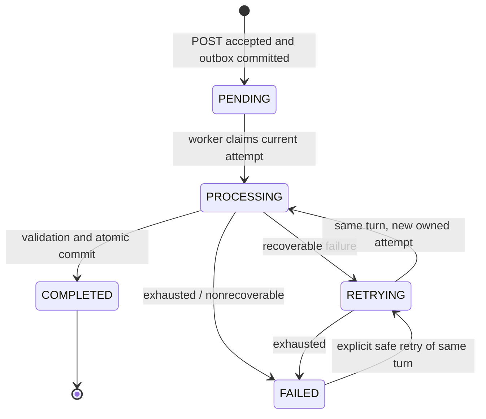
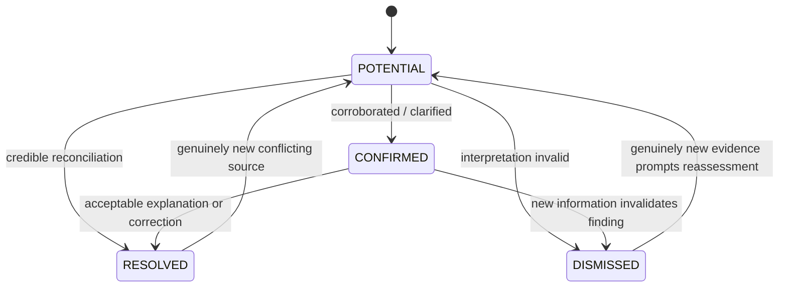

# ALIBI V1 — Game Engine Specification

**Phase:** 2 — System Architecture  
**Deliverable:** 4 of 7 — Game Engine Specification  
**Document version:** 1.0  
**Release:** Alibi V1  
**Status:** Architectural rules specified; numerical tuning remains subject to evaluation  
**Related documents:** `prd.md`, `alibi_phase2_01_architecture_design.md`, `alibi_phase2_02_database_erd.md`, `alibi_phase2_03_ai_agent_design.md`

---

## 1. Purpose and Authority

This document specifies **the Python Game Engine / Referee**, not Unity, Unreal, or a second application server. It lives inside the FastAPI backend codebase and is invoked by the Game/Session Service and by the LangGraph worker's validation/finalization stage.

It defines:

- Legal session and turn transitions.
- Difficulty behavior and interrogation completion policy.
- Which investigation findings can affect suspicion.
- A deterministic, configurable scoring algorithm and a distinct verdict procedure.
- Fairness and evidence-integrity gates.
- Atomic persistence, idempotency, and stale-worker protection.
- Results, progression handoff, and testable invariants.

### 1.1 Finalized decisions vs. values needing calibration

**Already decided:** Python owns state transitions and scoring; AI makes semantic assessments but cannot write arbitrary scores or verdicts. Suspicion is 0–100, shown *qualitatively* until the result screen. Cases have fixed published truth. Guilty and innocent players must both be able to win or lose. The interrogation adapts to difficulty and can conclude early when justified. One active turn per session; durable RabbitMQ workers may retry but must never duplicate official results.

**Not yet numerically finalized:** scoring weights, suspicion band cutoffs, verdict sufficiency thresholds, early-ending minimum-turn policy, exact XP values, performance ratings, and hard token/latency budgets. This document specifies the algorithms and **proposes versioned configuration for these values**, not falsely finalized numbers. Values must be selected against representative test cases before release.

### 1.2 Trust boundaries

| Input or component | Authority |
|---|---|
| Published case variation and its canonical facts | Immutable reference truth for the session |
| Evidence records | Existing investigative material; **not every allegation is true** |
| Player messages | Assertions by the player, not established truth |
| Investigator / Memory Analyzer | Proposes claims, finding significance, explanations, and recommendations |
| Detective / Strategy Engine | Proposes tactics, dialogue, and allowable evidence disclosures |
| Referee / Game Engine | Applies deterministic rules and produces the authoritative game assessment |
| PostgreSQL transaction | Commits the only authoritative game-state changes |
| Mobile app / WebSocket | Displays authorized results; never sets scoring, outcomes, or hidden facts |

The referee checks provenance, state transitions, eligibility, and arithmetic. **It cannot prove the semantic correctness of an LLM's interpretation by checking Pydantic types or evidence IDs.** Rubric-based evaluations and selective semantic checks reduce that risk.

---

## 2. Domain Model and State Ownership

The main persisted entities already specified in Document 2 are:

- `game_sessions` — user, pinned case variation, player role (through variation), detective, difficulty, lifecycle, version, suspicion and final result.
- `interrogation_turns` — accepted message, sequence number, processing status, detective response, qualitative suspicion level, idempotency metadata.
- `player_claims` — claims with origin excerpts, approximate times, meaning and correction/retraction history.
- `contradictions` — sourced findings and their severity, relevance and status.
- `session_evidence` — authorized evidence that was disclosed, inspected, or challenged.
- `turn_attempts` / `outbox_events` — processing attempts and durable messaging.
- `xp_events`, `user_achievements`, `user_detective_unlocks` — idempotent rewards.

**No new mandatory table is introduced by this document.** The Referee produces a typed assessment in memory and writes the official snapshot/result to the existing session/turn fields. The final result's explanation can be retained in `game_sessions.verdict_breakdown` (JSONB), while underlying source claims and evidence remain relational. If audits later require a per-turn score history, that can be a narrowly scoped schema revision; do not silently treat speculative storage as already approved.

### 2.1 Proposed Python boundaries

```python
class SessionService:
    # authorize, start/abandon/resume sessions; accept turns idempotently
    ...


class Referee:
    # pure, repeatable rules over validated session/assessment inputs
    def assess(self, snapshot, approved_findings, ruleset): ...
    def may_conclude(self, snapshot, assessment, ruleset): ...
    def decide_verdict(self, snapshot, assessment, ruleset): ...


class GameStateRepository:
    # DB reads and conditional atomic commits, not LLM-controlled writes
    ...
```

Ideally, `Referee.assess()` and `Referee.decide_verdict()` have **no I/O**. They take explicit, validated inputs and a named `ruleset_version`, making game outcomes reproducible in tests.

---

## 3. Session State Machine

### 3.1 Legal states

```mermaid
stateDiagram-v2
    [*] --> CREATED: authorized session creation
    CREATED --> ACTIVE: introduction/briefing complete; interrogation begins
    CREATED --> ABANDONED: player abandons
    ACTIVE --> COMPLETED: authorized verdict committed
    ACTIVE --> ABANDONED: explicit abandon after processing is safely resolved
    COMPLETED --> [*]
    ABANDONED --> [*]
```



| From | To | Initiator and required condition |
|---|---|---|
| none | `CREATED` | Server validates player, case access, detective unlock, selected difficulty, variation publication, one-active-session rule and session allowance/credit; creates record atomically with funding event. |
| `CREATED` | `ACTIVE` | Player completes briefing or game flow begins; first detective prompt may be generated/presented without counting as a player turn. |
| `CREATED` / `ACTIVE` | `ABANDONED` | Authorized player action; no running worker may later commit results against an abandoned session. Exact credit refund/forfeit policy is a separate commerce decision. |
| `ACTIVE` | `COMPLETED` | Referee authorizes end, all decisive findings validated, final result transaction commits. |

An `ACTIVE` session may remain idle indefinitely within configured retention limits. **Closing the app or losing WebSocket connectivity does not abandon it.** Completed and abandoned sessions are read-only for new player turns. For V1, one user has at most one session in `CREATED` or `ACTIVE` state (enforced by a partial unique index).

### 3.2 Session creation safeguards

1. Choose and **pin a published, immutable** `case_variation_id` before play starts.
2. Read the player's role from that variation (`GUILTY` or `INNOCENT`); never accept a role supplied by the client.
3. Verify the selected detective is available to the user.
4. Atomically create the session and record its free-allowance or credit funding source. Do not double-charge a retried creation request.
5. Initialize game-state version and a score derived only from permitted initial investigative material. Never initialize suspicion from the hidden canonical truth that the detective is not allowed to know.

---

## 4. Turn State Machine and Sequencing



| Rule | Specification |
|---|---|
| Authoritative order | `interrogation_turns.sequence_no` is strictly increasing **within a session**; `(session_id, sequence_no)` unique. |
| One active turn | At most one `PENDING`, `PROCESSING`, or `RETRYING` turn per session; PostgreSQL partial unique index protects against races. |
| Duplicate submission | Same `(session_id, client_request_id)` **and same request-body hash** returns the original turn; different body with same key is rejected. |
| Overlap | A different new turn while one is active receives `409 Conflict`; it is not queued behind the current turn. |
| Retry | A failed turn is recovered under its existing `turn_id`; a new turn cannot skip an unresolved failed turn. |
| Turn count | Count **accepted player turns successfully completed** (not model calls, worker attempts, detective intro lines, evidence-view taps, or failed retries). |
| Failed worker | Worker lease/attempt generation and RabbitMQ redelivery support recovery; model calls may repeat, but official state updates cannot. |
| Completion | A session cannot complete until the current turn's validated result and verdict are committed consistently. |

The mobile interface may prevent overlapping submits for UX, but **the server enforces the rule** regardless of the client.

### 4.1 Concurrent and late-result example

```text
Turn 6 accepted -> attempt generation 1 calls LLM
attempt 1 loses lease -> generation 2 claims same turn
attempt 2 commits validated result -> turn 6 COMPLETED
attempt 1 returns late -> generation/version mismatch -> discard
turn 7 may now be accepted
```

A stale worker must not append claims, update suspicion, disclose evidence, change the verdict or award XP. Application-side checks **and conditional database updates inside a single transaction** enforce this; RabbitMQ acknowledgment alone is insufficient.

---

## 5. Difficulty and Interrogation Progression

| Property | Rookie | Intermediate | Expert |
|---|---|---|---|
| Target completed player turns | 5–7 | 8–12 | 12–18 |
| Questioning | Direct | Strategic follow-ups | Multi-turn connected strategies |
| Evidence disclosure | Earlier | Selective | Carefully timed |
| Follow-up depth | Basic | Context-aware | Deep, interconnected |
| Psychological pressure | Low | Moderate | High |
| Memory / source accuracy | Accurate | Accurate | Accurate |
| Contradiction detection | Reliable | Reliable | Reliable |

**Difficulty changes the detective's tactics, pacing and available time—not whether the detective is allowed to forget, fabricate evidence, or ignore valid corrections.** The player role, canonical truth and evidence reliability do not change merely because difficulty changes.

### 5.1 Verdict readiness gate

After a Strategy Engine recommendation, the Python Referee evaluates whether the session can reasonably conclude:

```text
may_conclude =
    active_session
    AND active_authorized_turn
    AND no_unvalidated_decisive_findings
    AND important_accusations_have_had_a_fair_response_opportunity
    AND (
        enough_grounds_to_conclude_early
        OR target_turn_policy_reached
        OR configured_safety_cap_reached
    )
```

- `enough_grounds_to_conclude_early` is a *rubric-backed, deterministic eligibility decision over approved findings*, **not** a free-form LLM verdict recommendation.
- A `recommend_conclusion` field from the Strategy Engine may trigger evaluation, but can never bypass the Referee.
- Reaching the target range **does not establish guilt**. If evidence is insufficient, the result must reflect that insufficiency rather than force an accusation.
- A major issue newly raised on the intended last turn must be fairly addressable before being decisive. The Referee can request a final clarification or decline to count an unrebutted issue as dispositive.
- Avoid infinite interrogations: the configured turn cap and recovery behavior must be defined and tested. The Phase 1 ranges are **targets**, not an already-agreed hard maximum.
- Final timeout, safety-cap and readiness thresholds are **configuration/calibration work**, not settled numeric commitments.

The model does **not** decide that the player loses just because the conversation has gone long enough.

---

## 6. Canonical Evidence, Claims and Finding Eligibility

### 6.1 Keep these distinctions explicit

| Data | Meaning | May influence authoritative scoring? |
|---|---|---|
| Canonical fact | Established truth of pinned variation | Only through detective-authorized investigative knowledge and permitted scoring rules; hidden omniscient truth alone cannot convict |
| Evidence item | Document, record, testimony, footage, etc. | Yes, **if admissible/authorized, relevant, and sufficiently reliable**; a witness assertion is not automatically proven |
| Player claim | What the player actually asserted | May be evaluated; not independently proven |
| Potential contradiction | Plausible conflict needing context | **No automatic penalty** |
| Confirmed contradiction | Substantially established inconsistency **in claims or with reliable evidence** | Eligible, subject to relevance, severity and grouping |
| Resolved contradiction | Credible later explanation accepted | Its unresolved penalty is removed/reduced; original record remains |
| Dismissed contradiction | Mistaken comparison / wrong interpretation | No penalty |
| Alternative explanation | Player-offered defense or hypothesis | Only affects assessment when relevant, coherent and consistent with established facts; not merely confident wording |

A `CONFIRMED` contradiction means the discrepancy is well supported; **it is not proof that the player committed the underlying crime**. A severity label (`MINOR`, `MODERATE`, `MAJOR`) is a rubric-guided *semantic assessment*, not a mathematically proven fact.

### 6.2 Severity and relevance rubric

| Label | Definition | Example |
|---|---|---|
| `MINOR` | Small discrepancy with limited relevance to the accusation | “Around 9” vs “9:10” without a material timing issue |
| `MODERATE` | Meaningful conflict about credibility, sequence or an important context | Incompatible descriptions of when a witness arrived |
| `MAJOR` | Direct conflict central to a claimed alibi, decisive event or strong evidence | “I never entered that house” vs “I went inside briefly” |

**Relevance is separate from severity.** A material inconsistency about unrelated trivia should not count like a contradiction involving the incident. Proposed relevance categories could be `CENTRAL`, `SUPPORTING`, and `PERIPHERAL`; final enum naming and mapping belong to the implementation ruleset, not to the AI's unconstrained vocabulary.

### 6.3 Validated finding contract

For every finding that might affect a score, the referee needs an approved, traceable assessment:

```python
class ApprovedFinding:
    finding_id: str  # stable issue/finding identifier
    kind: str  # e.g., CONTRADICTION, EVIDENCE, DEFENSE
    source_claim_ids: tuple[str, ...]
    source_evidence_ids: tuple[str, ...]
    source_fact_ids: tuple[str, ...]
    status: str  # POTENTIAL/CONFIRMED/RESOLVED/DISMISSED, etc.
    severity: str | None  # rubric-based LLM assessment
    relevance: str
    reliability: str | None  # established source property/approved assessment
    explanation_status: str | None  # e.g., ACCEPTED / DISPUTED / PENDING
    issue_key: str  # stable grouping of same underlying matter
    assessment_rationale: str
```

This is a **logical internal contract**, not a new DB table or promise that all fields exist verbatim in existing models. Source IDs are resolved and validated against the session and case variation; the Referee refuses ungrounded or conflicting proposals. If a source isn't reliable enough, the finding is excluded or represented as uncertain rather than promoted to proven evidence.

**`issue_key` requirement:** Several claims, witnesses and evidence records may describe the **same underlying disputed event**. The Referee must group related material to avoid counting one issue repeatedly. This key can be derived from validated case/event references and preserved claim associations; it must not be an arbitrary unverified string that the LLM uses to manipulate scoring. The final persistence representation is a schema-design detail if stable grouping cannot be achieved with existing references.

### 6.4 Finding transitions



The exact allowed transition policy is implemented in Python and includes provenance/reason. Retraction does not erase the original claim; it may affect credibility after assessment, but **cannot itself be an automatic confession**. Re-evaluation must be allowed when the player provides new information.

---

## 7. Suspicion Scoring Specification

### 7.1 Guiding requirements

1. Suspicion is an integer in `[0, 100]`, calculated by Python from **current approved findings**, not copied from an LLM score.
2. Only eligible evidence and findings may contribute. `POTENTIAL` and `DISMISSED` findings have no automatic penalty.
3. Resolve or dismiss a finding → remove/reduce its *current* effect. Do not permanently accumulate increments for every mention.
4. Multiple references to one issue are not independent votes. Prevent duplicate and correlated-evidence inflation.
5. Credible defenses may reduce the significance of an issue; they cannot rewrite canonical facts.
6. Use versioned configuration so identical approved inputs under the same rules produce the same number.
7. Hidden truth unavailable to the detective is **never** a direct score input.

### 7.2 Deterministic computation model

**Proposed V1 model:** recompute suspicion from an assessment snapshot at each committed turn. Use an issue-level score rather than stacking every extracted finding:

\[
S_t = \operatorname{clamp}_{0,100}\!\left(\operatorname{round}\!\left(B + \sum_{g\in G_t} I_g - \sum_{d\in D_t} R_d\right)\right)
\]

Where:

- `B` = case/variation-specific initial *investigative* baseline from information the detective is permitted to consider; must not encode the secretly known guilt flag.
- `G_t` = distinct, approved, material **issue groups** at turn `t`, each representing one allegation/evidence cluster or contradiction, with no double counting.
- `I_g` = nonnegative contribution computed by Python using **configured** severity, relevance, reliability, status and corroboration rules; a potential or dismissed finding contributes zero.
- `D_t` = independently validated defenses/mitigations, linked to the issues they address; `R_d` is bounded so repeated equivalent explanations cannot drain suspicion indefinitely.

A defensible implementation usually calculates an *issue's net contribution* in one place rather than adding a penalty in one pass and unconstrained defenses in another. In either representation, cap contribution per issue and define how overlapping sources combine.

```python
def compute_suspicion(snapshot, approved_issues, ruleset) -> int:
    score = ruleset.initial_investigative_baseline(snapshot.case_context)
    for issue in deduplicate_and_group(approved_issues):
        if not issue.is_score_eligible:
            continue
        raw = ruleset.issue_weight(
            kind=issue.kind,
            severity=issue.severity,
            relevance=issue.relevance,
            reliability=issue.reliability,
        )
        mitigation = ruleset.approved_mitigation(issue)
        score += max(0, min(ruleset.per_issue_cap, raw - mitigation))
    return max(0, min(100, round(score)))
```

**The function demonstrates the algorithm, not finalized constants.** `deduplicate_and_group` needs authored evidence/fact links plus checked associations; it is not solved by a simple string similarity heuristic. Evidence items that are genuinely independent may corroborate an issue under a configured cap; evidence representing one source repeated through multiple records does not.

### 7.3 Example: corrected contradiction

A player first says “I never visited the house,” then admits being there. The Analyzer proposes a **major, central** contradiction. It is initially `POTENTIAL`, so no automatic score penalty applies. After contextual investigation confirms the discrepancy, it becomes eligible for a configured contribution. Later, a coherent clarification supported by evidence is accepted and the finding becomes `RESOLVED` or has reduced materiality. On the next evaluation the old contribution is removed/reduced—**no second negative transaction is needed**, and the source statements are still retained.

A witness's unsupported assertion can affect the detective's *questioning strategy*, but cannot automatically add the same weight as verified footage.

### 7.4 Visible suspicion bands

```python
# Configuration values shown symbolically because thresholds are not finalized.
def visible_band(score: int, thresholds) -> str:
    if score < thresholds.moderate:
        return "LOW"
    if score < thresholds.high:
        return "MODERATE"
    if score < thresholds.critical:
        return "HIGH"
    return "CRITICAL"
```

Client-visible during gameplay: **only** `LOW | MODERATE | HIGH | CRITICAL`, never the numeric score, weight coefficients, internal scoring breakdown or undisclosed evidence. The final verdict screen may reveal the **exact score and its authorized explanation**.

### 7.5 Ruleset versioning

Scoring Ruleset Versioning

1. Every game session stores `scoring_ruleset_version`.
2. The version is assigned at session creation.
3. Suspicion and verdict calculations load that version.
4. Published scoring configurations are immutable.
5. New scoring changes create a new version.
6. Existing sessions continue using their original version.
7. The final case breakdown records the version used.

---

## 8. Verdict Engine — Separate from Suspicion

**High suspicion is not sufficient proof.** The final decision considers the strength of the *case actually established against the player*, defenses, contradictions, evidence reliability, and reasonable doubt.

### 8.1 Two distinct determinations

1. **Case assessment:** Is the player convincingly implicated by the material the detective can substantiate after hearing the player's responses?
2. **Player result:** Did the player achieve their role-dependent objective? Guilty players aim to avoid convincing implication; innocent players aim to establish a sufficiently credible defense.

A guilty player may succeed despite being actually guilty in the hidden case truth. An innocent player can fail to persuade the detective. The Referee **does not read the canonical guilty/innocent flag as a shortcut to decide whether the detective should win**; that flag is used to interpret the player's game objective **after** evaluating the in-world investigation.

### 8.2 Authoritative verdict inputs

- Pinned case variation and **detective-authorized** investigative material.
- Approved central allegations/evidence issues and reliability/corroboration.
- Confirmed, resolved, dismissed and unresolved contradictions.
- Player's material explanations and objectively checkable support where available.
- Whether decisive accusations received a fair opportunity for response.
- Applicable ruleset version and difficulty pacing constraints.

**Not authoritative:** the LLM's free-form “guilty” label, confidence alone, impression of rhetorical confidence, the raw 0–100 suspicion score, or secret facts the detective was never permitted to learn.

### 8.3 Deterministic verdict procedure (proposed)

```text
1. Build eligible evidence issues and defense issues from the approved snapshot.
2. Remove dismissed issues; apply resolution / mitigation to confirmed issues.
3. Exclude allegations that lack the required source support or fair rebuttal opportunity.
4. Evaluate a versioned "sufficiency of case" rubric:
     - materiality to central accusation
     - reliability and independence of supporting sources
     - contradictions and their current status
     - viable, grounded alternative explanations
     - whether decisive holes remain
5. Evaluate a versioned "defense credibility" rubric:
     - relevance, consistency, compatibility with known evidence
     - support and responses to the actual accusation
6. Produce structured case assessment and role-aware player result.
7. Produce an explanation listing the decisive issue IDs and defense IDs.
8. Freeze the result before asking the LLM to write the closing monologue.
```

The initial rubric and outcome policy must be **implemented as configuration + deterministic Python predicates over approved categories**, and regression-tested against authored cases. It cannot be made semantically objective simply by turning subjective assessments into enums.

A practical *proposed* outcome vocabulary is `IMPLICATED | DEFENSE_ACCEPTED | INCONCLUSIVE`. An `INCONCLUSIVE` outcome must have an explicit role-aware result and reward policy before release; it must not be silently mapped to a win or loss. **The exact enum vocabulary and mapping are not yet approved product decisions.** If V1 UI requires a binary win/loss, select a stable sufficiency standard, handle borderline outcomes explicitly, and test both player roles. Never change the result just to satisfy a fixed win rate.

### 8.4 Reproducibility and appeal-like explanations

The verdict breakdown must record, at minimum:

- `ruleset_version` and final player role.
- Case assessment and official player result.
- Exact final suspicion score.
- Decisive approved issue IDs and evidence references.
- Successful defenses and resolved contradictions.
- Unresolved but **nondecisive** ambiguities.
- Why the relevant ending/fairness gates passed.

This allows debugging and player-facing results without disclosing hidden facts that were never revealed. When a finding was ambiguous, say so rather than presenting an inferred fact as certain.

---

## 9. Detective Response and Cinematic Closing

The Referee evaluates the proposed strategy/disclosure before final content is committed.

**Ordinary turn:** The Detective LLM receives the approved tactic and only authorized evidence it may cite or disclose. Its response may be sarcastic or confrontational, but the dialogue cannot alter game rules or fabricate verified material. Evidence assertions receive reference/authorization checks and **selective semantic verification** for high-stakes statements; this is risk mitigation, not a guarantee of perfect truthfulness.

**Final turn:** The Referee finalizes the result first. The closing LLM receives the fixed outcome, detective personality, and actual approved events. It generates a personalized cinematic monologue, including situational sarcasm even when the player wins. It **cannot revise the verdict or invent case events**. If monologue generation fails, retain the finalized result and present a safe, authored closing fallback; don't lose or reroll the verdict.

**Player-facing result must include:** outcome, exact suspicion, important contradictions, successful defenses, missed opportunities, performance rating, sarcastic monologue, and data for a shareable result card. Any published share card must omit private or unrevealed evidence. Performance-rating bands and “missed opportunity” assessment rules require versioned calibration; the LLM cannot simply assign arbitrary stars.

---

## 10. Rewards, Unlocks and Daily Challenges: Engine Hand-off

Reward rules belong to the Game Engine; purchase verification and session credits belong to the Commerce module. Do **not** mingle XP with consumable AI credits.

- **XP:** completion reward plus validated performance bonuses; a losing player still earns completion XP. A configurable anti-farming policy prevents unlimited identical replay rewards.
- **Ranks/unlocks:** deterministic thresholds and unlock conditions over authoritative `users.total_xp`, `xp_events`, `ranks`, `achievements` and detective unlocks.
- **Daily challenge:** one published case variation per globally defined challenge date; bonus XP and streak calculation use server time in a **single explicitly configured daily reset timezone**. Exact timezone and streak policy must be set before implementation, not inferred from device clock.
- **Idempotency:** one completion event cannot award XP twice. Use unique reward idempotency keys and transactional changes to balance and unlock tables.
- **Session credits:** only session initiation can consume free allowance or a session credit, never individual dialogue turns. Refunding an abandoned/failed session is a separately documented commerce rule.

The specifics of rewards and purchase APIs will be expanded in the API Specification / Implementation Plan rather than inventing new economic policies here.

---

## 11. Atomic Commit and Worker Safety

### 11.1 Complete-turn transaction

After LangGraph has produced proposed memory findings, strategy, dialogue or verdict, the worker must:

1. Open a short PostgreSQL transaction; lock the current session and turn.
2. Verify session is `ACTIVE`, turn is in a permitted active processing state, user/case references remain valid, and **turn sequence is the next unresolved turn**.
3. Verify `game_sessions.version == expected_session_version` and the turn's current `active_attempt_generation`/lease belongs to this worker.
4. Validate source references and case-variation ownership. Apply approved claim revisions, contradiction updates and evidence disclosures.
5. Recompute suspicion from the resulting validated assessment under the pinned ruleset. Check bounds and compute the visible qualitative level.
6. Apply either (a) ordinary detective response + `turn COMPLETED`, or (b) authorized final result + `session COMPLETED` + result breakdown and idempotent rewards as appropriate.
7. Atomically bump session version and commit; publish durable completion notification through the approved cross-process notification mechanism **after** the authoritative commit.
8. ACK the RabbitMQ message only after safe completion; on redelivery, notice that the turn is already complete and ACK without duplicate effects.

**Don't hold the database transaction open while calling an LLM.** No individual LangGraph model node executes arbitrary database writes.

### 11.2 Failure semantics

| Failure | Required outcome |
|---|---|
| LLM timeout / temporary 429 or 5xx | Bounded retry using node-specific timeouts; no partial official turn commit. |
| Failed structured schema / unsupported assertion | Bounded correction or fail safely; never commit unapproved evidence. |
| Worker crash before result commit | Recover from RabbitMQ and durable checkpoints as safe; same accepted turn preserved. |
| Crash after DB commit before ACK | Duplicate message sees completed turn; no duplicate findings, score or XP. |
| Old attempt completes after newer retry | Failed fencing/version check; result discarded. |
| Two different messages submitted concurrently | One accepted; other gets `409`; unique index and transaction uphold this. |
| App closed or WS drops | Processing continues; client recovers authoritative status/results through REST. |
| Result cannot be produced within safe budget | Turn `FAILED` with explicit retry path; never produce arbitrary conviction or corrupt memory. |
| Player abandons while a worker is active | Serialize/cancel or fence the attempt; no late state changes to abandoned session. |

An `ai_usage_records` entry should account for actual provider usage even when a workflow fails or an attempt becomes stale. No claim of exactly-once external LLM execution is made.

---

## 12. Gameplay and Fairness Invariants

Treat the following as **release-blocking rules**:

1. **Immutable variation:** no runtime rule, LLM output, or player statement changes published canonical facts.
2. **No omniscient conviction:** detective-unavailable hidden truth never becomes authoritative accusation evidence.
3. **Source provenance:** every consequential contradiction, accusation, and defense assessment is linked to real session claims/evidence/facts.
4. **Uncertainty is not guilt:** potential/ambiguous findings are not automatically penalized or deemed proven.
5. **Resolution is real:** accepted explanations remove/reduce eligible negative contributions; no ghost penalties remain.
6. **No double counting:** re-asking about the same underlying issue does not repeatedly increase suspicion.
7. **Player agency:** different supported explanations can produce different justified scores and verdicts for the same case.
8. **Role fairness:** guilty and innocent player roles each have reachable success and failure conditions.
9. **No arbitrary ending:** target turn count alone is not proof; no unchallenged decisive accusation is sprung in the final verdict.
10. **Determinism at the rules layer:** identical approved findings, case context and ruleset version produce identical score/verdict results.
11. **Single-turn serialization:** no overlapping official turns, including retries and worker races.
12. **Monologue is presentation:** dialogue and final narration never overwrite an authoritative score or verdict.
13. **No client authority:** client input cannot set score, XP, unlocks, truth or outcome.
14. **Recoverability:** no network disconnect, worker crash or duplicate RabbitMQ delivery causes lost player input or duplicate official game effects.

---

## 13. Validation and Test Plan

### 13.1 Unit tests — pure Referee

| Test | Expected result |
|---|---|
| Identical snapshot + same ruleset evaluated twice | Identical score, eligibility and verdict result |
| Score inputs beyond bounds | Clamped to 0–100; no invalid band |
| `POTENTIAL` or `DISMISSED` contradiction | No automatic negative suspicion contribution |
| Same underlying allegation referenced three times | One grouped/capped issue contribution |
| New credible explanation resolves prior conflict | Prior unresolved penalty removed/reduced |
| Peripheral conflict vs central event, same severity | Different configured relevance weighting |
| Strong evidence revealed later | Score changes only when that evidence becomes valid investigative input |
| Hidden canonical fact unavailable to detective | No score/verdict shortcut from secret truth |
| Final verdict with high suspicion but insufficient proof | Must not automatically convict based on score |
| Final verdict with unsupported decisive claim | Fairness gate rejects/excludes unsupported claim |
| Role mapping for guilty and innocent | Expected success/failure paths both possible |
| Alternate detective personality, identical approved facts | Rules calculation unchanged |

### 13.2 Integration tests — PostgreSQL / workers / APIs

| Test | Expected result |
|---|---|
| Two concurrent turn submissions | Exactly one accepted active turn; one `409` |
| Reused request key with identical payload | Original turn returned; no second turn |
| Reused request key with different payload | Request rejected |
| Failed/retried turn followed by new message | New turn blocked until previous resolved |
| Original worker returns after lease takeover | Old attempt cannot commit |
| Crash after commit before RabbitMQ ACK | Redelivery does not reapply findings/XP |
| Resume after app restart | Same turn state and original conversation restored |
| Unauthorized cross-user access | No session/evidence leakage |
| Invalid evidence from another variation | Reject proposal, no hidden evidence disclosed |
| Session ends and player replays case variation | New session, separate rewards/limits and original case version retained |
| Verdict monologue generation fails | Final result remains consistent; safe fallback displayed |

### 13.3 AI evaluation scenarios (rubric-backed)

- Metaphor: “I wasn't mentally present there” must not become a physical-location claim.
- Approximate times: “around nine” vs “9:10” should not automatically be a major contradiction.
- Clarified timeline: a relative event (“after Sarah left”) should be resolved against context or marked uncertain.
- Repeated accusation: detective pressing the same fact does not manufacture multiple score penalties.
- Evidence reliability: a witness allegation is not treated like independently verified video.
- Defense accepted: the model revisits an earlier potential/confirmed contradiction instead of permanently locking it in.
- Sarcastic or evasive language: intent is interpreted contextually, not by keyword filters.
- Same evidence and defense paraphrased differently: broadly comparable semantic assessment and identical rule calculations given equivalent approved findings.
- Last-turn reveal: decisive new accusation requires meaningful response opportunity.
- Guilty player with credible defense / innocent player with weak defense: both paths can lead to non-scripted role-specific outcomes.

Human playtesting is still needed to judge whether the interrogations feel intelligent and fair. Semantic classification quality is not guaranteed by Python's deterministic arithmetic.

---

## 14. Configuration and Open Calibration Items

Store versioned game rules in server-side, reviewable configuration (Python types or YAML loaded into validated objects). The exact storage format is an implementation choice.

| Parameter | Status / required decision |
|---|---|
| Contradiction severity rubric | **Defined qualitatively**, must validate against authored examples |
| Evidence reliability / independence mapping | Proposed rule framework; exact coefficients to calibrate |
| Initial investigative baseline | Must derive only from detective-available information; calibrate by case |
| Issue weights / caps / mitigation coefficients | Not finalized; tune using evaluation cases |
| `LOW`, `MODERATE`, `HIGH`, `CRITICAL` score boundaries | Not finalized |
| Verdict sufficiency and defense-credibility thresholds | Not finalized; must be independently tuned from suspicion |
| Early conclusion and max-turn safety policy | Requirements defined; exact thresholds not finalized |
| Role-specific outcome mapping for borderline cases | Must finalize before coding the production verdict UI |
| Ruleset version pinning | **Required**; each `game_sessions` row stores its immutable `scoring_ruleset_version` |
| XP reward amounts, anti-farming caps, rating bands | Not finalized; reward model already selected |
| Daily reset timezone / streak interpretation | Must finalize before daily challenge implementation |
| Node timeouts, retry counts, inference budgets | Benchmark-based; covered in AI/Infrastructure documents |

### 14.1 Suggested calibration sequence

1. Author representative cases and interrogation transcripts with grounded expected outcomes.
2. Label claims, evidence strength, contradictions, plausible defenses, and decisive issues by human review.
3. Test semantic assessments independently; reject unstable rubrics before tuning scoring weights.
4. Tune issue weights and bands against cases; ensure comparable scenarios produce comparable scores.
5. Tune verdict criteria **separately** from suspicion; specifically test high-suspicion-but-insufficient-evidence examples.
6. Pin a ruleset version and run regression tests; changes require a new version plus migration/rollout policy.

---

## 15. Completion Criteria for This Deliverable

The specification is ready to support implementation when:

- State-machine rules for sessions and turns are documented and enforceable.
- Difficulty affects questioning and pacing, never evidence integrity or memory reliability.
- The scoring algorithm is reproducible, avoids double-counting, and can undo penalties for resolved findings.
- Verdict rules remain distinct from suspicion and do not use hidden guilt as a shortcut.
- The final result and cinematic monologue have defined handoff responsibilities.
- Stale workers, duplicate deliveries, retry failures and reconnects cannot produce contradictory official game state.
- Outstanding **numeric** scoring and verdict calibration is tracked explicitly rather than silently invented.

**Next deliverable:** `alibi_phase2_05_api_specification.md` — REST request/response contracts, async turn lifecycle and WebSocket event schemas.

---

**End of Document 4 — Game Engine Specification**
