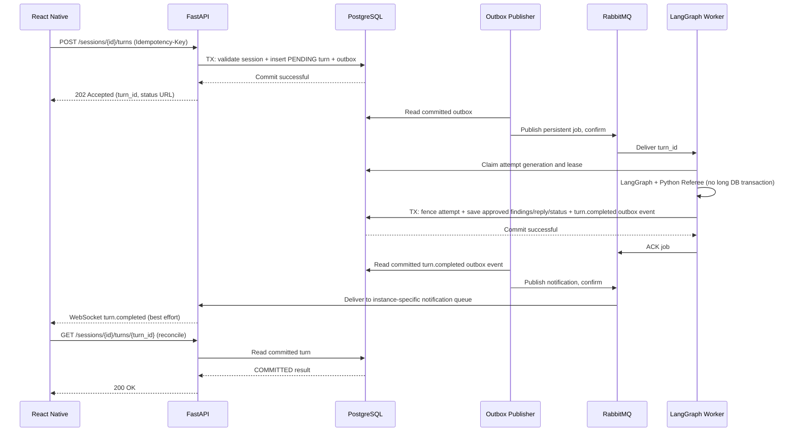

# ALIBI V1 — API Specification

**Phase:** 2 — System Architecture  
**Deliverable:** 5 of 7 — API Specification  
**Document version:** 1.0  
**Status:** Proposed interface contract based on Decisions 1–44; integration-dependent fields identified as open  
**Companion documents:** `alibi_phase2_01_architecture_design.md`, `alibi_phase2_02_database_erd.md`, `alibi_phase2_03_ai_agent_design.md`, `alibi_phase2_04_game_engine_specification.md`  
**Product requirements:** `prd.md`  
**Release:** Alibi V1

---

## 1. Purpose, Scope and Decision Boundaries

Define the **mobile-facing REST API, WebSocket protocol, authentication, schemas, errors, idempotency and recovery behavior** needed for Alibi V1. This is a contract to implement with FastAPI and Pydantic; it is not a claim that endpoint code already exists.

### Finalized architecture decisions

- React Native + Expo calls **FastAPI directly over HTTPS** for commands, queries and authoritative state recovery.
- **WebSockets** provide live status and completed responses; **REST polling** is the fallback.
- A player message is **durably accepted** in PostgreSQL, published through a transactional outbox to **RabbitMQ**, and processed by **LangGraph workers**. The HTTP submit request does **not** wait for model completion.
- Exactly **one active interrogation turn per session**. Subsequent different turns are rejected while one is pending/processing/retrying; an unresolved failed turn must be retried or the session safely abandoned.
- **Pydantic structured outputs** from AI are proposals. The Python Game Engine/Referee performs authoritative validation and state transitions before the response is exposed.
- Supabase Auth is the **preferred** managed auth provider, including guest accounts and identity linking; RevenueCat handles Apple/Google purchases.
- Server-only canonical truth, hidden evidence, private agent strategy and exact in-progress suspicion **must not be serialized to the mobile client**.

### Interface proposals introduced here

Endpoint names, field names, WebSocket event names, example JSON shapes and specific HTTP error mappings below are **proposed implementation contracts** to be reviewed against generated OpenAPI. They do **not** alter open product choices such as exact credit pricing, free allowances, rank thresholds, model timeouts, or the voice feature scope.

The mobile's **text-based interrogation** is the V1 API baseline. Real-time, interruptible audio transport is **not defined here**; if voice becomes a committed release requirement it needs a separate real-time media contract (WebRTC evaluation rather than assuming WebSockets are optimal for audio).

---

## 2. Conventions and Cross-Cutting Rules

| Item | Contract |
|---|---|
| REST base path | `/api/v1` |
| Transport | HTTPS (WSS for WebSockets); no plain HTTP/WS in production |
| Payload encoding | JSON, UTF-8; `snake_case` fields |
| Object identifiers | Opaque UUID strings; never derive authorization from knowing an ID |
| Timestamps | ISO 8601 UTC with explicit timezone, e.g. `2026-11-20T10:15:30Z` |
| Daily challenge date | ISO `YYYY-MM-DD` in one **server-configured reset timezone** (not device-local by default) |
| Authentication | `Authorization: Bearer <managed-auth-access-token>` on protected REST routes |
| Idempotency | `Idempotency-Key` header on commands that create sessions, turns or purchase effects |
| Caching | `Cache-Control: no-store` for private session, credit, account and result endpoints |
| Pagination | `limit` + opaque `cursor` where lists can grow; exact default/max limits remain configurable |
| Schema source | Pydantic request/response models; FastAPI publishes `/openapi.json`, `/docs`, `/redoc` as permitted by environment |
| Client contract | Mobile may generate TypeScript types from OpenAPI; no separate hand-maintained TypeScript schema is required |

### 2.1 Required security behavior

1. FastAPI verifies the managed-auth token and resolves it to the application's `users.id`. **Anonymous guest users are authenticated identities**, not unrestricted unauthenticated callers.
2. Every user-specific read or mutation applies server-side ownership checks. Return `404` for an inaccessible session/evidence item where this avoids existence disclosure.
3. Client-supplied `user_id`, `case_variation_id`, `canonical_fact_id`, suspicion, XP, credits, verdict and unlocked flags are **never authoritative**. Do not accept them in mutation schemas.
4. Never put database credentials, LLM API keys, hidden evidence, the detective-only investigation briefing, prompt internals or full AI graph state in client responses.
5. Apply body-length, request-rate, per-user, guest and abuse limits. Numerical thresholds are **not finalized**.
6. Do not log access tokens, purchase secrets, hidden case truth, or full private conversation text by default. Correlate requests using generated IDs.

### 2.2 Standard response conventions

- Use normal HTTP status codes. A successful asynchronous turn submit returns **`202 Accepted`** with stable identifiers and its current status.
- Return the **same resource identity** on idempotent replays, never a second charge or second turn.
- Status and error codes are stable machine-readable enum strings; human messages are display aids, not parsing targets.
- Use generic, non-spoiler errors for forbidden evidence rather than returning internal authorization reasons.

Example error envelope:

```json
{
  "error": {
    "code": "ACTIVE_TURN_EXISTS",
    "message": "Finish or recover the current turn before submitting another.",
    "request_id": "req_01",
    "details": {
      "active_turn_id": "22222222-2222-4222-8222-222222222222"
    }
  }
}
```

`details` must be explicitly allowlisted per error; it must never reveal hidden evidence or another user's records.

---

## 3. REST Endpoint Inventory

### 3.1 Account, profile and progression

| Method | Endpoint | Purpose | Auth |
|---|---|---|---|
| `GET` | `/me` | Resolve/create the application user for a valid auth identity and return player profile | Guest or registered |
| `PATCH` | `/me` | Update allowed profile fields (`display_name`, `avatar_url` under validation) | Guest or registered |
| `GET` | `/me/progression` | XP, rank, progress toward next rank, eligible unlocks | Guest or registered |
| `GET` | `/me/achievements` | Achievement definitions and earned state | Guest or registered |
| `GET` | `/me/unlocks` | Player-owned/unlocked detective and content summaries | Guest or registered |

**Authentication operations** such as anonymous sign-in, Google/Apple sign-in, token refresh and linking a new identity are handled by the chosen managed auth SDK—not reimplemented as custom password/JWT endpoints in FastAPI. `GET /me` provisions the internal `users` record when needed, idempotently on the provider's stable subject. Existing-account sign-in is **not an implicit merge** of two unrelated users.

Proposed `GET /me` response:

```json
{
  "id": "11111111-1111-4111-8111-111111111111",
  "display_name": "DetectiveDodger",
  "avatar_url": null,
  "is_guest": true,
  "total_xp": 540,
  "rank": { "code": "rookie", "name": "Rookie" }
}
```

Do not expose the auth provider's subject by default unless a client integration actually requires it.

### 3.2 Cases and detectives

| Method | Endpoint | Purpose | Auth |
|---|---|---|---|
| `GET` | `/cases` | List published/available cases, with category/difficulty/access filters | Guest or registered |
| `GET` | `/cases/{case_id}` | Public description, unlock requirements, player-visible preview | Guest or registered |
| `GET` | `/detectives` | List two launch personalities, availability and unlock state | Guest or registered |
| `GET` | `/detectives/{detective_id}` | Public detective bio/personality and access conditions | Guest or registered |

Proposed `GET /cases/{case_id}` response:

```json
{
  "id": "33333333-3333-4333-8333-333333333333",
  "title": "The Missing Necklace",
  "description": "A theft that happened during a private gathering.",
  "categories": ["SOCIAL_MYSTERY", "CRIME_MYSTERY"],
  "recommended_difficulty": "INTERMEDIATE",
  "access": {
    "available": true,
    "requires_case_pack": false
  }
}
```

**Catalog exclusions:** no unplayed variation truth, hidden witnesses, canonical facts, undisclosed evidence, detective-held briefing or intended final outcome. Public previews must be author-reviewed to avoid spoilers.

Detective response fields should include `id`, `name`, `public_description`, `is_unlocked`, `unlock_requirement` (safe public copy) and `is_selectable`. Never send private strategy prompts or agent configuration assets.

### 3.3 Interrogation sessions

| Method | Endpoint | Purpose | Auth | Idempotency |
|---|---|---|---|---|
| `POST` | `/sessions` | Create a paid/free-funded session and pin a published case variation | Owner | Required |
| `GET` | `/sessions` | List user's sessions, optionally filtered by status | Owner | — |
| `GET` | `/sessions/active` | Retrieve the single current `CREATED` or `ACTIVE` session if present | Owner | — |
| `GET` | `/sessions/{session_id}` | Resume: session metadata, briefing, current state and active-turn pointer | Owner | — |
| `POST` | `/sessions/{session_id}/activate` | Move `CREATED` → `ACTIVE` after briefing | Owner | Transition itself idempotent |
| `POST` | `/sessions/{session_id}/abandon` | End an unfinished session without a verdict | Owner | Idempotent transition |
| `GET` | `/sessions/{session_id}/turns` | Ordered, player-visible interrogation history | Owner | — |
| `POST` | `/sessions/{session_id}/turns` | Accept one new player message for asynchronous processing | Owner | Required |
| `GET` | `/sessions/{session_id}/turns/{turn_id}` | Authoritative turn status, reply or safe failure | Owner | — |
| `POST` | `/sessions/{session_id}/turns/{turn_id}/retry` | Recover an existing `FAILED` turn; never create a replacement sequence number | Owner | Same turn resource; retry authorization checked |
| `GET` | `/sessions/{session_id}/result` | Completed verdict, exact suspicion and case breakdown | Owner | — |

**Route declaration caution:** Static paths such as `/sessions/active` must take priority over variable paths such as `/sessions/{session_id}` in FastAPI routing.

#### 3.3.1 Create session

```http
POST /api/v1/sessions
Authorization: Bearer <access-token>
Idempotency-Key: a19693f8-9e0a-437e-b5d6-81566e99e6ee
Content-Type: application/json
```

```json
{
  "case_id": "33333333-3333-4333-8333-333333333333",
  "detective_id": "44444444-4444-4444-8444-444444444444",
  "difficulty": "INTERMEDIATE"
}
```

**On the server, in one database transaction:** verify user, active-session uniqueness, detective access, case-pack entitlement, chosen difficulty and configured free allowance/credit; select and pin a published immutable `case_variation_id`; create the session; reserve/spend the permitted **session-level** allowance exactly once. Do not charge per turn.

Proposed `201 Created` response:

```json
{
  "id": "55555555-5555-4555-8555-555555555555",
  "status": "CREATED",
  "case": {
    "id": "33333333-3333-4333-8333-333333333333",
    "title": "The Missing Necklace"
  },
  "detective": {
    "id": "44444444-4444-4444-8444-444444444444",
    "name": "Detective"
  },
  "difficulty": "INTERMEDIATE",
  "briefing": {
    "player_role": "GUILTY",
    "introduction": "The necklace disappeared during the evening party.",
    "player_information": ["You attended the gathering as a guest."]
  },
  "suspicion_level": "LOW",
  "completed_turn_count": 0,
  "active_turn_id": null
}
```

The `briefing` represents **authorized player knowledge** for the pinned variation. Its actual fields depend on the curated case format. The example is not canonical case truth or a real published case. The backend is free to withhold even a variation identifier if it is unnecessary for mobile.

A repeated submission with the **same key and identical canonicalized request body** returns the same session (typically `200 OK`) with **no additional credit debit**. The same key with a different body returns `409 IDEMPOTENCY_KEY_REUSED`.

**ERD follow-up required:** add durable `create_request_id` and body hash to `game_sessions`, or a dedicated session idempotency record keyed by user and request ID. Decision 28/33 require this behavior; Document 2 did not fix the storage field. Do not claim session-creation idempotency is implemented until that schema gap is closed.

#### 3.3.2 Activate or resume

- `POST /sessions/{id}/activate`: from `CREATED` to `ACTIVE`. Repeat calls return current `ACTIVE` state. If already completed/abandoned, return a state conflict. Opening lines may be authored/precomputed; **whether activation generates any AI work remains open**. It must not silently create an ordinary player turn.
- `GET /sessions/active`: response is the session view or `204 No Content` when none exists. Because only one unfinished session is allowed in V1, no selection ambiguity arises.
- `GET /sessions/{id}`: returns the latest committed session view and a pointer to any active turn. `GET /sessions/{id}/turns` gives full ordered, approved conversation history. If the app disconnected mid-turn, **GET that original turn**; do not send its message again with a new key.
- `POST /sessions/{id}/abandon`: explicit action only—closing the app does not abandon the session. The server must fence any active worker before committing abandonment. If a safe fence cannot yet be established, return `409 TURN_IN_PROGRESS` instead of racing an unfinished attempt. Credit refund policy for abandonment is **not finalized**.

#### 3.3.3 Submit turn and retrieve result

```http
POST /api/v1/sessions/55555555-5555-4555-8555-555555555555/turns
Authorization: Bearer <access-token>
Idempotency-Key: 519e8109-735d-48d4-9c87-62b2413010d6
Content-Type: application/json
```

```json
{
  "message": "I was home around nine. That CCTV footage must be wrong."
}
```

Proposed first response, `202 Accepted`:

```json
{
  "turn_id": "66666666-6666-4666-8666-666666666666",
  "session_id": "55555555-5555-4555-8555-555555555555",
  "sequence_no": 3,
  "status": "PENDING",
  "submitted_at": "2026-11-20T10:15:30Z",
  "status_url": "/api/v1/sessions/55555555-5555-4555-8555-555555555555/turns/66666666-6666-4666-8666-666666666666"
}
```

**On submit:** verify owned `ACTIVE` session; check no unfinished prior `FAILED` turn and no other `PENDING/PROCESSING/RETRYING` turn; validate input bounds; write new `PENDING` turn **and outbox event atomically**. Return immediately, without awaiting RabbitMQ publication or a model response.

**Idempotency:** the header value maps to `interrogation_turns.client_request_id` (scoped to the session). The same key and same body hash return that exact `turn_id` and current state; if the existing turn is still processing return `202`, if already completed return `200`. Reusing a key for changed input returns `409`. A different key while a turn is active returns `409 ACTIVE_TURN_EXISTS`. A new turn following an unresolved `FAILED` turn returns `409 PREVIOUS_TURN_UNRESOLVED`.

While processing, authoritative `GET /sessions/{sid}/turns/{tid}` might return:

```json
{
  "id": "66666666-6666-4666-8666-666666666666",
  "sequence_no": 3,
  "status": "PROCESSING",
  "player_message": "I was home around nine. That CCTV footage must be wrong.",
  "detective_response": null,
  "visible_suspicion_level": null,
  "error": null
}
```

Once validated and **committed**:

```json
{
  "id": "66666666-6666-4666-8666-666666666666",
  "sequence_no": 3,
  "status": "COMPLETED",
  "player_message": "I was home around nine. That CCTV footage must be wrong.",
  "detective_response": "You think the recording is wrong? Then explain what makes you so sure.",
  "visible_suspicion_level": "MODERATE",
  "revealed_evidence_ids": [],
  "session_status": "ACTIVE",
  "result_available": false,
  "completed_at": "2026-11-20T10:15:46Z",
  "error": null
}
```

The detective line is illustrative and deliberately **does not claim a nonexistent CCTV record is verified**. The backend can reveal specific evidence only after checking its existence, pinned-variation membership and disclosure policy.

If processing fails after bounded retries:

```json
{
  "id": "66666666-6666-4666-8666-666666666666",
  "sequence_no": 3,
  "status": "FAILED",
  "player_message": "I was home around nine. That CCTV footage must be wrong.",
  "detective_response": null,
  "error": {
    "code": "TURN_PROCESSING_FAILED",
    "message": "We couldn't finish this response. Retry this turn."
  },
  "retry_allowed": true
}
```

`POST /sessions/{sid}/turns/{tid}/retry` acts on the **same** turn and message, and requeues the work under a fresh worker attempt generation when allowed. It must **not** incur a new interrogation credit charge. Repeated retry requests that find the turn already pending/processing return its current state rather than enqueueing duplicates. If the turn has completed, return its completed resource. Do not allow a later turn to bypass the failed turn.

### 3.4 Player-visible evidence interactions

| Method | Endpoint | Purpose | Auth |
|---|---|---|---|
| `GET` | `/sessions/{session_id}/evidence` | List evidence already available to the player in this session | Owner |
| `GET` | `/sessions/{session_id}/evidence/{evidence_id}` | Read one authorized evidence item | Owner |
| `POST` | `/sessions/{session_id}/evidence/{evidence_id}/inspect` | Record an authorized inspection, if it matters for gameplay | Owner |

Natural-language challenges and disclosure requests (e.g. “Let me see the CCTV report”) remain ordinary **turn messages**, parsed and evaluated by the AI; they are not assumed to be client-chosen secret IDs.

A successful evidence response may contain `id`, `type`, `display_title`, `player_visible_description`, `media_url` (when authorized), `disclosed_at`, `inspected_at` and `can_challenge`. No hidden witness/canonical fact metadata or signed storage credentials with excessive lifetime.

- A missing/undisclosed/unauthorized item returns **404** (not a complete list of secret IDs).
- The inspect command validates ownership and allowed visibility; it records `inspected_at` idempotently.
- **Interleaving rule:** if an inspection mutates state that could influence an active LangGraph turn, reject it with `409 TURN_IN_PROGRESS` or serialize it through the same turn boundary. A read-only `GET` may proceed safely.
- Authorized time-limited media URLs must be issued server-side; client-supplied media paths are never trusted.

### 3.5 Final result

`GET /sessions/{session_id}/result` returns **404 or a typed `RESULT_NOT_READY` conflict** (choose one consistently in implementation) until the session is `COMPLETED`. When complete:

```json
{
  "session_id": "55555555-5555-4555-8555-555555555555",
  "status": "COMPLETED",
  "outcome": "PLAYER_WIN",
  "final_suspicion_score": 38,
  "suspicion_level": "MODERATE",
  "performance_rating": "GOOD",
  "successful_defenses": [
    { "description": "Clarified the time of departure." }
  ],
  "important_contradictions": [
    { "description": "Conflicting accounts of when you left.", "status": "RESOLVED" }
  ],
  "missed_opportunities": [],
  "detective_monologue": "Not the story I expected. Enjoy the victory while it lasts.",
  "share_card": {
    "case_title": "The Missing Necklace",
    "outcome": "PLAYER_WIN",
    "rating": "GOOD"
  }
}
```

All values are illustrative—not finalized scoring thresholds or story content. Unlike in-progress turn responses, the completed result **may show the exact numerical suspicion score**. Share-card fields must be curated to avoid exposing undisclosed case truth or private player dialogue.

---

## 4. Daily Challenge APIs

| Method | Endpoint | Purpose |
|---|---|---|
| `GET` | `/daily-challenge` | Today's globally shared featured variation's safe public description, date, availability and player's participation status |
| `POST` | `/daily-challenge/start` | Idempotently create or resume the authorized challenge session using the same session/credit rules |

Proposed request for `POST /daily-challenge/start`:

```json
{
  "detective_id": "44444444-4444-4444-8444-444444444444",
  "difficulty": "INTERMEDIATE"
}
```

The client does **not** choose `case_variation_id` or the reset date. FastAPI resolves today's `daily_challenges` record using the configured server timezone, enforces unique `(user_id, daily_challenge_id)` participation and the one-active-session rule, and links `user_daily_challenges.game_session_id` transactionally.

- Require `Idempotency-Key` and dedupe across retries.
- Duplicate start attempts for the same player's challenge return the existing session if resuming is permitted; never grant a second daily reward.
- `GET /daily-challenge` must not leak hidden case truth before play.
- Exact free-session allowance, difficulty restrictions, challenge date reset timezone and replay policy remain **open**.

---

## 5. Store, Credits and RevenueCat APIs

| Method | Endpoint | Purpose |
|---|---|---|
| `GET` | `/store` | Server-approved products, pack metadata and display/catalog identifiers |
| `GET` | `/me/entitlements` | Purchased/available case-pack entitlements |
| `GET` | `/me/credits` | Current available session-credit balance and any configured allowance summary |
| `POST` | `/purchases/verify` | Trigger backend reconciliation of a client-observed purchase; **not** an untrusted grant command |
| `POST` | `/webhooks/revenuecat` | Receive trusted RevenueCat purchase lifecycle notifications (separate webhook auth) |

The mobile app initiates Apple/Google purchase through the RevenueCat SDK. The server maps **verified** store/RevenueCat transaction identifiers to the server-side `store_products` catalog, then updates `purchases`, `purchase_events`, `user_entitlements`, `credit_transactions` and cached user balance transactionally/idempotently.

### 5.1 Purchases are not client-authorized

The client may provide a transaction **reference** to `/purchases/verify` to request a server-side verification lookup; it must never send `credits_to_add`, `purchase_verified: true`, or `unlock_pack: true` as authority. The exact lookup fields must be finalized **against the actual RevenueCat SDK and webhook payloads** before the Pydantic contract is frozen. A client request may return `202 PENDING_VERIFICATION` until trusted confirmation is obtained.

### 5.2 Webhook intake and idempotency

1. Authenticate incoming RevenueCat webhook requests using the configured provider webhook credentials/protocol; **do not** require a player Supabase JWT on this endpoint.
2. Persist the event's unique delivery/event ID and sanitized payload in `purchase_events` under a unique constraint; duplicate deliveries return a successful acknowledgment without repeating purchase effects.
3. Reconcile the underlying store transaction and owner identity, then atomically grant/revoke case-pack rights or append credit ledger movements.
4. Treat **purchase, refund and revocation** as distinct lifecycle events; duplicate transaction IDs do not imply duplicate events.
5. If reconciliation needs retry, durably retain the event; do not silently acknowledge an unpersisted event as processed.
6. Session-level spending is handled by the session creation transaction, **not** by the purchase webhook or each chat turn.

**Open business policies:** credit quantities/prices, free allowances, purchase restore behavior for unrelated accounts, and treatment of already-spent credits after a refund. This API document must not invent them.

---

## 6. WebSocket Protocol — Live Status and Responses

### 6.1 Connection and authorization

**Endpoint:** `wss://<api-host>/api/v1/ws` (production; host configured per environment).

**Proposed, transport-neutral authentication handshake:** Open the WSS connection, then send an `auth` JSON frame with the managed-auth access token as the **first application message**. The server verifies the token before accepting any subscriptions or emitting private events. It closes unauthorized or unauthenticated connections with an appropriate policy close code. The token must not be logged or placed in a URL query string.

```json
{ "type": "auth", "access_token": "<managed-auth-token>" }
```

Successful authentication acknowledgment:

```json
{
  "type": "auth.ok",
  "payload": { "authenticated": true }
}
```

This is a **proposed handshake**; implementation will confirm Expo/React Native WebSocket behavior and enforce token expiry/reconnect/refresh. The backend must validate ownership **again** when a client subscribes to a session. Browser-style cookies or URL tokens are not assumed.

Subscribe to updates for one owned session:

```json
{
  "type": "session.subscribe",
  "session_id": "55555555-5555-4555-8555-555555555555"
}
```

Server responds `session.subscribed` if authorized, or a sanitized `error` event otherwise. The app can unsubscribe or disconnect. Server heartbeats/ping-pong, connection limits and idle deadlines are configurable and **not finalized**.

### 6.2 Server event envelope

```json
{
  "event_id": "77777777-7777-4777-8777-777777777777",
  "type": "turn.status_changed",
  "occurred_at": "2026-11-20T10:15:32Z",
  "session_id": "55555555-5555-4555-8555-555555555555",
  "turn_id": "66666666-6666-4666-8666-666666666666",
  "payload": {
    "status": "PROCESSING"
  }
}
```

**Event names and safe payloads (proposed):**

| Event | Meaning | Allowed player-facing data |
|---|---|---|
| `turn.status_changed` | Accepted turn entered `PENDING`, `PROCESSING` or `RETRYING` | Turn ID, state, generic activity indicator |
| `turn.completed` | Approved reply committed | Turn ID, sequence, detective response, visible suspicion level, newly disclosed **authorized** evidence IDs |
| `turn.failed` | Turn permanently failed for now | Turn ID, safe error code, whether retry is available |
| `session.completed` | Final result committed | Session ID, `result_available: true`, result retrieval URL; avoid duplicating full private verdict unnecessarily |
| `session.status_changed` | Session activation/abandonment changed | Session ID and public session status |
| `error` | Auth/subscription/frame error | Sanitized code and action needed; no sensitive detail |

### 6.3 Delivery, order and reconnect guarantees

- **Events are hints, not authoritative writes.** A WebSocket message must represent a **previously committed** status or approved result; never stream raw, unvalidated LLM tokens as player dialogue.
- WebSocket events can be delayed, duplicated or missed during reconnect. **Do not promise exactly-once delivery** or in-order notifications across reconnects.
- `event_id` allows client-side deduplication when received; it **does not imply a persistent replay cursor**. Replay storage and resume cursors have **not been selected**.
- After reconnect, authenticate and resubscribe; fetch `GET /sessions/{id}` plus the existing active/completed turn via REST to reconcile authoritative state.
- If two devices use the same user identity, both may receive session updates, but only the server permits one active turn and applies ownership/idempotency checks.

#### Worker-to-WebSocket Notification Delivery

1. LangGraph worker completes a turn.
2. PostgreSQL atomically commits the turn result and a `turn.completed` outbox event.
3. Outbox publisher publishes the event to RabbitMQ.
4. FastAPI consumes the notification from its instance-specific notification queue.
5. FastAPI checks active session subscriptions.
6. The event is forwarded to authorized WebSocket clients.

RabbitMQ notifications are best-effort client delivery. PostgreSQL remains authoritative.

On reconnect, mobile retrieves the current session and turn state through REST.

Duplicate or delayed WebSocket events must be handled using `event_id` and `turn_id`.

### 6.4 What WebSockets do *not* own

- In V1, the mobile app submits official player messages by **REST**, not WebSocket, so `Idempotency-Key` and `202 Accepted` remain consistent.
- WebSockets cannot authorize case evidence, determine suspicion, commit a verdict, or maintain the only copy of a chat message.
- A voice mode with live microphone frames and interruptions is **outside this text-event protocol**; separate its transport and consent/recording rules if added.

---

## 7. Sequence Diagrams

### 7.1 Successful asynchronous interrogation turn



### 7.2 Disconnect, duplicate submit and stale worker

```mermaid
sequenceDiagram
    participant M as Mobile
    participant A as FastAPI
    participant D as PostgreSQL
    participant W1 as Old worker attempt
    participant W2 as Current worker attempt

    M->>A: POST turn A (key K)
    A->>D: Save turn A + outbox
    A-->>M: 202 (turn A)
    Note over M: Mobile connection drops
    W1->>D: Claim generation 1
    Note over W1: Slow provider call; attempt lease expires
    W2->>D: Claim generation 2
    W2->>D: Commit approved turn A (generation 2)
    W1->>D: Try late commit (generation 1)
    D-->>W1: Fencing failure; discard result
    M->>A: Retry POST using same key K
    A->>D: Look up original turn A
    A-->>M: 200 with original completed turn A
    Note over M,A: New turn B may now be submitted
```

**Critical invariant:** An AI reply is not visible until validation and database commit finish. Duplicate jobs and late workers may consume AI tokens, but cannot duplicate authoritative state changes or reorder player turns.

---

## 8. HTTP Codes and Machine-Readable Errors

| HTTP | Error code | When | Client behavior |
|---|---|---|---|
| `400` | `INVALID_REQUEST` | Invalid or unsupported non-schema request | Correct request |
| `401` | `UNAUTHENTICATED` | Missing/expired/invalid managed-auth token | Refresh/login |
| `403` | `CASE_NOT_UNLOCKED` | Case access not granted | Display unlock/store options |
| `403` | `DETECTIVE_LOCKED` | Detective unavailable to player | Show unlock requirement |
| `403` | `INSUFFICIENT_SESSION_ALLOWANCE` | No configured free allowance or available session credit | Display credits/store options |
| `404` | `RESOURCE_NOT_FOUND` | Resource absent or not owned | Do not reveal whether another user's resource exists |
| `409` | `ACTIVE_SESSION_EXISTS` | Starting a second unfinished session | Resume existing session |
| `409` | `ACTIVE_TURN_EXISTS` | Different message while current turn is pending/processing/retrying | Retrieve/wait for current turn |
| `409` | `PREVIOUS_TURN_UNRESOLVED` | Prior turn is `FAILED` and not recovered | Retry same turn or safely abandon |
| `409` | `IDEMPOTENCY_KEY_REUSED` | Same key but differing payload | Generate correct new key after resolving state |
| `409` | `INVALID_SESSION_STATE` | Illegal session transition | Refresh session |
| `409` | `TURN_IN_PROGRESS` | Conflicting state-changing evidence/abandon action | Retry after turn is settled |
| `422` | `VALIDATION_ERROR` | Pydantic schema, allowed enum or length failure | Correct fields |
| `429` | `RATE_LIMITED` | Player/guest/IP budget exceeded | Honor `Retry-After` if present |
| `500` | `INTERNAL_ERROR` | Unexpected server failure | Safe retry/recovery by idempotency key |
| `503` | `SERVICE_UNAVAILABLE` | Queue, broker or storage outage / overload | Backoff; check accepted turn before re-submitting |

These are **proposed mappings**, not a claim that every branch is implemented. A client-side timeout is **not proof** that the server rejected a POST. Always reconcile its idempotency key or previously observed resource before deciding to submit again.

### 8.1 Important distinction: `202` acceptance vs. job completion

`202` means **the turn and outbox transaction committed**. It does not mean the worker began or completed. Once accepted, transient RabbitMQ or model outages must be reflected in subsequent turn status/retries; do not silently lose the player message.

If the initial database transaction fails, return a non-2xx response and do not claim acceptance. A broker outage **after** a committed outbox event is not grounds to roll back an already accepted turn; the publisher retries later.

---

## 9. Idempotency, Concurrency and Transaction Rules

### 9.1 Identifiers and scoping

| Operation | Identity | Required durable invariant |
|---|---|---|
| Session creation | `(user_id, Idempotency-Key)` + body hash | One session and at most one session-level funding debit |
| Turn submission | `(session_id, client_request_id)` + body hash | One accepted turn ID/sequence per original message |
| Turn processing | `(turn_id, attempt_generation)` | Only current leased/fenced generation can commit |
| XP award | `(user_id, xp_event.idempotency_key)` | No duplicate rewards |
| Session credit spend | Unique session-spend ledger entry | No double charge for creation/retry |
| RevenueCat event | Unique provider event ID | No duplicated webhook side effects; refunds still processed |

### 9.2 Turn-state contract

```text
PENDING  -> PROCESSING -> COMPLETED
                    \-> RETRYING -> PROCESSING
                    \-> FAILED
FAILED   -> RETRYING (same turn ID, explicit safe retry)
```

`COMPLETED` is terminal for a turn. Next message is not accepted while the previous turn is nonterminal or has failed unresolved. A session can reach `COMPLETED` only when the current approved turn and authoritative verdict transaction commit together.

### 9.3 Worker and API separation

- FastAPI transaction commits turn + outbox; no LLM call in that transaction.
- Publisher sends a persistent RabbitMQ job, uses publisher confirms and records publication progress; duplicate publication is possible and tolerated.
- Worker claims a DB-backed lease/generation; runs LangGraph and selective semantic checks without holding row locks across model calls.
- Before state write, worker validates claim/evidence provenance, the pinned variation, attempt ownership, session `version`, and rule-based scoring. Commit must be atomic for all approved effects.
- Stale worker results are discarded even if a model call eventually succeeds.
- Turn completion notifications are emitted **after** commit and must be recoverable by GET if lost.

### 9.4 Failed and abandoned sessions

A failure during AI processing is recorded on the **turn**, not by setting the whole session to an invented terminal `FAILED` state. For sessions use only `CREATED`, `ACTIVE`, `COMPLETED`, `ABANDONED` unless the Game Engine Specification explicitly changes.

A failed turn retry reuses the same player input and sequence number; no additional credit is charged. Abandonment must block late workers through version/attempt fencing. Whether abandonment refunds a session credit remains a **commercial policy not yet specified**.

---

## 10. Pydantic / OpenAPI Contract Organization

Suggested modules (not necessarily a new top-level package per item):

```text
app/api/v1/
├── routers/
│   ├── me.py
│   ├── cases.py
│   ├── detectives.py
│   ├── sessions.py
│   ├── evidence.py
│   ├── daily_challenge.py
│   ├── store.py
│   └── purchase_webhooks.py
├── schemas/
│   ├── common.py
│   ├── account.py
│   ├── catalogs.py
│   ├── sessions.py
│   ├── turns.py
│   ├── evidence.py
│   ├── results.py
│   ├── progression.py
│   ├── daily_challenge.py
│   └── commerce.py
└── websocket/
    ├── gateway.py
    └── events.py
```

Illustrative Pydantic enums and inputs:

```python
from enum import Enum
from uuid import UUID
from pydantic import BaseModel, ConfigDict, Field


class Difficulty(str, Enum):
    ROOKIE = "ROOKIE"
    INTERMEDIATE = "INTERMEDIATE"
    EXPERT = "EXPERT"


class SessionStatus(str, Enum):
    CREATED = "CREATED"
    ACTIVE = "ACTIVE"
    COMPLETED = "COMPLETED"
    ABANDONED = "ABANDONED"


class TurnStatus(str, Enum):
    PENDING = "PENDING"
    PROCESSING = "PROCESSING"
    RETRYING = "RETRYING"
    COMPLETED = "COMPLETED"
    FAILED = "FAILED"


class SessionCreateRequest(BaseModel):
    model_config = ConfigDict(extra="forbid")
    case_id: UUID
    detective_id: UUID
    difficulty: Difficulty


class TurnSubmitRequest(BaseModel):
    model_config = ConfigDict(extra="forbid")
    message: str = Field(min_length=1)  # max_length: config/TBD
```

**Do not** reuse database ORM models or internal LangGraph Pydantic schemas as public API response schemas. Define explicit player-facing serializers to prevent accidental exposure when private database columns are added.

Required OpenAPI behaviors:

1. All routes have request and `response_model` schemas (including errors as applicable).
2. Authentication and idempotency headers are declared and tested.
3. Explicit schema constraints forbid client-mutated authoritative fields.
4. Example JSON is kept consistent with generated OpenAPI, not maintained as a second incompatible specification.
5. **WebSocket messages** have separately versioned JSON schemas or typed server/client contracts; OpenAPI alone does not define them.
6. Generated TypeScript types for `alibi-mobile` are derived from a tagged backend OpenAPI artifact or controlled published schema to avoid silent mobile/backend drift.

---

## 11. Security and Privacy Test Matrix

| Test | Required result |
|---|---|
| Player A reads Player B's session, turn, result or evidence | 404/denied without data leakage |
| Client requests hidden evidence ID | No disclosure; not enumerated in list/detail |
| Client sends `suspicion_score`, `verdict`, `credits`, `user_id` in turn request | Rejected/ignored by strict schema; never authoritative |
| Guest links a new identity to the same auth account | Existing internal `users.id`, XP, credits and unlocks remain attached |
| Player logs into a different preexisting account | No automatic merge of guest purchases/XP/credits |
| Concurrent turn submit with two different keys | Exactly one accepted; other `409` |
| Retry same key after HTTP timeout | Original turn returned; no duplicate turn |
| Worker crashes after DB commit but before broker ACK | Redelivery sees completed turn; no extra score, response or XP |
| Old worker completes after a newer generation | Fencing blocks stale changes |
| Purchases verified only from client payload | Rejected as untrusted; trusted provider verification required |
| Duplicate RevenueCat event or later refund event | Duplicate ignored; genuine refund applied according to policy |
| WebSocket subscribes to another user's session | Subscription denied; no private events |
| WebSocket reconnect misses a completion | REST returns authoritative committed result |
| Result endpoint queried before session completes | No exact score or premature verdict revealed |
| Log/error payload during failure | No provider tokens, hidden evidence or raw agent prompts leaked |

---

## 12. Performance, Availability and Observability Contracts

- **Fast acceptance:** `POST /turns` covers validation and durable DB/outbox write, **not** LLM processing. No hard acceptance-latency SLO is committed until VPS testing.
- **Separate completion measurement:** monitor accepted-to-worker, queue wait, per-graph-node latency, total turn completion latency, and model tokens/costs per retry/attempt.
- **High-contention behavior:** at most one active turn per session; different players' sessions can process concurrently subject to broker, worker, provider and VPS capacity.
- **Restored operation:** after API restart, WS reconnect, network timeout or worker crash, query DB state by session/turn ID rather than assuming the process's memory survived.
- **Rate limits/overload:** advertise `429` with retry guidance when appropriate; fail session/turn **acceptance** clearly on DB unavailability and never claim success before the transaction commits.
- **Tracing:** include `request_id`, `session_id` and `turn_id` in server spans/log metadata; attach attempt generation to worker traces, but **do not reveal worker internals to players**.
- **Privacy:** cache prevention for sensitive data, minimized error payloads, HTTPS/WSS, verified authentication, and no unrevealed case data in telemetry.

---

## 13. Open Items and Cross-Document Updates

These are **real remaining implementation details**, not newly finalized features:

| Item | Required follow-up |
|---|---|
| Session creation idempotency persistence | Add request ID/body hash to ERD or dedicated table; unique per user; atomic funding association |
| Case briefing response details | Finalize player-visible authored metadata after first case content is written; no hidden truth exposure |
| WebSocket worker-to-API event relay | Choose and document cross-container transport; test lost/duplicate event recovery |
| WebSocket authentication behavior | Verify Expo runtime handling, token expiry, refresh and multi-device connections |
| Initial detective opening | Decide authored/precomputed vs asynchronous AI generation on activation; don't invent a counted turn |
| RevenueCat reconciliation fields | Confirm exact SDK identifiers/webhook payloads and secure event validation |
| Free allowance and refunds | Finalize start/abandon/refund policy without per-message charging |
| Daily reset and challenge replay | Choose one server timezone and official retry/replay policy |
| Page limits, user text lengths, quotas | Benchmark/security test; do not hardcode unsupported numerical targets |
| Storage/signed media URLs | Define player-visible evidence media security and expiration if asset evidence is needed |
| WebSocket event schema publication | Generate/maintain separate typed JSON schema; event replay is **not promised** |
| Semantic verification behavior | Never emit generated text before its evidence assertions are grounded/validated and committed |

### Phase 3 and later hand-off

Phase 3 should implement the **foundation** (FastAPI application, PostgreSQL/Alembic, RabbitMQ/outbox, worker skeleton, authentication dependency stubs/health endpoints, observability and CI). Full content, LangGraph intelligence, scoring and commerce endpoints are implemented in their respective later workstreams—not falsely marked complete when only API schemas exist.

---

## 14. Acceptance Criteria for This API Design

- [ ] Route inventory covers profile/progression, cases/detectives, sessions, turns, evidence, results, daily challenges and purchases.
- [ ] Session and turn JSON distinguish player-visible and server-only state; no hidden facts or exact mid-game suspicion leak.
- [ ] Turn POST is `202` after DB/outbox commit and returns stable `turn_id` for recovery.
- [ ] Duplicate submissions and different concurrent submissions have unambiguous idempotency/conflict behavior.
- [ ] Failed-turn retry operates on the same turn and cannot be skipped by a later message.
- [ ] WebSocket auth, subscription, events and reconnection use REST as source of truth.
- [ ] Purchase verification does not trust client-supplied success; RevenueCat lifecycle events are deduplicated without losing refunds.
- [ ] Session credit funding is once per session; player messages are never charged individually.
- [ ] FastAPI OpenAPI is the authoritative REST schema and WebSocket contracts are separately typed.
- [ ] ERD idempotency gap and remaining commercial details are explicitly handed off rather than silently assumed resolved; notification delivery uses the selected RabbitMQ flow.

**Document conclusion:** Alibi V1 uses **durable REST commands and recovery**, **WebSocket live notifications**, and **server-controlled validation** around asynchronous AI turns. The mobile client may disconnect or retry, and workers may crash or duplicate messages, without duplicating turns, leaking hidden evidence, or bypassing the referee's authoritative session state.
