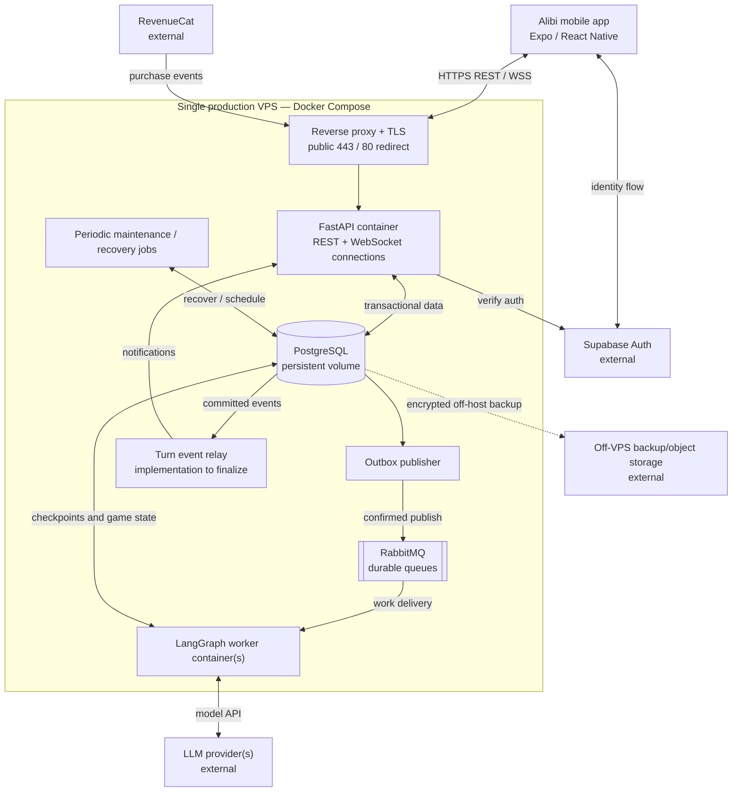
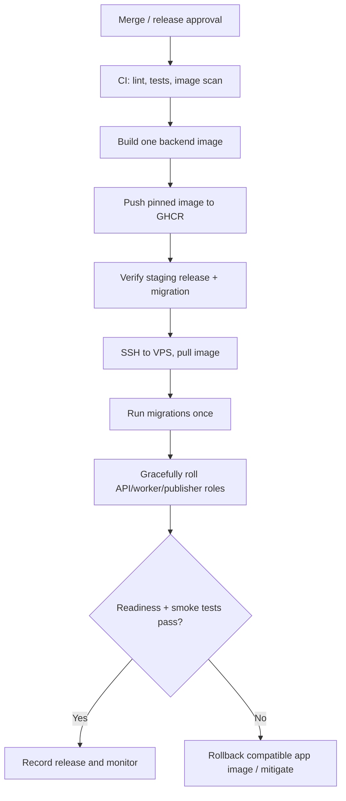

# ALIBI V1 — Infrastructure Design

**Phase:** 2 — System Architecture  
**Deliverable:** 6 of 7 — Infrastructure Design  
**Release:** Alibi V1  
**Document version:** 1.0  
**Status:** Design specification; deployment and benchmark-dependent values remain open  
**Companion documents:** `alibi_phase2_01_architecture_design.md`, `alibi_phase2_02_database_erd.md`, `alibi_phase2_03_ai_agent_design.md`, `alibi_phase2_04_game_engine_specification.md`, `alibi_phase2_05_api_specification.md`

---

## 1. Purpose, Scope and Locked Decisions

This document specifies **how Alibi V1 is hosted, deployed, operated, secured, observed and recovered**. It translates the finalized architecture decisions into an implementable production topology without prematurely selecting an untested VPS size, LLM provider, or numerical latency/cost budget.

### Locked architecture decisions

| Area | Agreed decision |
|---|---|
| Source repositories | Separate `alibi-mobile` and `alibi-backend` repositories |
| Mobile release | React Native + Expo; its build/distribution pipeline is separate from the backend |
| Backend shape | FastAPI modular monolith; LangGraph and Python referee in the same backend codebase |
| Execution model | REST accepts turns; dedicated **asynchronous workers** execute LangGraph |
| Work broker | **RabbitMQ**, not a PostgreSQL-based job queue or Redis Streams |
| Durable truth | PostgreSQL for sessions, turns, claims, evidence state, purchases, checkpoints, and transactional outbox |
| Deployment | **Single VPS + Docker Compose** for the initial Alibi V1 deployment |
| Delivery | GitHub Actions → GHCR → pull versioned images on VPS → controlled Compose rollout |
| Real-time updates | WebSockets for committed turn/status events, REST for commands and reconnect reconciliation |
| Identity / purchases | Supabase Auth preferred for managed + anonymous identities; RevenueCat for in-app purchases |
| Telemetry | Structured JSON logs, OpenTelemetry, Sentry, per-model-call usage and cost records |
| Optional pieces | Redis, vector database, Kubernetes, separate AI microservice are **not required** |

**Non-negotiable invariants:** canonical evidence remains immutable for a pinned variation; one active turn per session; authenticated ownership enforcement; at-least-once message delivery with **at-most-once committed turn effects**; no partial game-state commits; long LLM calls never depend on an open client HTTP connection; no hidden case truth is sent to the mobile client.

**Important boundary:** The single VPS is **not highly available**. Multiple worker containers on that VPS do not provide protection against VPS/provider failure. Backups and restoration reduce recovery risk but do not turn this topology into HA.

---

## 2. Production Topology and Traffic Boundaries



The turn-processing route is: **API → PostgreSQL transaction (turn + outbox) → publisher → RabbitMQ → worker → LangGraph → referee → PostgreSQL final commit → notification relay → WebSocket**. The player's authoritative answer is also always readable through REST. The notification path is **not** responsible for durability.

### Network exposure

| Entry point | Exposure | Reason |
|---|---|---|
| HTTPS 443 | Public through reverse proxy | Mobile REST, WebSocket upgrade, verified RevenueCat webhook |
| HTTP 80 | Public only for redirect / certificate challenges | No gameplay traffic served in plaintext |
| SSH | Restricted to administrator IP/VPN or strong authenticated access | Operational deployment; avoid password login |
| FastAPI container port | **Internal only** | Proxy is the sole internet-facing application entry point |
| PostgreSQL 5432 | **Internal only** | No direct public or mobile database access |
| RabbitMQ AMQP 5672 | **Internal only** | Used by publisher/worker; no outside broker access |
| RabbitMQ management 15672 | **Internal or SSH tunnel only** | Administrative access; never publicly exposed by default |
| Metrics / tracing exporters | Internal only unless protected | Metrics must not leak operational or user identifiers |

**Recommended host layout:** one private Docker network for application dependencies and one proxy-facing network; persistent named volumes for PostgreSQL and RabbitMQ; a separate protected host path for secret/config files; limited log storage. Firewall rules apply at both cloud/VPS and host levels where available.

---

## 3. Containers and Responsibilities

| Service | Image/code ownership | Main role | Scale rule |
|---|---|---|---|
| `reverse-proxy` | Pinned Caddy/Nginx image; selection open | TLS termination, WSS upgrade, request size/timeout controls | One on single VPS |
| `api` | `alibi-backend` image | FastAPI HTTP, authenticated WebSockets, session commands, reads, RevenueCat webhook | Start with one; replicas need WS event fanout |
| `worker` | **Same backend image**, worker entrypoint | RabbitMQ consumer, LangGraph, deterministic referee, durable commit | Replicas/concurrency configurable |
| `outbox-publisher` | Same backend image, publisher entrypoint | Publish committed DB outbox rows to RabbitMQ using confirms | Single initially; multiple with row-claim coordination |
| `scheduler` | Same backend image, scheduling entrypoint | Retry/recovery scans and daily challenge scheduling | Single active scheduler or distributed lock |
| `postgres` | Pinned official PostgreSQL image | Authoritative tables + LangGraph checkpoint storage | One database instance on single VPS |
| `rabbitmq` | Pinned RabbitMQ image | Persistent task delivery, consumer ACK/NACK, retries | One broker on single VPS |

**No independent AI HTTP microservice.** API, worker, outbox publisher, and scheduler are separate **process/container roles** of the same modular Python application. The mobile app is not hosted by Docker Compose on the VPS.

### Repo and deployment artifacts

```text
alibi-backend/
├── app/                              # FastAPI, game, AI, messaging, database modules
├── migrations/                       # Alembic migration scripts
├── docker/
│   ├── Dockerfile                    # One backend runtime image
│   ├── compose.local.yml             # Local overrides, if needed
│   ├── compose.prod.yml              # Production service definition
│   └── proxy/                        # Reverse-proxy configuration
├── scripts/
│   ├── backup/                       # Backup/restore wrappers (after implementation)
│   └── deploy/                       # Release/health/rollback scripts
├── .github/workflows/               # CI, image publish, deployment jobs
├── docs/architecture/
└── .env.example                      # VARIABLE NAMES ONLY — never real credentials
```

The production VPS should receive **versioned container images and protected configuration**, not a full Git checkout of `alibi-mobile` or a required development environment. Paths above are a proposed implementation layout, not completed source files.

### Compose design rules

- Pin **tested image versions/digests**, including PostgreSQL and RabbitMQ; do not deploy floating `latest` tags.
- Use `restart: unless-stopped` (or an explicitly chosen equivalent) for long-lived services, plus proper health checks.
- Use `depends_on: condition: service_healthy` where useful for startup dependencies; **application-level reconnect/retry logic remains necessary** if dependencies fail later.
- Apply container CPU/memory limits after sizing; set worker concurrency and consumer prefetch explicitly.
- Prefer non-root application containers, read-only filesystems where practical, and writable mounts only where necessary.
- Provide distinct **liveness** (process alive) and **readiness** (can serve traffic) checks. A failed LLM provider must not trigger an endless API container restart loop.
- Configure graceful shutdown: stop accepting new tasks, stop new RabbitMQ deliveries, let active turns finish within a bounded drain period or be recovered safely.
- Keep temporary model outputs and checkpoint data out of transient container filesystems whenever recovery depends on them.

### Minimal deployment contract (illustrative)

```bash
# Executed on the VPS by the controlled release job.
# IMAGE_TAG is a pinned Git SHA/digest-backed release, not 'latest'.
docker compose --env-file /opt/alibi/config/production.env \
  -f /opt/alibi/compose.prod.yml pull

# Schema migration is a single, explicit release step.
docker compose --env-file /opt/alibi/config/production.env \
  -f /opt/alibi/compose.prod.yml run --rm api alembic upgrade head

# Start / replace services, then run authenticated smoke tests.
docker compose --env-file /opt/alibi/config/production.env \
  -f /opt/alibi/compose.prod.yml up -d --remove-orphans
```

The command assumes a deployed Compose file and runtime environment; it is **not** a completed deployment script. Exact startup commands, migration ordering and rollback steps will be implemented and tested before launch.

---

## 4. RabbitMQ Topology and Turn Delivery

### Broker ownership

RabbitMQ is a **transport** for accepted AI work. PostgreSQL is the **authoritative state**. A message should contain only correlation data such as `turn_id`, `session_id`, event kind and trace context—not full private conversation history, canonical secrets, or fabricated state snapshots.

### Proposed logical topology (final queue type/names subject to broker-version testing)

| Component | Purpose |
|---|---|
| `alibi.turns` exchange | Route newly accepted and retried interrogation work |
| `alibi.turns.work` durable queue | Workers consume turn jobs |
| `alibi.turns.dead` / dead-letter route | Investigate poison messages and exhausted broker delivery attempts |
| Delayed retry path | **Backoff**, not immediate hot-loop requeue; can be driven by DB `available_at` + outbox publisher |
| `alibi.notifications` | RabbitMQ fanout exchange for committed player-visible events |
| `alibi.notifications.api.{instance_id}` | One notification queue per FastAPI instance; exists only while that API instance is running |
| Notification consumer | Forwards received events to locally connected WebSocket clients |

Use **durable queue declarations** for work queues, **persistent messages**, **publisher confirmations**, **manual consumer acknowledgments**, and bounded **prefetch**. Instance-specific notification queues are transient and exist only while the corresponding API instance is running. Missing notifications are recovered through REST reconciliation, not broker replay. Select classic vs quorum queue based on the pinned RabbitMQ version, operational tests, and disk/capacity requirements. A quorum queue on a single VPS does **not** create multi-host availability.

### Transactional outbox: acceptance to publication

1. API authenticates player and locks/checks the relevant session under an appropriate DB transaction.
2. API enforces the one-active-turn invariant and idempotency key.
3. Insert `interrogation_turns(PENDING)` and `outbox_events(turn.requested)` **in one PostgreSQL transaction**.
4. Commit and return `202 Accepted` with existing or new `turn_id`.
5. Outbox publisher claims due, unpublished rows (e.g. `FOR UPDATE SKIP LOCKED`), publishes messages with a stable message/event ID and requests broker confirmation.
6. **Only after publisher confirmation** mark the outbox row published. Avoid holding a DB transaction open across slow external broker operations when possible; use a claim/lease or carefully bounded transaction around publisher ownership.

A publisher crash after broker confirmation but before marking the outbox row can create a **duplicate broker message**. This is expected; turn idempotency protects state. If RabbitMQ is down, outbox records remain pending and publication resumes when the broker recovers.

### Worker execution, acknowledgment, duplicate handling

```mermaid
sequenceDiagram
    participant MQ as RabbitMQ
    participant W as LangGraph Worker
    participant DB as PostgreSQL
    participant AI as LLM Provider
    MQ->>W: Deliver turn_id (unacked)
    W->>DB: Check turn; claim current attempt generation and lease
    alt Already completed / duplicate
        W-->>MQ: ACK duplicate delivery
    else Eligible turn
        W->>DB: Read pinned case, history, claims, checkpoints
        W->>AI: Run conditional LangGraph steps
        AI-->>W: Proposed structured findings + dialogue
        W->>DB: Validate, fence attempt, atomically commit final game state
        DB-->>W: Commit successful
        W-->>MQ: ACK message
    end
    Note over W,DB: Stale workers cannot commit after newer generation/version wins
```

**ACK is after successful final DB commit** (or after checking that the turn has already been committed). A crash **after commit but before ACK** results in redelivery; the next worker sees `COMPLETED` and ACKs without re-running the game-state update. A crash before final commit leaves the authoritative turn incomplete and eligible for recovery.

### Failure and retry behavior

| Situation | Required handling |
|---|---|
| RabbitMQ unavailable during submission | Turn and outbox are still committed; API can return accepted state; publisher retries later |
| Worker crashes mid-LLM call | Broker can redeliver; DB attempt lease/fencing prevents stale writes |
| Temporary LLM 429/5xx/timeout | Bounded retry with exponential backoff and jitter, respecting turn budget |
| Permanent invalid evidence/structured output | Bounded repair path; then mark turn failed safely, do not fabricate a verdict |
| Retry after recorded failure | Reuse **same turn ID and original message**; new attempt generation; no extra session-credit charge |
| Retry limit reached | Turn becomes `FAILED`; return safe error/retry controls, no later turn bypass |
| Poison message / repeated redelivery | Quarantine/alert and reconcile turn in PostgreSQL; **do not drop the only recoverable work state** |
| Worker finishes after its lease expired | Fenced commit fails; ignore obsolete result |
| RabbitMQ data lost while DB intact | Reconcile eligible unfinished turns/outbox with DB and re-enqueue safely |

Do **not** implement `basic_nack(requeue=true)` in an uncontrolled loop. Prefer delayed republishing from DB scheduling metadata or a tested broker dead-letter/retry topology. If the worker intentionally schedules a retry, commit the retry state and its outbox event **before ACKing** the current delivery. Broker delivery-acknowledgment limits and consumer timeouts must be checked against the **pinned RabbitMQ version**, because a multi-step LLM call may take substantially longer than an ordinary task. Long waits must not block the AMQP heartbeat/event loop.

### Checkpoints are not authoritative state

LangGraph checkpoints may resume a graph step, but a checkpoint is **not** a completed interrogation turn. `turn_attempts.generation`, `interrogation_turns.active_attempt_generation` and `game_sessions.version` determine which worker may commit. Checkpoint namespaces/threads must avoid stale attempts overwriting recovered attempts. Final writes to claims, contradictions, session evidence, turn result, and suspicion occur atomically, under the game's validation and fencing rules.

---

## 5. WebSocket Notifications Across Processes

FastAPI API and LangGraph workers run in **different containers**. A worker cannot call an API process's in-memory WebSocket manager directly. Committed player-visible events use the RabbitMQ notification exchange and an instance-specific queue per running FastAPI instance.

```text
LangGraph Worker
    ↓
PostgreSQL
    ├── Commit completed turn
    └── Insert notification outbox event
    ↓
Outbox Publisher
    ↓
RabbitMQ (alibi.notifications)
    ↓
FastAPI instance-specific queue
    ↓
WebSocket Connection Manager
    ↓
React Native
```

The completed turn and its notification outbox event are committed atomically. The publisher uses RabbitMQ publisher confirmations before marking the outbox event published. Each running FastAPI instance consumes from its own notification queue and forwards events only to **authenticated, session-authorized subscribers**. Instance-specific queues exist only while the corresponding API instance is running; missing notifications are recovered through REST reconciliation, not broker replay.

Duplicate notification deliveries are permitted. Clients use `event_id` and `turn_id` for deduplication and reconciliation. Only **validated, committed** detective text can be emitted as gameplay; raw, unvalidated model tokens are not sent as authoritative dialogue. On lost sockets, reconnecting clients authenticate again, resubscribe, and fetch authoritative session/turn data over REST. **No durable WebSocket event replay is promised in V1.**

---

## 6. PostgreSQL Operations, Data Ownership and Migrations

### Database boundaries

- PostgreSQL contains users, published canonical cases/variations/facts/evidence, sessions/turns/memory, credits and purchases, outbox events, worker attempts, usage records, and library-managed LangGraph checkpoints.
- Mobile and external clients **never** connect directly to production PostgreSQL.
- SQLAlchemy uses bounded connection pools; capacity planning must count **API pools + worker pools + publisher/scheduler + migrations**, not only the API process.
- LLM calls run **outside** open database transactions. Short-lived transactions protect acceptance, credit spending, attempt claims, and final state commit.
- Use database constraints for unique active turns, uniqueness of idempotency keys, and ownership/relationship integrity as specified in Document 2.
- Retain published case variation versions when existing sessions reference them. Modifying a published version in place would break canonical truth.

### Migrations

1. Generate and review an Alembic migration (including locks/backfills/possible table rewrites).
2. Test against staging-like data and a restore snapshot; verify old and new application code can coexist during rollout where feasible.
3. Take/verify a recent backup before risky production schema changes.
4. Run migrations **once** through the controlled release job; never automatically on every API or worker startup.
5. Deploy compatible application images, then perform health and turn-processing smoke tests.
6. Roll back to a prior application image only if schema compatibility permits it; **database downgrade is not an automatic safe rollback**.

### Database and checkpoint maintenance

- Monitor DB size, disk usage, WAL growth, connection counts, lock waits, long queries and checkpoint-table growth.
- Define retention/archival policies for historical turns, AI usage records, traces and LangGraph checkpoints without deleting active session recovery data.
- Ensure in-flight work is recoverable after restart; **no manual cleanup of active turn rows or checkpoints** during deployments.

---

## 7. Backups, Recovery and Disaster Planning

**Production data durability depends primarily on PostgreSQL**, plus external service settings. A Docker named volume is **persistent storage, not a backup**.

### Proposed backup design (must be implemented and restore-tested)

| Asset | Backup / recovery strategy | Notes |
|---|---|---|
| PostgreSQL | Scheduled consistent logical backups (`pg_dump` custom format) stored **off-VPS**, encrypted | Simple initial baseline; supports complete DB restoration but not continuous PITR |
| PostgreSQL, if tighter RPO needed | Base backups + WAL archiving to external storage | Required for true point-in-time recovery; adds setup and storage complexity |
| RabbitMQ | Treat as replayable transport; persist broker definition/config and durable queue state | Outbox/turn state in PostgreSQL enables reconstruction; never rely on RabbitMQ as sole record |
| Container images | Retain versioned GHCR images and release identifiers | Rebuild/redeploy application binaries on a replacement VPS |
| Compose / proxy config | Version-controlled nonsecret configuration | Runtime secrets separately backed up securely |
| Runtime secrets | Secure offline/encrypted recovery procedure with restricted access | Do **not** copy plaintext `.env` files into application logs or general backups |
| Evidence media, if used | Private object storage + versioned backup/replication plan | Asset store not yet selected; keep hidden evidence private |

**Practical starter proposal, not an agreed SLA:** automate one or more PostgreSQL backups daily, retain multiple recovery points, upload them encrypted to storage independent of the VPS/provider, verify backups arrive, and periodically perform a restore to an isolated database. A once-daily logical backup can lose nearly a day's changes in a total host-loss scenario; if that is unacceptable for purchases, progression and player sessions, adopt WAL archiving/PITR or managed database replication before launch.

### Restore procedure (document and rehearse)

1. Provision a clean VPS with patched OS, Docker/Compose, firewall, restricted SSH and storage.
2. Fetch pinned images and nonsecret Compose configuration; recover runtime secrets through an authorized channel.
3. Restore PostgreSQL from a **verified off-host** backup (and WAL if configured).
4. Apply only compatible migrations; restore/recreate broker definitions and queues.
5. Reconcile `outbox_events`, `interrogation_turns`, leases and attempts; requeue unfinished turns **idempotently**.
6. Reconcile RevenueCat transactions against authoritative store events to avoid lost or duplicate grants after restoring an older database snapshot.
7. Validate Supabase authentication and account mappings; execute a session-resume and completed-turn read test.
8. Restore HTTPS/WSS service and monitor error/backlog rates during reopening.

**Recovery targets to select after tests:** RPO (acceptable data loss), RTO (acceptable recovery duration), backup cadence/retention, restoration drill frequency, and behavior during total-VPS outage. A single-VPS design cannot promise zero downtime or zero data loss.

---

## 8. Environments, Configuration and Secrets

| Environment | Database and broker | External integrations | Purpose |
|---|---|---|---|
| Local | Local Compose volumes/containers | Development credentials and sandbox/test integrations | Daily development, failure simulation |
| Staging | **Isolated** PostgreSQL database, broker vhost/credentials, volumes and secret set | Separate or properly isolated auth/payment test settings | Integration, migration and release rehearsals |
| Production | Production-only database/broker and credentials | Production managed auth, RevenueCat and LLM keys | Real player traffic |

Staging **may** share the same VPS if capacity allows, but then it shares the host failure domain and resource contention risk. Never let staging workers consume production queues or run real-money purchase fulfillment.

### Secrets controls

- Secrets include PostgreSQL credentials, RabbitMQ credentials, auth verification configuration where sensitive, LLM provider keys, Sentry DSN (nonsecret but environment-specific), RevenueCat API/webhook credentials, GHCR deploy credentials, and backup encryption credentials.
- CI secrets belong in GitHub environment secrets or an equivalent secret store with environment approvals where helpful. Prefer short-lived/OIDC credentials when supported; rotate deploy keys and revoke on compromise.
- Runtime secrets are stored outside Git and Docker images with least-privilege filesystem permissions; optionally use file-mounted Docker Compose secrets and application `_FILE` handling.
- Use separate DB and RabbitMQ users for roles where practical. The API should not have unnecessary schema-admin permissions; migrations use an elevated migration role.
- Do not place auth access tokens in WebSocket URL query strings, user data in RabbitMQ message payloads, or LLM provider keys in mobile code.
- Sanitize provider errors and authentication logs. Define a procedure to rotate keys without changing user identities or corrupting active turns.

### External dependencies and their failure behavior

| Dependency | Expected behavior on outage |
|---|---|
| Supabase Auth | Existing token verification may continue if valid signing keys cached; fresh auth/linking may fail. Fail closed on unverifiable tokens. |
| RevenueCat | Do not grant unverified purchases. Persist/retry verified event processing and reconcile transactions later. |
| LLM provider | Retries/backoff and configured fallback if previously evaluated; turn remains recoverable and can fail safely. |
| Off-site backup storage | Backup job alerts; app may continue, but release risk rises until backups resume. |

---

## 9. CI/CD and Release Pipeline

### Source control and build

- `alibi-mobile`: separate Expo/EAS build and app-store release process. Backend deploys must not rebuild mobile.
- `alibi-backend`: GitHub Actions performs formatting/linting, unit tests, database/queue integration tests, migration validation, security scans where available, builds **one backend image**, and publishes to GHCR under a unique Git SHA/version.
- API, workers, publisher and scheduler reuse that immutable image with different startup commands; record exact image digest in release metadata.

### Proposed release sequence



**Release precautions:**

- Use pinned image references (SHA/digest); no mutable `latest` deployments.
- Preserve active turn durability during worker shutdown; avoid a blanket `docker compose down -v` or deleting persistent volumes.
- Use backwards-compatible migrations (expand → deploy → contract) for schema changes involving active workers.
- Ensure only **one** migration runner and, by default, one scheduler/coordination owner.
- Verify Postgres health, broker publish/consume, API ready, authenticated session fetch, test turn enqueue/consume and WS reconnect behavior after release.
- On failure, reverting images does **not** undo a destructive migration. Manual recovery may require forward fixes/restoration.
- Protect release operations through scoped SSH/registry credentials, branch protections and production environment approvals where appropriate.

### Rollback rule

Restore the previous **tested application image** only if database and message contracts are compatible. Otherwise run a forward fix. If the database is corrupted, use the tested restoration procedure; **never assume `alembic downgrade` safely reverts live data**.

---

## 10. Observability, Health and Operations

### Telemetry correlation

Carry identifiers where applicable: `request_id`, `user_id` (internal only), `session_id`, `turn_id`, `turn_attempt_id`/generation, `workflow_thread_id`, `outbox_event_id`, and trace/span IDs. Keep event bodies and private case truth out of routine logs.

| Domain | Operational measurements |
|---|---|
| API | Request rate/errors, p50/p95/p99 HTTP latency, WebSocket connections/reconnects, 401/403/409/429 counts |
| PostgreSQL | Connections/pool exhaustion, slow queries, locks, disk, WAL, backup freshness |
| Outbox | Pending rows by age, publish lag, confirmation failures, repeated publish attempts |
| RabbitMQ | Ready/unacked queue depth, consumer count/capacity, redeliveries, dead-letter volume, memory/disk alarms |
| Workers | Active jobs, lease age, stale-attempt discard count, retry rate, complete/failed turn rate |
| LangGraph | Per-node duration, conditional branch frequency, context tokens, schema repair attempts, provider 429/5xx |
| Economics | Per-call input/output tokens, model/provider, cost, retries, cost per turn/session and free vs paid usage |
| User safety/fairness | Invalid evidence references, unsupported evidence assertions, session ownership violations, verdict evaluation regressions |
| Recovery | Backup age, last restore drill, time to restore broker/DB, unsettled turns after restart |

### Monitoring implementation boundaries

- **Required instrumentation:** structured JSON logs, OpenTelemetry spans, Sentry errors, `ai_usage_records` in PostgreSQL for cost attribution.
- **Monitoring backend choice is open:** choose a lightweight external collection/hosted destination or selectively self-host metrics after seeing VPS headroom. Do not silently deploy Prometheus + Grafana + Loki + Tempo on a resource-constrained VPS just because instrumentation exists.
- Correlate FastAPI request → outbox publish → RabbitMQ dispatch → worker attempt → LangGraph nodes → DB commit → WebSocket notification. Trace context can travel in safe broker headers.
- Never include raw hidden case facts, player private conversations, access tokens, purchase credentials or unredacted prompts in default traces.
- Define alert thresholds from measured baseline rather than pretending all workflows have the same latency. Distinguish queue delay from LLM time.

### Operational alerts to implement

1. No recent successful off-host backup / restore verification overdue.
2. Persistent growth in outbox lag or turn queue ready/unacked counts.
3. Worker attempts/leases stuck past their **configured and tested** deadline.
4. High turn failure/redelivery rate or unexpected duplicate/stale attempt discards.
5. High database connection use, disk space pressure, or RabbitMQ memory/disk alarms.
6. Unusual LLM token-cost growth, high spend per session, or provider rate-limit spikes.
7. API readiness/WSS failures or RevenueCat webhook verification failures.

---

## 11. Capacity Planning, Scaling and AI Cost Estimates

### What can scale on one VPS

- **Worker replicas / async LLM concurrency** can increase while CPU, RAM, file descriptors, DB connections and provider rate limits permit.
- API/worker processes compete for the same host resources; adding more containers does **not** add physical CPU or RAM.
- PostgreSQL connections must be budgeted across every process. Prefer short DB sessions and conservative per-process pool sizes.
- RabbitMQ disk/memory alarms and publisher confirm latency can backpressure job distribution.
- A second API replica needs cross-process WS notification fanout and a suitable proxy balancing configuration.
- True horizontal availability requires **additional hosts** and redesigned DB/broker availability, which is **not** selected for V1.

### Sizing method (not a finalized VPS specification)

Benchmark on a production-like host with an actual LLM provider/model and representative case data:

1. Memory footprint: OS + PostgreSQL + RabbitMQ + proxy + API + scheduler + idle workers + telemetry + headroom.
2. CPU footprint: SQL operations, JSON/validation, LangGraph orchestration, tool execution, encryption/TLS and any local AI work (remote inference itself is off-host).
3. Connections: API HTTP/WSS concurrency, workers × worker concurrency, SQLAlchemy pools, RabbitMQ channels and provider connection limits.
4. Storage: DB, indexes, WAL, checkpoints, RabbitMQ persistent messages, local buffers/logs, and free disk reserve.
5. Latency: distinguish queue wait, node-level LLM call times, full turn runtime and WebSocket notification delay.
6. Load: measure a few realistic player/session arrival rates; avoid relying only on raw HTTP request RPS to size LLM workers.

**Decision still open:** VPS vendor/region/specification and worker count/concurrency. Do not infer them from a previous unrelated backend project's workload or cloud credits.

### Monthly cost model

Define variables:

- `C_vps`: VPS compute, disk and network charges.
- `C_backup`: independent backup/object storage + transfer.
- `C_ops`: domain/TLS extras (if any), hosted monitoring, email/notifications and other services.
- `N_turns`: all actual processed turns, including retried attempts counted separately when evaluating inference calls.
- `C_llm_calls`: sum of **actual model-call costs**, including conditional analysis, retries, verifiers and monologues.
- `C_store`: transaction/store/payment service costs or revenue share (budget separately from inference).

```text
Monthly operating cost ≈ C_vps + C_backup + C_ops + C_llm_calls + other usage fees

C_llm_calls = Σ across all provider calls [
  (input_tokens / 1,000,000 × model_input_price_per_M)
+ (output_tokens / 1,000,000 × model_output_price_per_M)
+ any provider-specific charges
]

Cost per completed interrogation =
  (all LLM cost attributable to its turns + retries + verdict/verifier calls)
  / 1 completed interrogation
```

A **hypothetical calculation only**: if 2,000 sessions complete in a month and observed average LLM spend is `$0.06` per completed session (including retries), inference spend would be `$120` before server/backup/other costs. **Neither the volume nor `$0.06` is an agreed forecast or measured Alibi value.** Exact LLM vendor prices, host prices, session allowances and case-pack prices remain open until model/market benchmarking.

### Cost guardrails

- Record actual input/output tokens and billable provider units for **every attempted LLM call**, even when a turn eventually fails.
- Tag calls with node, model, session, turn, and attempt; expose estimated cost per session/user cohort.
- Enforce per-turn/per-session call, token and monetary budgets with safe failure/retry semantics; do **not** produce a fabricated verdict on exhaustion.
- Make worker prefetch and concurrency configurable for backpressure rather than allowing unlimited simultaneous calls.
- Compare node-splitting vs merged Memory/Strategy calls in evaluations **before** optimizing away reasoning quality.
- Keep credit/session economics separate from server processing cost: purchasing a pack doesn't mean infinite cost-free model use.

---

## 12. Failure Drills and Production Acceptance Tests

| Drill | Expected outcome |
|---|---|
| FastAPI restarts after returning `202` | Accepted turn still exists; publisher/worker eventually process it; client resumes through REST |
| RabbitMQ down while API accepts a turn | DB outbox retains event; no lost turn; publisher catches up when broker recovers |
| Publisher crashes after broker confirm, before outbox mark | Duplicate delivery is harmless; no duplicate turn commit |
| Worker crashes during LangGraph model call | Broker/lease recovery resumes or safely retries same turn; no partial approved game-state commit |
| Worker commits response, crashes before ACK | Redelivery observes completed turn, ACKs without duplicate findings/XP/credits |
| Worker A times out; worker B recovers; A returns late | Worker A fails generation/lease/version fencing; only one result is authoritative |
| Player submits a second turn during processing/retry | Server returns `409`; conversation order remains intact |
| Mobile loses Wi-Fi/WebSocket during processing | Backend completes independently; REST reconciliation retrieves result |
| VPS reboot or Compose restart | Volumes survive; services reconnect; outbox/attempt scans recover incomplete work |
| Full VPS loss | New VPS restored from **off-host** backup; quantify actual RPO/RTO, reconcile purchase events and work |
| RevenueCat event delivered twice | Single verified entitlement/credit effect; second delivery is recognized as duplicate |
| Storage space or DB pool exhausted | Alerts fire; services degrade safely rather than silently losing turns or corrupting records |
| Slow / rate-limited LLM | Conditional timeouts, bounded retry/backoff, budget tracking and safe turn failure |
| Hidden-evidence leak attempt | API/WS responses omit inaccessible facts; server rejects unauthorized IDs |

These drills exercise **design claims**; they are not yet passing test results. Document pass/fail evidence and adjust infrastructure or budgets before public release.

---

## 13. Implementation Order and Phase 3 Hand-off

The infrastructure work below belongs to **Phase 3 — Backend Foundation**, except where explicitly deferred to later phases. This is a dependency sequence, not a new approval round.

1. Create `alibi-backend` Python project, environment configuration, structured logging and baseline FastAPI routes/health checks.
2. Implement Docker backend image and local Compose with PostgreSQL + RabbitMQ. Verify health/reconnect and persistent volumes.
3. Configure SQLAlchemy sessions and Alembic migrations; define core outbox/turn-processing infrastructure schema needed for a **test job**.
4. Implement outbox publisher with publisher confirms, RabbitMQ consumer with manual ACKs, and bounded worker prefetch.
5. Implement turn/job attempt generation, lease recovery, idempotency and fencing **on a synthetic test job**; keep the real interrogation logic for later phases.
6. Instrument worker/API tracing and error handling; add unit/integration tests for duplicate publication, redelivery and crash-after-commit.
7. Add GitHub Actions build/test/publish pipeline and a staging deployment rehearsal; configure secrets/backup job structure.

**Phase 3 exit criterion:** One synthetic job can be accepted, persisted, published, processed, retried/recovered and committed **exactly once in authoritative DB state** under duplicate messages, worker crashes and restarts, with traceable logs and a documented local deployment. AI gameplay itself is implemented in subsequent phases.

---

## 14. Open Parameters — Explicitly Not Yet Finalized

These are **implementation choices or benchmark values**, not new product decisions to revisit automatically:

| Open item | How to resolve it |
|---|---|
| VPS provider, region, CPU/RAM/disk | Select from host availability, benchmark and budget constraints |
| Reverse proxy image/config | Test TLS automation, WS upgrade, request/body limits and shutdown behavior |
| PostgreSQL / RabbitMQ pinned versions | Choose compatible supported versions; test operational semantics before deployment |
| RabbitMQ queue type and exact exchange/route names | Validate durability, timeout settings, dead-letter behavior and consumer capacity |
| Worker replicas, concurrency, prefetch, retry/backoff and leases | Measure provider latency, host capacity, queue load and failure behavior |
| Worker-to-WS notification relay mechanism | Implement and test dedicated event transport with multi-replica fanout when needed |
| Backup frequency/retention, PITR and RPO/RTO | Choose from acceptable data-loss risk, storage budget and restore drill results |
| External evidence asset storage | Decide only when authored case media requires an object store |
| Metrics/trace backend | Keep instrumentation compatible; select affordable destination after capacity tests |
| LLM provider/model/prices and AI budgets | Run agent quality/latency/cost evaluations, then set enforceable limits |
| Production auth/payment provider configuration | Validate guest linking, RevenueCat webhook security and purchase reconciliation |
| Daily challenge reset timezone and scheduler cadence | Specify consistent server-side rule before launching daily challenges |

---

## 15. Completion Criteria for This Deliverable

The Infrastructure Design deliverable is complete **as an architectural specification** when it clearly defines:

- [x] Single-VPS Compose topology and public/private network boundaries.
- [x] API/worker/publisher/scheduler responsibilities and image deployment boundaries.
- [x] PostgreSQL + RabbitMQ transactional outbox and ACK/recovery semantics.
- [x] Sequential turn processing and stale-worker fencing across restarts.
- [x] WebSocket notification boundary with authoritative REST recovery.
- [x] CI/CD, environment isolation, migration and rollback strategy.
- [x] Secrets controls, backups, restoration procedure and single-host failure limitations.
- [x] Logging, tracing, health signals, alerts and AI cost accounting.
- [x] Benchmark-driven capacity and cost model, with unfinalized values marked clearly.
- [x] Failure drills and Phase 3 hand-off.

**Implementation, load-test results, restore verification and operational SLA values are not claimed complete.** Those must be proved in later development phases.

---

## 16. Upstream Operational References

These references support implementation mechanics; they do **not** override Alibi's finalized architecture decisions:

- RabbitMQ — [Consumer acknowledgments and publisher confirms](https://www.rabbitmq.com/docs/confirms), [Consumers and delivery-timeout behavior](https://www.rabbitmq.com/docs/consumers), [Reliability guide](https://www.rabbitmq.com/docs/reliability).
- Docker — [Compose services and health/dependency settings](https://docs.docker.com/reference/compose-file/services/), [Compose secrets](https://docs.docker.com/compose/how-tos/use-secrets/).
- PostgreSQL — [Backup and restore overview](https://www.postgresql.org/docs/current/backup.html), [Continuous archiving and point-in-time recovery](https://www.postgresql.org/docs/current/continuous-archiving.html).

**End of Document 6 — Infrastructure Design (v1.0)**
