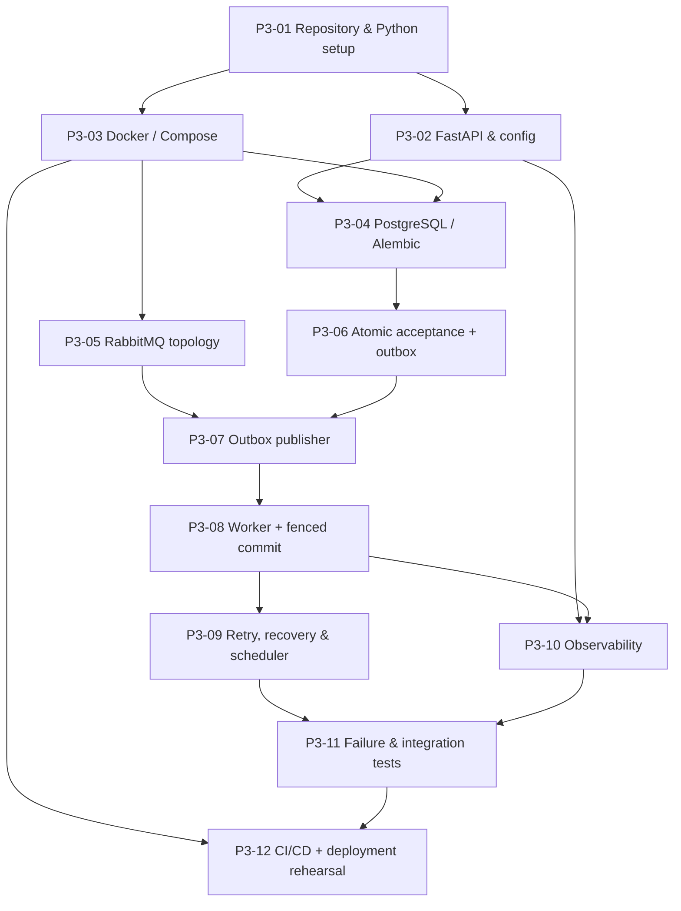

# ALIBI V1 — Phase 3 Implementation Plan

**Phase:** 2 — System Architecture  
**Deliverable:** 7 of 7 — Implementation Plan  
**Document version:** 1.0  
**Status:** Implementation-ready plan; Phase 3 work has **not** started  
**Release:** Alibi V1  
**Repository:** `alibi-backend` (separate from `alibi-mobile`)  
**Source documents:**

1. `alibi_phase2_01_architecture_design.md`
2. `alibi_phase2_02_database_erd.md`
3. `alibi_phase2_03_ai_agent_design.md`
4. `alibi_phase2_04_game_engine_specification.md`
5. `alibi_phase2_05_api_specification.md`
6. `alibi_phase2_06_infrastructure_design.md`
7. `prd.md` — product requirements and 14-phase roadmap

---

## 1. Objective and Exit Criterion

**Phase 3 — Backend Foundation** establishes the deployable, observable, testable infrastructure on which the later Alibi systems will run. The goal is not to implement the detective yet: it is to prove that the selected backend architecture can safely accept and recover durable work.

> **Phase 3 exits when a synthetic test job can be accepted, persisted, published via the transactional outbox, delivered through RabbitMQ, processed by a dedicated worker, and committed exactly once to authoritative PostgreSQL state — including under duplicate messages, retry, worker crash, stale worker completion and service restart.**

This means **at-most-once committed effects**, not exactly-once execution of a worker or an LLM. Tests must prove the difference.

### Phase 3 scope

- FastAPI project bootstrap, application lifecycle, configuration, health endpoints and structured errors.
- PostgreSQL connectivity, SQLAlchemy session handling, Alembic foundation and the minimum schema required to exercise durable work.
- Docker image and Compose environment for API, PostgreSQL, RabbitMQ, worker, outbox publisher and recovery scheduler.
- Durable outbox publication, publisher confirms, consumer acknowledgments, retry/recovery, attempt generations, fencing and idempotency.
- Basic observability, integration tests, failure drills and GitHub Actions CI; deployment artifacts and a staging rehearsal if a VPS is available.
- Stable module interfaces for later authentication, case content, AI orchestration and game rules.

### Explicitly out of scope for Phase 3

- Real Supabase anonymous/login/account-linking flows (**Phase 4**).
- Writing the five cases, publishing variations or building evidence authoring (**Phase 5**).
- Complete session/game lifecycle, actual player interrogation and scoring (**Phase 6**, followed by Phase 10 for referee/scoring).
- LLM model integration, LangGraph graph nodes, structured claim extraction, AI checkpoints, contradiction reasoning or a playable detective (**Phases 7–9**; the agent design is already documented).
- The mobile app, live game WebSocket experience, cinematic presentation and voice interface (**Phase 11**; production WS contracts were designed in Phase 2).
- RevenueCat integration, real credits, entitlements, ranks, achievements and daily challenge implementation (**Phase 12**, with supporting domain work where appropriate).
- Production launch, final capacity tuning, AI quality certification and payment-store approval (**Phases 13–14**).

**Scope guard:** Do not migrate all **29 proposed application tables** just because Document 2 describes them. Create foundational tables when their dependencies and features are ready. Likewise, do not make the Phase 3 synthetic test endpoint publicly accessible in production.

---

## 2. Invariants to Preserve from Day One

| ID | Invariant | Enforced by |
|---|---|---|
| INV-01 | One authoritative PostgreSQL record per accepted command | Request idempotency + DB transaction |
| INV-02 | Turn acceptance and work-to-publish are committed together | Transactional outbox in same DB transaction |
| INV-03 | RabbitMQ delivery may duplicate; DB-visible result must not | Consumer idempotency + unique constraints |
| INV-04 | Only current worker attempt may commit | Attempt generation, lease and fencing token |
| INV-05 | Two active turns must never coexist in one session | Partial unique index + application validation (when domain tables are introduced) |
| INV-06 | A slower previous attempt cannot overwrite a newer commit | Version compare-and-swap / locked conditional update |
| INV-07 | No long DB transaction remains open during processing | Short transactions around claim and final commit only |
| INV-08 | Client disconnect must not cancel accepted work | Durable API acknowledgment; worker independent of client connection |
| INV-09 | RabbitMQ ACK follows a durable commit, never precedes it | Worker commit→ACK ordering |
| INV-10 | Secrets, canonical case truth and arbitrary internal errors never leak to clients | Config isolation, serializers and sanitized errors |
| INV-11 | API, worker, publisher and scheduler are roles of one backend codebase/image | Shared source with different commands |
| INV-12 | Future AI results require Python validation before authoritative writes | Typed boundary and guarded commit service, established now |

At Phase 3, test these with synthetic payloads and placeholders. Full player-facing enforcement is added when real session/auth/game features exist.

---

## 3. Development Order and Dependencies



Work on configuration/tests can proceed in parallel with messaging, but **do not advance to the next persistence milestone until its invariants pass**. The numbered tasks below are an execution order, not 12 new product decisions.

---

## 4. Work Breakdown — Executable Phase 3 Tickets

### P3-01 — Initialize `alibi-backend`

**Dependencies:** None.

**Implement**

- Create a single Python project with a declared, reproducible dependency/lockfile workflow (exact tooling may be chosen during setup).
- Establish `app/`, `tests/`, `migrations/`, `docker/`, `scripts/`, `docs/architecture/` and `.github/workflows/`.
- Configure formatting, linting, static type checking and `pytest`.
- Define dependency groups for API runtime, workers, development and tests. Pin tested versions rather than relying on broad/latest ranges.
- Add README with local commands and environment prerequisites; `.env.example` lists names but contains no real credentials.

**Done when:** Fresh checkout can install dependencies, import the app and run formatter/linter/tests without a personal-machine dependency.

### P3-02 — Application shell, configuration and error handling

**Dependencies:** P3-01.

**Implement**

- FastAPI application factory and lifecycle startup/shutdown handlers.
- Typed settings for database, broker, environment, timeouts, observability and permitted origins; fail fast on missing production secrets.
- `GET /health/live` for process liveness and `GET /health/ready` for critical dependency readiness. Final public monitoring exposure is controlled by the reverse proxy.
- Versioned API router prefix `/api/v1`; route organization only, **not** the full gameplay endpoints yet.
- Centralized exception handling and safe structured error envelope; distinguish controlled 4xx conflicts from 5xx infrastructure errors.
- Auth dependency **interface/stub** for tests and future Supabase integration; never treat a hardcoded demo identity as production authentication.

**Done when:** Health/readiness behavior is testable under dependency success/failure, and errors do not expose secrets or tracebacks in HTTP responses.

### P3-03 — One backend image and local Docker Compose

**Dependencies:** P3-01 (can parallelize with P3-02).

**Implement**

- Multi-stage or otherwise lean Dockerfile with a non-root runtime where practical.
- Compose roles: `api`, `worker`, `outbox-publisher`, `scheduler`, `postgres`, `rabbitmq`; development overrides where useful.
- Persistent PostgreSQL and RabbitMQ volumes, private networks, health checks, and deterministic startup/reconnect logic.
- Configure **the same backend image** for API and non-API processes using separate commands.
- Ensure database/broker administrative ports are local/private, not exposed to the public internet. Pin tested container versions.
- Run separate isolated Compose project names and env files when using local/staging environments.

**Done when:** Containers start cleanly from a fresh checkout, API readiness becomes healthy, restart preserves PostgreSQL data, and unavailable dependencies recover after restart.

### P3-04 — Database foundation, migrations and transaction helper

**Dependencies:** P3-02 + P3-03.

**Implement**

- SQLAlchemy 2.x-style models/repositories (exact tested version to pin), async or sync strategy chosen **consistently**; configure bounded connection pools and timeouts per process role.
- Alembic initialization, reproducible revision files, constraint conventions and explicit migration execution command.
- A small set of production schema migrations necessary for the queue pathway. **Honor the foreign-key dependency chain**: if `outbox_events` and `turn_attempts` refer to `interrogation_turns`, create their required `users`, `detectives`, `cases`, `case_variations`, `game_sessions` and `interrogation_turns` structural parents as needed, without implementing full gameplay.
- Include critical constraints from Document 2 as the respective tables appear: `(session_id, sequence_no)`, `(session_id, client_request_id)`, one-active-turn partial uniqueness, `(turn_id, generation)`, outbox idempotency uniqueness and conditional session version updates.
- Add short-lived transaction boundary helpers; ensure failed SQL statements roll back cleanly and connections return to the pool.
- Use migration/seed fixtures for synthetic tests in a **test database**. Do not add permanent fake gameplay tables or demo content as production requirements.

**Done when:** Migration to head works on an empty database; a repeat migration is safe; constraints reject duplicates; tests exercise rollback and pool cleanup. Migration DDL is manually reviewed.

### P3-05 — RabbitMQ connection and topology

**Dependencies:** P3-03.

**Implement**

- Async-capable or background-safe RabbitMQ client adapter with reconnect, heartbeat and bounded timeouts.
- Declare durable exchange, durable work queue, routing key and a retry/dead-letter strategy; choose tested broker queue type and names during implementation (not an additional architectural decision).
- Publish **persistent** messages with publisher confirmations; consume with **manual ACK/NACK** and bounded prefetch.
- Message envelope: stable `event_id`, `turn_id`, `session_id`, `schema_version`, `trace_id`; **IDs and routing data only**, not hidden case truth.
- Distinguish transient errors, permanent invalid jobs, redeliveries and dead-letter handling.

**Done when:** A test publisher can deliver to a consumer; a message is redelivered when the consumer dies before ACK; duplicate messages are possible by design and harmless downstream.

### P3-06 — Atomic command acceptance and transactional outbox

**Dependencies:** P3-04.

**Implement**

- Implement a **non-public synthetic command handler** (test harness or development-only route) that exercises the same DB acceptance boundary intended for real interrogation turns.
- Create a `PENDING` turn and its `outbox_events` row in **one** transaction. Store scoped idempotency key and request hash; repeated same key/same payload returns the original ID; same key/different payload is rejected.
- Verify that rollback leaves neither a turn nor an outbox event.
- Enforce one active turn per seeded session; reject a second different submission during `PENDING`, `PROCESSING` or `RETRYING`.
- Keep the accepted turn durable even when RabbitMQ is unavailable. The **command succeeds only after the database transaction commits**.

**Done when:** Concurrent identical submissions yield one accepted turn/outbox event; independent competing turns cannot both become active; broker outage leaves unpublished committed outbox work for later delivery.

### P3-07 — Outbox publisher

**Dependencies:** P3-05 + P3-06.

**Implement**

- Poll unconfirmed `outbox_events` in small batches; use database claim coordination (`FOR UPDATE SKIP LOCKED` or a safe equivalent) and publisher confirms.
- Mark an event `published_at` only **after** a broker confirmation. Do not mark published on timeout or uncertain delivery.
- Support bounded retry/backoff, error details, stuck-outbox alerts and a reclaim/retry method after publisher crashes.
- Do **not** hold database row locks while blocked on an unbounded broker publish. If using a claim/lease for publisher rows, make duplicate publication safe.
- Propagate correlation identifiers into the RabbitMQ message.

**Done when:** Unpublished events eventually reach RabbitMQ after outage; publisher crash after broker confirm but before DB mark can cause another publish without corrupting work.

### P3-08 — Worker processing, attempts and fenced commit

**Dependencies:** P3-07.

**Implement**

- Consume work through RabbitMQ; use `turn_attempts` and `interrogation_turns.active_attempt_generation` for unique processing attempt generations.
- Claim an eligible turn transactionally; record `lease_expires_at`, session version and worker identity. Duplicate delivery for a `COMPLETED` turn immediately ACKs without reapplying work.
- Run a **deterministic synthetic handler**, e.g. hash input/produce a fixed test output with injected delay/failure. This validates infrastructure without introducing real LLM gameplay.
- Finalize in one database transaction: lock/recheck turn/session, current attempt generation/lease, expected session version and status; persist one result, advance version and mark turn `COMPLETED`.
- Only **after successful commit**, ACK the RabbitMQ message. Discard stale results; never merge them into current memory/state.
- Provide an interface that later LangGraph execution will implement; an LLM call must run **outside** the long-lived DB transaction.
- Support graceful shutdown of consumers: stop taking new messages, drain within bounded period or relinquish work safely.

**Done when:** Duplicate broker delivery, second worker racing to claim, or late old attempt cannot yield two committed results or overwrite a newer one.

### P3-09 — Recovery scheduler, retries and failure handling

**Dependencies:** P3-08.

**Implement**

- Detect expired processing leases, abandoned deliveries and unpublished outbox records; repair/requeue with a **new generation** when permitted.
- Ensure only one scheduler is active for each recovery sweep (single process initially; coordination lock if expanded).
- Distinguish transient errors (retry with bounded backoff/jitter) from permanent errors (mark `FAILED` for safe operator/client retry later).
- Add operator-visible dead-letter handling and reprocessing controls for diagnostic recovery, not blind infinite retries.
- Exercise failed-turn retry **against the same turn ID and original payload**, never as a later sequence number; add no new credit charges.
- Make retry/backoff/lease duration configurable and test with short synthetic delays; finalize production values after measured workloads.

**Done when:** A killed worker's uncommitted work can be retried and completed once; failed turns are not silently skipped; a timed-out old worker returning after recovery cannot commit.

### P3-10 — Observability and failure visibility

**Dependencies:** P3-02; instrument P3-06–09 as they are implemented.

**Implement**

- JSON logs with `request_id`, `event_id`, `session_id`, `turn_id`, `attempt_id`, `trace_id`, worker role and error classification.
- OpenTelemetry spans for accept → outbox → publish → queue → worker claim → processing → commit → ACK. Pass trace context through messages.
- Sentry integration with privacy-safe sanitization, environment tags and bounded sample configuration.
- Counters/timers for API acceptance/errors, unpublished outbox age, queue depth, redeliveries, job wait, retries, lease expiry, commit conflict and worker processing time.
- Instrumentation **interfaces** for later LangGraph node latencies and per-call token/cost records. Do not fabricate inference-cost telemetry before an actual model is integrated.

**Done when:** A single synthetic job can be followed end-to-end by correlation IDs, and a crash/retry appears clearly in logs/spans/metrics without exposing player text or secrets unnecessarily.

### P3-11 — Automated tests and failure-injection drills

**Dependencies:** P3-06–10.

**Implement**

- Unit tests for idempotency key reuse, retry classification, state transitions, generation fencing and error envelopes.
- PostgreSQL/RabbitMQ integration tests against real containers (not mocked transaction/ACK behavior).
- Concurrent-submit tests against the DB uniqueness constraints.
- Fault injection: kill worker mid-job; duplicate publish; publisher dies after broker confirm; broker outage; API restart after `202`; stale completion; full Compose restart; PostgreSQL unavailable/exhausted pool.
- Verify migrations on a fresh database and rerun/upgrade behavior; benchmark basic queue wait and worker throughput on a local machine without pretending to establish production capacity.
- Capture the command, test fixture, expected result and actual pass/fail evidence for every critical drill.

**Done when:** All release-blocking tests in Section 6 pass deterministically in CI or an explicitly reproducible local integration environment. Flaky failure drills must be fixed or clearly reported; do not mark them green by assertion alone.

### P3-12 — CI/CD, runbooks and deployment rehearsal

**Dependencies:** P3-03 + P3-11.

**Implement**

- GitHub Actions on PRs: formatting, linting, type checks, unit tests, integration test job with PostgreSQL/RabbitMQ, migration check, Docker image build.
- On controlled `main` release: build and push backend image to GHCR with immutable Git SHA/tag/digest. Deploy API, worker, publisher and scheduler with **different startup commands from the same image**.
- Document Compose start/stop, migration command, health checks, queue inspection, redelivery troubleshooting and rollback procedure.
- Prepare environment-specific protected configuration. GitHub stores only CI/deployment secrets; VPS runtime secrets remain outside Git/released images.
- Prepare automated off-host PostgreSQL backup/restore **procedure and scripts**. Run a restore drill in a disposable environment when a backup destination is available. Do not claim backups are proven without evidence.
- Rehearse on staging/VPS when available: pull pinned image, run a **single controlled** Alembic migration job, start services, run authenticated/protected smoke tests, verify restart and rollback compatibility.

**Done when:** PR gates reliably fail on regression; a versioned image builds and runs consistently; staging deployment and backup restoration are recorded as **passed** or **pending external infrastructure**, not silently conflated.

---

## 5. Concrete Repository Skeleton

```text
alibi-backend/
├── app/
│   ├── main.py                  # FastAPI app factory/lifespan
│   ├── core/
│   │   ├── config.py            # Typed environment settings
│   │   ├── errors.py            # Safe API error model
│   │   └── logging.py           # JSON log configuration
│   ├── api/
│   │   └── v1/
│   │       └── health.py        # Health/readiness; more APIs in later phases
│   ├── auth/                    # Interfaces only in Phase 3
│   ├── db/
│   │   ├── base.py
│   │   ├── session.py
│   │   ├── models/              # Only foundational models migrated now
│   │   └── repositories/
│   ├── messaging/
│   │   ├── contracts.py         # Versioned queue envelope
│   │   ├── broker.py            # RabbitMQ connection and topology
│   │   ├── outbox.py            # Atomic acceptance + outbox repository
│   │   ├── publisher.py
│   │   ├── worker.py
│   │   ├── claims.py            # Attempt/lease coordination
│   │   └── recovery.py
│   ├── sessions/                # Turn acceptance/state interface; full logic later
│   ├── ai/                      # Stub execution interface; real LangGraph later
│   ├── game/                    # Referee interface; actual scoring later
│   └── observability/
│       ├── tracing.py
│       └── metrics.py
├── migrations/
├── tests/
│   ├── unit/
│   ├── integration/
│   ├── failure_drills/
│   └── fixtures/
├── docker/
│   ├── Dockerfile
│   ├── compose.local.yml
│   └── compose.prod.yml
├── scripts/
│   ├── dev/
│   ├── deploy/
│   └── backup/
├── docs/
│   ├── architecture/
│   └── runbooks/
├── .github/workflows/
├── .env.example
└── README.md
```

The exact Python package names are a **proposed layout**, not an additional requirement. Preserve the logical module boundaries from Document 1 even if file names change. Do not add internal HTTP calls between modules of this monolith.

---

## 6. Phase 3 Acceptance Test Matrix

These are the concrete checks the implementation must pass before we say the backend foundation works.

| ID | Test / failure condition | Required observable result |
|---|---|---|
| T01 | Fresh database, run migrations | Schema created, documented constraints present, no manual DB edits |
| T02 | Same request ID + identical payload submitted twice | Same accepted turn/job ID; one authoritative acceptance and one outbox intent |
| T03 | Same request ID + different payload | Conflict; no second turn or outbox event |
| T04 | Two different submissions race in one session | No more than one active turn; losing submission gets a recoverable conflict |
| T05 | RabbitMQ unavailable during acceptance | Committed pending work remains in PostgreSQL; publisher delivers after recovery |
| T06 | Publisher crashes after broker confirm, before DB update | Possible duplicate message; one final DB-visible result |
| T07 | Worker crashes before result commit | Work redelivered/recovered; no partial commit; eventually completes or fails safely |
| T08 | Worker commits then crashes before ACK | Redelivery finds completed work; no second result applied |
| T09 | Old attempt returns after lease was superseded | Stale attempt denied commit; newer authorized attempt owns final result |
| T10 | Worker executes slow synthetic handler | Lease renewal or safe deadline behavior; no false completion or indefinite retries |
| T11 | Turn retries after permanent/explicit failure | Same turn ID/input/sequence; bounded attempt count; later turn cannot bypass it |
| T12 | API/Compose restarted after successful `202` acceptance | Status and work recover from PostgreSQL; no duplicate acceptance |
| T13 | Database constraint or commit raises error | Transaction rolls back entirely; API/worker reports controlled failure |
| T14 | PostgreSQL pool exhausted / broker connection lost | Bounded timeouts and meaningful monitoring; no silent data corruption |
| T15 | Broker queue builds up | Metrics reflect queue wait/backlog; worker prefetch/concurrency limits hold |
| T16 | Synthetic worker result inspected in logs/traces | End-to-end correlation; no auth tokens, hidden facts, or unsanitized secrets |
| T17 | Worker process receives stop signal | Stops new deliveries, drains or recovers in-flight job without double-commit |
| T18 | Schema applied by one migration runner during a rehearsal | No startup migration races; API/worker images work with the deployed schema |
| T19 | Recover database from off-host backup (when available) | Documented restoration works; any remaining data-loss window recorded explicitly |
| T20 | Test-only synthetic route in production configuration | Route is absent/disabled or explicitly protected; it cannot mint free player resources |

**Never use a mocked RabbitMQ client or in-memory SQLite database as the sole evidence for T04–T12.** Their guarantees depend on actual PostgreSQL concurrency and broker delivery behavior.

### Suggested validation commands (illustrative)

```bash
# Names are proposals; wire these commands into the repository once created.
docker compose -f docker/compose.local.yml up -d --build
pytest tests/unit -q
pytest tests/integration -q
pytest tests/failure_drills -q
alembic upgrade head
```

Run failure drills against **disposable** local/test data. Do not kill production workers or induce database loss in a live environment to satisfy tests.

---

## 7. Definition of Done and Evidence Required

### Code and review

- [ ] `alibi-backend` has a reproducible local setup, type/lint/test checks and a documented module structure.
- [ ] All service roles use the same versioned backend code/image with independent commands.
- [ ] Database migrations are committed and manually reviewed; foundational constraints are implemented.
- [ ] Synthetic acceptance uses the transactional outbox and idempotency in the **same database transaction**.
- [ ] RabbitMQ publisher confirms and consumer ACK-after-commit behavior are demonstrated.
- [ ] Attempt generation, leases, stale-result fencing and recovery are implemented and tested.
- [ ] API/worker observability includes end-to-end correlation and sanitized errors.
- [ ] GitHub Actions can build/test the backend image without local secrets.

### Test evidence

- [ ] T01–T18 and T20 pass in a reproducible environment with real PostgreSQL and RabbitMQ.
- [ ] T19 (restore drill) passes **if backup infrastructure exists**; otherwise record as an explicit Phase 14 infrastructure readiness blocker, not a completed test.
- [ ] Known limitations, unresolved thresholds, and any deferred failures are recorded with owners and next steps.

### Deliverable for the next phase

At the end of Phase 3, the next developer should be able to run local services, apply migrations, submit synthetic work, observe its processing, retry safely after failures and extend the existing modules for **Phase 4 authentication** without restructuring the queue or application lifecycle.

---

## 8. Environment, Deployment and Safety Notes

- **Local:** Docker Compose with disposable development credentials and realistic PostgreSQL/RabbitMQ behavior; do not reuse production secrets.
- **Staging:** Isolated data and broker resources; prefer separate Compose project/network/volumes even if sharing a VPS. Sharing one VPS does **not** isolate hardware failures or resource exhaustion.
- **Production:** Single-VPS deployment selected in Decision 35; actual host/vendor/size, region, disk, backup destination and worker count remain intentionally unselected until infrastructure is available and measured.
- **Operations:** Use pinned image versions, no public PostgreSQL/RabbitMQ ports, restricted SSH, TLS reverse proxy, explicit schema-migration job, off-host backup strategy and restore testing before live launch.
- **Schema changes:** Backward-compatible additive migrations before mixed-version rollout where feasible; irreversible data changes require a specific rollout/rollback plan.
- **Runtime backpressure:** Configure bounded worker prefetch, connection pools, retry counts and publisher batches. Do not copy throughput/concurrency numbers from unrelated projects.
- **WebSocket updates:** Full event relay and mobile reconnection are Phase 11 API integration tasks. Phase 3 may define committed-event hooks but must not claim that real-time delivery is implemented without a relay and tests.

---

## 9. Dependencies for Later Phases

| Later phase | Reuses the Phase 3 foundation | Adds later |
|---|---|---|
| **4 — Authentication & Users** | FastAPI auth dependency, PostgreSQL models, settings | Supabase JWT verification, guest linking, user ownership |
| **5 — Case Management** | SQLAlchemy/Alembic, private serializers | Authored/published immutable cases, canonical facts and evidence |
| **6 — Core Game Engine** | Turn lifecycle, durable work, session boundary | Actual game session rules, case binding, actions and lifecycle behavior |
| **7 — AI Memory System** | Worker interface, PostgreSQL persistence | Claim extraction, memory tables, contextual history |
| **8 — AI Investigation Engine** | Worker pipeline, validation interface | Evidence/contradiction analysis, uncertainty handling |
| **9 — Intelligent Detective Agent** | RabbitMQ worker, tracing, execution harness | LangGraph graph/nodes, model adapters, prompts, controlled tools |
| **10 — Referee & Scoring** | Atomic commit patterns and testing | Suspicion, verdicts, fairness rules and scoring calibration |
| **11 — Mobile Application** | API contracts, backend deployment boundary | Expo UI, real WebSocket event delivery, reconnect/polling |
| **12 — Engagement & Monetization** | Transactions, idempotency, scheduling framework | RevenueCat, entitlements, credits, XP, ranks, daily challenges |
| **13 — Testing & Optimization** | Fault-injection suite, tracing | Full gameplay evaluation, model benchmarks, performance/cost tuning |
| **14 — Deployment & Launch** | Compose/CI artifacts, runbooks | Final VPS launch, end-to-end production readiness, restore/rollback drills |

**Important:** These are the agreed roadmap phases and the expected ownership of implementation work; they are not claims that later functionality is already built.

---

## 10. Open Implementation Values — Do Not Invent Them

The following need selection or measurement during implementation, but **do not warrant reopening the already-finalized architecture**:

- Supported Python/FastAPI/SQLAlchemy/PostgreSQL/RabbitMQ versions and dependency pins.
- Broker queue type, exchange/routing names, dead-letter topology and publisher batching.
- Worker count, prefetch, concurrency, claim lease, heartbeat cadence, retry budget and backoff.
- SQLAlchemy pool sizes/timeouts and graceful shutdown deadline.
- Monitoring backend selection for collected traces/metrics and exact alert thresholds.
- VPS vendor/location/spec, staging deployment budget, and off-host backup retention/RPO/RTO.
- Provider/model-dependent LangGraph limits, checkpoint versioning and actual inference economics (later AI phases).

When choosing these, record the configuration and its test evidence. Avoid selecting arbitrary production numbers in a planning document.

---

## 11. Phase 3 Execution Checklist (Short Form)

- [ ] P3-01 Repository and tooling
- [ ] P3-02 FastAPI shell and configuration
- [ ] P3-03 Docker image and local Compose
- [ ] P3-04 SQLAlchemy, migrations and DB transactions
- [ ] P3-05 RabbitMQ client and topology
- [ ] P3-06 Atomic acceptance + outbox
- [ ] P3-07 Publisher confirms and replay-safe outbox
- [ ] P3-08 Worker claim, fenced final commit and ACK
- [ ] P3-09 Recovery scheduler and bounded retry behavior
- [ ] P3-10 JSON logs, OpenTelemetry and Sentry
- [ ] P3-11 Integration/failure tests (T01–T20 as applicable)
- [ ] P3-12 GitHub Actions, runbooks and deployment rehearsal

**Recommended first engineering action:** Create the `alibi-backend` repository with the project scaffold, tests and local Compose. Do not start by building LangGraph agents or production game APIs before the durable-worker pathway is proven.

---

## 12. Phase 2 Completion and Handoff

This document is the **seventh planned Phase 2 architecture artifact**. Alongside Documents 1–6, it specifies how the approved system design becomes incremental engineering work.

**Phase 2 artifacts are design documents, not implementation evidence.** Completing the seven documents does not mean the code, infrastructure, model evaluations or operational drills already exist.

**Handoff decision:** Begin **Phase 3 — Backend Foundation** with P3-01 through P3-04, then implement the outbox/RabbitMQ/worker chain and prove its failure behavior before layering gameplay and AI logic onto it.

**End of Document 7 — Implementation Plan (v1.0)**
